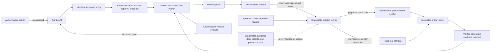

# DWD Project Handoff

Last updated: 2026-10-28

## Latest resume point — DW-944529 AI workforce test (2026-10-28 03:24 PKT)

- Workspace source is `D:\website-projects-backup\durrani-web-developers`; the local workforce/project data root is `D:\website-projects-backup\Durrani_AI-Agents`. The current inquiry artifacts are under `projects\DW-944529-ahlam-collections-preview\`.
- Latest actual agent run: `agent-build-2026-10-27T22-21-11-980Z-16740`, recorded as `failed`. Fashion UX Designer and Ecommerce Architect completed using `llama3:latest`; Storefront Coder failed using `qwen2.5-coder:7b` after three attempts because required product catalog and explicit international 2x price disclosure checks were missing. Admin Dashboard Coder and QA Reviewer remained waiting; no completed agent-built storefront/admin or passing end-to-end QA exists. See `agent-generated-store\latest-agent-run.json` and that run's `agent-run.json`/`agent-outputs\` for evidence.
- Agency application publish: commit `da7e3c96b465811adc7c042d801840d8614d53c9` (`Add local AI workforce inquiry build workflow`) was pushed to GitHub `main`; Vercel's connected Git deployment reached `Ready` in Production. Verified live `/admin/workforce` and `/pricing` returned HTTP 200; the pricing page contains the new industry add-on category content. The workforce API returned 401 without an admin session, as expected. This deploys the agency application, not the Ahlam customer store.
- Vercel CLI direct deployment remains unavailable because its saved token is invalid; the production deployment was completed by the connected GitHub integration after push. The local workforce engine still cannot run on Vercel or access local Ollama; only the agency app/dashboard is production-hosted.
- `ollama list` currently confirms `llama3:latest` and `qwen2.5-coder:7b` installed. `qwen2.5-coder:14b` is not installed; an earlier pull attempt cannot be claimed complete. D: had about 17.5 GB free when checked. Do not start a duplicate large download until checking storage and confirming the intended model.
- The hand-authored `website-templates\ahlam-collections-preview\` remains a separate visual reference, not an AI deliverable. The inquiry-specific runner is manually invoked; it is not an approval-triggered inquiry watcher or a general autonomous development agency.
- Updated durable status and operator instructions are in `website-templates\ahlam-collections-preview\project-status.json`, `WORKFORCE.md`, and this handoff. A full local source snapshot (application, assets, templates, scripts, tests, configs, package manifests, and docs) is saved under `D:\website-projects-backup\Durrani_AI-Agents\projects\DW-944529-ahlam-collections-preview\project-source\`. It intentionally excludes `.git`, dependencies/build caches, local environment files, and the `data` directory containing local inquiry/workforce data.
- Resume by reviewing the failed attempt/output, confirming a stronger installed local coder model, then rerunning only `npm.cmd run workforce:inquiry` with `OLLAMA_MODEL=llama3:latest` and the confirmed `OLLAMA_CODER_MODEL`. Keep the run failed until all five roles and deterministic storefront/admin/QA gates pass. Run focused test `npx.cmd tsx --test tests/workforce-inquiry-agent.test.ts` and typecheck `npx.cmd tsc --noEmit` after any code changes.
- Not done: no admin approval watcher, payment verification, live payment/courier/FX integration, locally generated images, or production backend for the Ahlam customer store. The sample store has not been deployed; advance payment is unverified and customer-project production release is not approved.

## AI website factory readiness checkpoint (2026-10-28)

- Requested outcome: take a real customer inquiry from `durraniwebdevelopers.vercel.app`, assign it to a locally running AI development workforce, build a real website project, use this PC for local image generation, show live task and handoff status, and keep source, local data, GitHub, Vercel, and this handoff synchronized.
- Current system is not that factory yet. The local workforce is an Ollama-backed role-brief/static-template batch pipeline. It does not accept a customer inquiry as a development job, write a general-purpose application into an isolated project workspace, run that project's package/build tests, provide a client-ready full-stack backend, generate images, or deploy a client project.
- Verified local machine: Ollama responds on `127.0.0.1:11434`; installed model is `llama3:latest` (about 4.66 GB); Windows reports 31.1 GB RAM and an NVIDIA GeForce RTX 5070 Ti. No image-generation API responded at the usual local ComfyUI (`8188`) or Automatic1111 (`7860`) endpoints. The GPU is a useful prerequisite, not proof image generation is installed.
- Current external workforce state is under `D:\website-projects-backup\Durrani_AI-Agents`: `batch-2026-10-28` has four completed template-pipeline tasks; `batch-2026-10-30` is queued with zero completed tasks. Do not mark the queued batch complete or launch it as a substitute for a customer inquiry.
- Required architecture: customer inquiry is persisted as a real job; a locally running worker claims it through an authenticated outbound connection; each job gets an isolated workspace with bounded tools; code generation is followed by actual project build/tests and a local preview; image generation uses a locally installed model/service; the admin UI streams truthful task, log, artifact, QA, and handoff state. Keep Ollama private on loopback. Require human approval before any production deployment; only then deploy the reviewed artifact through a configured Vercel workflow.
- Timing: a single inquiry-to-local-preview pilot can be the first same-day milestone after the customer brief and project constraints are supplied. A dependable end-to-end factory, local image pipeline, secure cloud/local queue, recovery controls, and gated production deployments are separate phases; do not promise these as already delivered or as a same-day completion. Confirm hardware/model setup, job scope, and access before setting a committed production date.
- Admin supplied the full inquiry scope and explicitly authorized a sample-project pilot for DW-944529. A responsive Ahlam Collections storefront and admin dashboard visual prototype now exist at `website-templates/ahlam-collections-preview/`; a copy is stored in `D:\website-projects-backup\Durrani_AI-Agents\projects\DW-944529-ahlam-collections-preview\`. A local Python preview server is serving `http://localhost:3001` (storefront) and `http://localhost:3001/admin.html` (admin visual preview).
- Pilot prototype scope: Pakistani traditional-wear catalog; stitched/unstitched choices; selectable country/currency and disclosed 2x international clothing multiplier; browser-local design-reference image preview; illustrative TCS/Leopards and DHL/UPS shipping choices; sample cart/checkout; sample admin order, design-request, delivery, and analytics views. Product content, product prices, exchange rates, shipping charges, orders, and analytics are illustrative, not approved client facts. Remote Unsplash fashion imagery is used because no local image-generation service was installed. No independent workforce agents or Ollama model generated this project; the current implementation was completed by a single orchestrated coding assistant.
- When admin reported `/admin/workforce` was not loading, verification showed no process listening on port 3000. Restarted Next dev server on `127.0.0.1:3000`; workforce page returned HTTP 200, compiled dashboard JS returned HTTP 200, and the admin-only API returned 401 to an unauthenticated PowerShell request as expected. Added a “Client preview · DW-944529” panel linking the workforce dashboard to the local storefront and visual admin preview; these links require the separate preview server on port 3001 to stay running.
- Admin clarified that the goal is to test the AI workforce by having it build the store; assistant-authored storefront code is not an acceptable workforce result. Acknowledge this was a process mistake: the existing `website-templates/ahlam-collections-preview/` was manually authored by the coding assistant and must not be presented as an agent-built deliverable. README and `project-status.json` now label it accordingly. The local Requirements Analyst did complete a real Ollama role task, persisted at `D:\website-projects-backup\Durrani_AI-Agents\projects\DW-944529-ahlam-collections-preview\agent-runs\requirements-analyst-001.json`; current truthful state is `requirements_analysis_completed_build_not_started`. No designer, coder, or QA agent has yet produced this website.
- Next: implement/launch an inquiry-scoped local agent job (Design/Architecture → Code → QA) that consumes the saved analyst output and writes its own artifact into a distinct agent-generated directory; record each actual Ollama invocation, status, output artifact and real QA result. Do not copy or relabel the manual prototype as the agent result. Keep payment/courier integrations blocked until account credentials, client choices, storage and approval are configured.
- Validation completed: the production Next.js build, TypeScript check, targeted ESLint, `npm.cmd test`, and focused inquiry-agent tests passed before publishing. The production dashboard route and pricing route return HTTP 200; workforce API returns 401 without an admin session. Browser visual interaction review of the agent-run UI remains pending. The sample-project permission authorizes local prototype testing only; advance payment is unverified and customer-project production release is not approved.
- Remaining work: build the real inquiry approval watcher/job queue; expose truthful running task/log/artifact states; add secure isolated project generation and automated project build/tests; install and verify local GPU image generation; configure private media/order storage, real currency and payment/courier integrations; then obtain explicit production approval. The worktree contains pre-existing uncommitted changes; selectively publish intended project files and handoff rather than committing/deploying the full worktree.

## Current delivery checkpoint (2026-10-28)

- Workspace: `D:\website-projects-backup\durrani-web-developers`; GitHub repository: `nexuseventmanagementorg-cell/durraniwebdevelopers`; branch: `main`.
- Latest pushed source commit: `54f93c15f99ff3e4beffbeeff147c9b98fb683ed` (`Add selectable add-ons to website estimator`). The worktree was clean after publishing except for generated, tracked `tsconfig.tsbuildinfo`; do not commit that cache without an explicit need.
- The URL Budget Estimator now renders a searchable add-on catalog below each scan result. Scan-detected chargeable add-ons start selected, package-included add-ons are not charged twice, and selected one-time/monthly amounts update live using existing catalog pricing. Regression coverage verifies package price-range and included add-on behavior. Tests, TypeScript, lint, production build, and desktop browser selection check passed before deployment.
- Vercel production deployment `dpl_6371qVQYWeMNbSS3TBCwigu5ggab` reached `READY`; production alias is `https://durraniwebdevelopers.vercel.app`. The deployed estimator JavaScript chunk includes `Choose add-ons and update the budget` and `estimator-addon-search`. The public estimator route returned HTTP 200, but an HTML response was CDN-cached and did not contain those strings; verify in a fresh browser session and investigate cache only if the page still fails to hydrate/show the selector.
- AliExpress scan diagnosis reproduced against the production estimator API (2026-10-28): response was successful but scanned only `https://aliexpress.com/`, had zero catalog add-ons, `basePrice=0`, `estimatedTotal=0`, and no warnings. Direct HTTP inspection with the scanner's `curl` user-agent returned only ~1.8 KB of HTML containing an AliExpress `_____tmd_____/punish?x5secdata=...` anti-bot challenge script; it had no `<title>` and no links. `/sitemap.xml` redirected to `https://www.aliexpress.com/s/error/404` with an HTML 404 page, not a sitemap. The estimator therefore fell back to the hostname as title and its generic “Public informational website” placeholder, then showed “Insufficient priced signals”. This is a challenge/interstitial response, not an actual scan of AliExpress pages. Alibaba (4 pages), Shopify (24), and Amazon (24) worked in the user's screenshots.
- AliExpress next task: detect this known challenge/interstitial before treating it as website content, and show a clear “site blocked automated scanning / no estimate” result with retry/manual quote guidance. Do not bypass CAPTCHA/anti-bot protections, fabricate features or prices, or label the site informational. Add a regression test using a fixture containing the `_____tmd_____/punish` marker; preserve existing prices and other site's scans.
- Scope reminder: this is a public-page, comparable-build estimator, not a website valuation or a verified inventory of backend/private functionality. Keep existing package/add-on prices unchanged; distinguish public evidence from assumptions.
- Suggested new-session prompt: “Read `PROJECT_HANDOFF.md` first. Continue from the 2026-10-28 checkpoint. Latest app commit `54f93c15f99ff3e4beffbeeff147c9b98fb683ed` is deployed to `https://durraniwebdevelopers.vercel.app`; latest handoff commit is `da37365`. AliExpress's production scan was verified to receive an AliExpress `_____tmd_____/punish?x5secdata=...` anti-bot interstitial (~1.8 KB, no title or links); its sitemap redirects to an HTML 404, so the estimator incorrectly displays a generic informational placeholder and no budget. Implement a small safe fix to identify the challenge and report the scan as blocked/no estimate, without bypassing anti-bot controls or inventing features/prices. Add a fixture regression test; preserve existing catalog prices and other-site behavior.”

## Current delivery checkpoint (2026-10-24)

- Current request: make public marketing-page motion more noticeable, then publish the validated changes to GitHub and deploy through Vercel. Admin, calculator, inquiry, and customer flows remain untouched. Completed and verified below.
- Delivery preference: for future completed project updates, proactively include the GitHub push and Vercel deployment when the repository is configured for deployment; report clearly if anything prevents publication.
- User requested publishing the current project to `origin/main` (`nexuseventmanagementorg-cell/durraniwebdevelopers`) and deploying the linked Vercel project, plus a reusable continuation prompt.
- Preflight: local branch is `main`; `git fetch origin main` reports local `HEAD` and `origin/main` in sync before the pending worktree changes. Vercel project linkage and CLI authentication are available.
- Existing uncommitted application, test, and handoff changes are part of the requested project update. `.env` and `.env.local` are ignored; a scan of the pending source diff found no common private-key/API-token patterns. Do not stage environment files or credentials.
- `tsconfig.tsbuildinfo` is tracked and dirty as generated TypeScript build metadata; exclude it from the delivery commit.
- Final pre-delivery validation passed: `npm test` (131/131), `npm run build` (all 52 static pages generated), and `git diff --check`. The generated `tsconfig.tsbuildinfo` remains excluded from the delivery commit.
- Local commit `e939b91` (`feat: sync portfolio pricing and estimates`) now contains the 19 intended application, regression-test, and handoff files. `.env`, `.env.local`, `.vercel` metadata, and generated `tsconfig.tsbuildinfo` were excluded. The committed diff has 1,846 insertions and 161 deletions.
- Application commit `e939b91` and follow-up handoff commits are pushed to `origin/main` in GitHub; the latest verified remote head is `5739c6abd90404450df0506194419ff2647420c5`.
- The explicit CLI deploy attempt returned `fetch failed`, but GitHub pushes triggered Vercel production deployments. The application deployment for commit `e939b91` is `READY` (`durraniwebdevelopers-76bv1uuwe-nexuseventmanagementorg-2858.vercel.app`); the latest pushed commit `5739c6a` also reached production `READY` (`durraniwebdevelopers-cfzj2l6br-nexuseventmanagementorg-2858.vercel.app`).
- Production verification passed: `https://durraniwebdevelopers.vercel.app`, `/api/public/portfolio`, and `/api/public/addons` returned HTTP 200. The live portfolio API reports Restaurant Name at PKR 225,000 (`Estimated Build Price`); the live add-on API returns 102 add-ons and its pricing configuration.
- Production deployment of the project and latest pushed commit is verified. The application source remains commit `e939b91`; later commits are documentation-only. After pushing `5739c6a`, the production domain and both portfolio/add-on APIs returned HTTP 200; the restaurant portfolio estimate is PKR 225,000.

### Public marketing motion polish (2026-10-24)

- Added a reusable IntersectionObserver scroll-reveal wrapper with stagger timing for selected hero media, package cards, industry cards, homepage portfolio/process cards, public portfolio cards, and template cards.
- Added restrained DWD red ambient hero motion and hover lift/shadow on selected public cards. Motion is CSS-based; no external UI component code was copied and no animation dependency was added.
- Preserved the site's existing native smooth scrolling and made it honor `prefers-reduced-motion`; reveal transitions and hover/ambient motion also respect reduced motion. Admin and calculator pages are not decorated.
- Validation passed: targeted ESLint, `npx tsc --noEmit --incremental false`, `npm test` (131 tests), `npm run build` (52 static pages), and `git diff --check`.
- Browser verification passed on `http://localhost:3001` for `/`, `/portfolio`, and `/templates`. The homepage's 20 reveal elements all became visible after scrolling, with no pending elements remaining.
- Follow-up after user feedback that motion was not noticeable: visible-on-load reveal elements now enter on the next animation frame rather than appearing instantly; offscreen reveals travel 36px with a brief blur/scale transition. The hero gradient and ambient orb motion are more apparent, and card hover lift/image zoom is stronger. Reduced-motion handling remains in place.
- Follow-up validation passed: targeted ESLint, TypeScript, all 131 tests, production build (52 static pages), and `git diff --check`. Rechecked the updated homepage at `http://localhost:3001`; 20 reveal wrappers are present and the hero headline uses the animated gradient.
- Published as `3460087` (`feat: polish public page motion`) to `origin/main`. Vercel production deployment `durraniwebdevelopers-pqhdvjfet-nexuseventmanagementorg-2858.vercel.app` reached `Ready` and is aliased to `https://durraniwebdevelopers.vercel.app`.
- Production verification passed after deployment: homepage returned HTTP 200 and its served CSS contains the new gradient and scroll-reveal motion rules; `/api/public/portfolio` and `/api/public/addons` both returned HTTP 200.

## Project goal and architecture

Durrani Web Developers is developing an AI-assisted software agency platform. The current application is Next.js 14 with TypeScript and Supabase-backed project workspaces. The existing delivery workflow is admin-assisted; the Gemini Requirements Analyst is a separate admin-triggered capability. The 50 workforce entries are role profiles, not 50 executable agents.

Relevant architecture:

- `src/lib/project-workflow.ts` defines the admin-managed delivery task graph and customer milestone projection.
- `src/lib/project-storage.ts` persists project snapshots in `project_workspaces` (with the existing local-development fallback).
- `src/lib/nexus-agent-storage.ts` persists the separate Requirements Analyst runs in `agent_runs`.
- `src/lib/project-task-executions.ts` contains the new project-linked execution record types, storage functions, transition rules, and evidence-shape checks.
- `src/app/api/admin/projects/task-executions/route.ts` provides authenticated admin create/list operations.
- `src/app/api/admin/projects/route.ts` owns admin workflow updates and blocks implementation/QA completion without a succeeded execution record.
- `src/app/api/public/inquiries/track/route.ts` and `src/app/track-order/page.tsx` currently project customer progress from workflow statuses, not execution records.

## Work completed

### Admin inquiry website-creation prompt

- Admin inquiry details now include an internal prompt draft generated from the submitted website scope, selected admin features/add-ons, and public scan findings. Scan evidence is explicitly labeled unverified; reference URL query strings/fragments are removed, and common email/phone/credential values are redacted.
- Admins can edit, save to the inquiry, regenerate, and copy the prompt for a later agency handoff. Saving is restricted to the authenticated inquiry API and capped at 20,000 characters.
- The prompt is a planning/handoff artifact, not an autonomous website builder. It requires scope review and verified advance before implementation; it prohibits customer contact, external charges, production deployment, or DNS changes without separate approval.
- Regression tests cover prompt contents/privacy safeguards, unsafe reference schemes, unauthenticated save rejection, and authenticated payload validation before persistence. The agency still does not have an operational end-to-end customer-site build/test/release worker.

### Portfolio offers, demo URLs, and estimator presentation (2026-10-24)

- Admin portfolio entries can store a demo URL and configure a public offer tag, discount percentage, and expiration. The API validates active offer values; deleted seed entries remain deleted until restored.
- Public home, portfolio, and template pages display available demo URLs and a live offer countdown. Offer pricing is derived from the approved public budget and is kept separate from new-build package/add-on estimates. The portfolio API is dynamic and disables response caching so admin updates can appear promptly.
- The Student Burgers project (`scratch/student-shawarma`) was reviewed against its actual admin pages and API routes. Its nine authenticated admin sections cover dashboard, orders, daily sales, customers, products, deals, QR tables, menu verification, and settings. Verified functions include WhatsApp checkout with server-side order validation, customer order-status tracking, order CSV export, editable menu/deals, printable table QR codes, monthly/date-based sales summaries with item breakdown, daily purchases and estimated profit/loss, and customer monthly-credit accounts/payment balances. It does not implement an online payment gateway. Its PKR 150,000 E-Commerce Business base plus Restaurant Digital Menu & QR Codes (PKR 10,000), Order Tracking (PKR 25,000), Daily Sales Records (PKR 10,000), Daily Sales Calendar (PKR 10,000), Customer Monthly Credit Accounts (PKR 10,000), and Order CSV Export (PKR 10,000) totals PKR 225,000. The 50% offer is PKR 112,500; its existing expiration (`2026-10-24T16:57:54.113Z`) is preserved without restarting or extending the timer.
- Regression tests cover offer pricing/expiry validation and persistence of seeded portfolio deletions. `npm test` passed (114 tests), and `npm run build` passed.
- Both public template cards show their configured template starting price, using the same plan calculation as the request form; promotional offer pricing remains displayed separately.
- Template cards include a details dialog listing the website description, portfolio-listed technologies/features, and explicitly configured template add-ons with their individual prices marked “Included.” Included add-ons also appear checked and marked in the categorized add-on list; optional quote add-ons remain selectable estimates, not claims about features already installed in the demo. The price breakdown keeps included features from being charged twice.
- The Grillvi project source (`scratch/grillvi`) was inspected directly for the second restaurant template. Its admin app implements eight sections, per-item QR creation/print sheets, customer order tracking, kitchen tickets/receipts, and date-based daily sales reports with CSV export/print. The template uses a PKR 150,000 E-Commerce Business base plus Restaurant Digital Menu & QR Codes (PKR 10,000), Order Tracking (PKR 25,000), Kitchen Order Ticket (PKR 20,000), Daily Sales Records (PKR 10,000), and Daily Sales Calendar (PKR 10,000), totaling PKR 225,000. No discount is enabled for this template. The URL estimator uses this verified template scope when its published demo URL is scanned; generic scans only select add-ons when public-page signals match.
- URL estimator scanning now crawls up to 12 same-origin public HTML pages using homepage links, nested internal links, sitemap URLs, and up to three same-origin child sitemaps. It recognizes additional restaurant/business signals such as daily sales item breakdowns and purchases, monthly customer credit/payment ledgers, and CSV order exports. Known portfolio templates supplement crawl findings with owner-confirmed project feature records, separately labeled from public scan signals. For other sites, private/authenticated, JavaScript-only, backend, and unlinked features remain unverified; users can add missing priced features manually, review detections, and confirm scope before continuing to the calculator. This is deliberately not described as guaranteed exhaustive feature identification.

### Public ready-made website templates and availability controls

- Portfolio records have a separate owner-managed website availability status (`Online`/`Offline`) and template availability flag; project lifecycle status remains unchanged. Offline demos stay labeled Offline and may no longer load, while the project can still be offered as a template.
- The admin portfolio record is the source of truth for project feature tags, included priced add-ons, template package/starting price, and per-template price overrides. Public portfolio cards/details, template cards/details, and known-site URL estimates reuse those project fields. The URL estimator sends its reviewed add-on selection and structured feature evidence into the budget calculator and subsequent inquiry; owner-confirmed project-record evidence stays distinguished from unverified public scan signals.
- Admins can edit the included priced add-ons from the current customer-safe add-on catalog and optionally set a template-specific price. Portfolio admin cards show the full feature list and comparable new-build total. Seeded Student Burgers feature migration is one-time/versioned so later admin edits are not silently overwritten.
- `/api/public/addons` now supplies the sanitized live pricing configuration in addition to enabled add-ons. The budget calculator loads this configuration rather than relying only on build-time defaults, and blocks estimate progression if current prices cannot be loaded.
- The public `/templates` catalog lists public projects unless the owner explicitly marks a template unavailable. Existing saved projects missing the new fields default to Online and available; explicit Offline or unavailable settings are preserved.
- Template requests use the existing public contact inquiry flow; there is no checkout or automatic booking. The catalog shows Package 1 at PKR 35,000 without a client admin panel, Package 2 at PKR 45,000 with a client admin panel, published e-commerce/SaaS starting plans, and a categorized add-on checklist with current configured prices. Selected add-ons update the preliminary one-time and monthly totals; package-included features are not charged twice. `/api/public/addons` exposes enabled add-on prices and billing periods from the current pricing configuration.
- Customer requests are finalized and quoted first. Work is booked only after scope is finalized and payment is received; delivery timing/date is calculated and confirmed after booking.

### Project-linked task execution foundation

Implemented typed project execution records with project ID, task ID and approved description, agent role, idempotency key, lifecycle status, attempts, timestamps, sanitized error code, artifact references, and verification metadata. Added project-scoped storage reads, duplicate handling, and conditional status transitions with a three-attempt bound.

The implementation task now requires explicit admin approval before a pending execution record can be created. A trusted worker is not implemented: no model is invoked, no project code is executed, and no artifact or test result has been generated. The other workforce profiles remain non-executable.

The project PATCH route requires a successful record for the same task before implementation or QA workflow status can be completed. QA records cannot currently be created, and no route currently invokes execution transitions. This is intentionally fail-closed, but means task execution and workflow completion are not operational.

### Migration review

`supabase/project-task-executions.sql` has been reviewed read-only against `supabase/project-workspaces.sql`, project storage, execution storage, and the admin API. It has **not** been applied or tested against a live Supabase instance.

Review conclusion: **apply only after independent SQL review and live-schema compatibility check**. The foreign-key type/target, project-scoped idempotency key, service-role access pattern, and documented dependency on `project_workspaces` align with current code. Lifecycle row-shape constraints were tightened in a later local change; evidence remains metadata, and `CREATE TABLE IF NOT EXISTS` does not reconcile an incompatible existing table.

RLS is enabled; `anon` and `authenticated` are revoked and `service_role` is granted access, consistent with the existing project workspace pattern. This was verified from source SQL only; live Supabase roles and policies were not inspected.

### Focused lifecycle-constraint review and local fix (2026-10-20)

Compared the migration with `createProjectTaskExecutionTransition()` and its callers, then fixed clear row-shape inconsistencies locally. The migration remains **unapplied** and compatibility with the live Supabase schema remains **unverified**. No SQL was executed.

- **Status and attempts:** `project_task_executions_state_attempt_error_check` in `supabase/project-task-executions.sql` now matches the TypeScript lifecycle: pending counts `0..2`; running and terminal states `1..3`; pending/running/succeeded require a null error; failed requires a non-timeout failure code; timed_out requires `timeout`. Explicit non-null predicates on failed/timed_out branches prevent SQL CHECK's three-valued logic from accepting a NULL result.
- **Timestamps:** `project_task_executions_timestamps_check` enforces `created_at <= updated_at`, `created_at <= started_at <= updated_at` when started, and `started_at <= completed_at <= updated_at` when completed. The TypeScript transition helper rejects invalid/backwards timestamps; retry accepts an optional timestamp for deterministic use and defaults to current time.
- **Succeeded evidence NULL safety:** `project_task_executions_succeeded_evidence_check` wraps the predicate in `COALESCE(..., FALSE)`, checks required JSON field types/values, and uses `CASE` before `jsonb_array_length` so a non-array cannot invoke that function. A focused static contract test checks the named constraints and key predicates.
- **Evidence timestamp ambiguity:** SQL requires a non-empty `verifiedAt` string, while TypeScript requires a parseable date. Neither currently requires it to fall between task start and completion. This relationship was not inferred; decide it explicitly before relying on evidence timestamps.
- **Evidence limitation:** These checks validate metadata shape only. They do not resolve artifact references, verify content hashes, or attest that test commands ran. The TypeScript check is also structural. Evidence values must not be treated as proof of real artifacts or tests; no executor was built.
- **Transition limitation:** SQL validates row shapes, not OLD-to-NEW transition legality. TypeScript compare-and-set logic constrains application transitions, but a privileged service-role writer can bypass that helper. Whether to add a database trigger/RPC is deferred rather than assumed.
- **Compatibility limitation:** `CREATE TABLE IF NOT EXISTS` does not retrofit constraints on an incompatible existing table. The target schema was not inspected; a separate authorized compatibility check is required before applying.

**Smallest next task:** request an independent local SQL review of revised constraint syntax and NULL semantics, including whether to enforce direct service-role transitions with a trigger/RPC. If that passes, check that the development target table is absent or compatible before separately authorizing migration application. Keep success writes disabled until a trusted runner verifies artifacts and test output.

Files changed for this focused follow-up: `supabase/project-task-executions.sql`, `src/lib/project-task-executions.ts`, `tests/business-logic.test.ts`, and this handoff file. No other files were changed for the follow-up.

### Independent lifecycle review (2026-10-20)

Read the current migration, lifecycle helper, focused tests, and this handoff. No source, test, or SQL changes were made; no database was contacted.

- **VERIFIED — lifecycle and retries align:** `project_task_executions_state_attempt_error_check` (SQL lines 29–56) agrees with `createProjectTaskExecutionTransition()` (TypeScript lines 180–267): pending attempts are 0–2; start increments once; running and terminal states are 1–3; only failed/timed-out rows can retry, and retry does not increment until the next start. The third attempt cannot be retried. The explicit `error_code IS NOT NULL` on failed/timed-out branches, non-null status/count columns, and exhaustive status check prevent those branches from passing as SQL `NULL`.
- **VERIFIED — ordinary lifecycle timestamp ordering aligns:** `project_task_executions_timestamps_check` (SQL lines 58–65) enforces creation ≤ update, creation ≤ start ≤ update, and start ≤ completion ≤ update when the optional timestamps exist. The transition helper rejects invalid or backwards action times and checks start/completion ordering. No contradictory ordinary lifecycle ordering was found.
- **VERIFIED — primary evidence expression is NULL-safe:** `project_task_executions_succeeded_evidence_check` (SQL lines 67–87) uses `COALESCE(..., FALSE)` around the success predicate; nullable evidence or missing JSON properties therefore cannot satisfy a succeeded row. The guarded `CASE` avoids calling `jsonb_array_length` on a non-array. The status is non-null, so the outer `status <> 'succeeded' OR ...` does not introduce an unknown result.
- **ISSUE — SQL accepts malformed artifact entries:** SQL only requires `artifact_refs` to be an array and, for success, non-empty. It does not validate each entry's object shape, relative `path`, or 64-character SHA-256. `hasValidProjectTaskEvidence()` (TypeScript lines 146–179) requires those. A privileged direct writer can therefore persist a succeeded row that the TypeScript completion check would reject. This is structural validation only; neither layer proves the referenced file exists.
- **POTENTIAL STRICTNESS MISMATCH — passed-test number representation:** SQL lines 79–80 requires the extracted JSON number text to match positive decimal digits, while TypeScript uses `Number.isInteger()` and accepts any positive integral JS number. The migration has not been evaluated by PostgreSQL, so whether JSONB text normalization makes this mismatch observable for inputs such as `1.0` is **NOT VERIFIED**. Avoid relying on parity until tested with PostgreSQL or the SQL rule is expressed numerically.
- **AMBIGUOUS — `verifiedAt` interval:** SQL requires only a non-empty string at lines 83–84; TypeScript requires a parseable date at lines 176–177. The model and `succeed` action attach evidence to a terminal transition, but do not explicitly define whether verification must occur after `started_at`, before `completed_at`, or can happen outside that interval. No interval constraint should be invented; document the intended event semantics before changing either validator.
- **TEST GAP — SQL behavior is not executed:** the retry tests (business-logic test lines 945–998) exercise TypeScript's retry ceiling; timestamp tests cover lifecycle boundaries; the migration test (lines 1050–1063) uses source-text assertions only. Tests do not evaluate PostgreSQL CHECK three-valued behavior or directly compare SQL acceptance against TypeScript for malformed artifact entries and number representations. No SQL was run, as required.
- **NOT VERIFIED:** PostgreSQL syntax/runtime behavior, live-schema compatibility, and whether direct service-role transitions need database-level OLD→NEW enforcement remain untested/unresolved. `CREATE TABLE IF NOT EXISTS` still will not retrofit a conflicting existing table.

**Follow-up:** This review's alignment work is recorded in the subsequent "Artifact/evidence validation alignment" section. PostgreSQL validation and target-schema compatibility remain pending.

### Artifact/evidence validation alignment (2026-10-20)

Updated the SQL metadata constraint, TypeScript shape validator, focused tests, and this handoff. The migration remains **unapplied**. No PostgreSQL or Supabase connection, SQL execution, deployment, commit, or push occurred.

- **Artifact metadata:** `project_task_artifact_refs_valid()` in `supabase/project-task-executions.sql` checks the JSON value is an array and rejects NULL/missing/wrong-typed object fields using `IS DISTINCT FROM`. Every entry must be an object with a non-empty relative path and a 64-hex SHA-256 string. Absolute paths, Windows/URI-style prefixes, backslashes, and `.`/`..` path segments are rejected. The success constraint still requires at least one reference. `hasValidProjectTaskEvidence()` in `src/lib/project-task-executions.ts` now uses the same path-prefix rule. This establishes metadata shape only, not artifact existence or hash correctness.
- **Numeric evidence:** SQL now uses guarded numeric casts and `trunc()` to require a positive integral `testsPassed` value, and numeric equality for zero `exitCode`/`testsFailed`. This accepts integral JSON numbers regardless of decimal/exponent spelling (for example, `1.0`) while rejecting fractional, non-positive, wrong-type, and out-of-finite-JavaScript-range passed counts. TypeScript's `Number.isInteger()` rejects non-finite values and accepts positive integral values. This is semantic alignment for values representable by the application; raw JSON lexical forms are not available to TypeScript after parsing.
- **`verifiedAt` semantics:** Code search found no production producer of this field. It is declared on `ProjectTaskVerificationEvidence` and passed as caller-supplied evidence to the `succeed` transition; the only concrete values are test fixtures. Its name and separation from record-level `completed_at` suggest it is intended to mean the verification event time, not a synonym for task completion, but that intent is not implemented or documented elsewhere. No interval check against `started_at`/`completed_at` was added; define this when a trusted verifier is implemented.
- **Validation:** `npm test` passed (**60 passed, 0 failed**); `npx tsc --noEmit` passed; `git diff --check` passed with existing line-ending warnings. The migration test asserts SQL source text; it does not execute PostgreSQL. PostgreSQL syntax, function behavior, NULL semantics, and numeric behavior therefore remain **NOT VERIFIED**.
- **Evidence limitation:** Passing these checks does not prove a file exists, matches its digest, or that a test command actually ran. No executor or trusted verifier exists.

**Precise next step:** review and execute focused constraint tests in a disposable local PostgreSQL environment (not Supabase) to verify the new PL/pgSQL helper, NULL cases, and numeric representations. Keep the migration unapplied until PostgreSQL validation passes and a separate authorized check confirms target-schema compatibility.

### Local PostgreSQL test environment feasibility (2026-10-20)

Read-only feasibility check only. No software or images were installed/downloaded, no service was started, no database or Supabase was contacted, and no SQL was executed.

- No `psql`, `pg_isready`, `initdb`, `createdb`, `pg_ctl`, `docker`, or `podman` command was found on PATH. No PostgreSQL Windows service or listener on port 5432 was found. Chocolatey's local package inventory showed no PostgreSQL or Docker/Podman package.
- `winget` is available. Its configured source lists PostgreSQL 17 (`PostgreSQL.PostgreSQL.17`, version 17.11-5) and PostgreSQL 18 (version 18.6-5). This is package discovery only; neither package is installed, and installer/service behavior was not tested. Docker/Podman is not currently an option without additional setup.
- The project has no Docker Compose/PostgreSQL configuration. `package.json` runs only the TypeScript business-logic test file; migration coverage is static source assertions, not PostgreSQL execution. The prior local dependency inspection found no PostgreSQL test client/runtime package in `node_modules`.
- **Recommendation:** the EDB Windows binary archive with a manually initialized cluster is the lower-system-impact candidate, but it is an expert-use archive, not documented as portable or self-contained. Verify its Windows runtime prerequisites and integrity information before any download or extraction. Do not use the machine-scope installer for this local-only test unless separately approved.
- No environment variables were read. The migration remains unapplied. PostgreSQL syntax/runtime behavior, target-schema compatibility, and the live Supabase PostgreSQL major version remain unverified.

This feasibility note is superseded by the sourced PostgreSQL 17 local-only setup review below.

### PostgreSQL 17 local-only setup review (2026-10-20)

Official documentation review only. No archive or installer was downloaded, extracted, or run; no cluster/server was created or started; no SQL was executed; and no database was contacted.

- **Windows binaries:** the [PostgreSQL Windows download page](https://www.postgresql.org/download/windows/) describes EDB's ZIP as an advanced-user archive for bundling PostgreSQL with another application. EDB's [binary archive page](https://www.enterprisedb.com/download-postgresql-binaries) says it contains files from its installer, is for expert users, and recommends the installer otherwise. It lists PostgreSQL 17.11 Windows x86-64 at this official [EDB file endpoint](https://sbp.enterprisedb.com/getfile.jsp?fileid=1260616). Neither page establishes that the archive is portable or self-contained. The PostgreSQL page lists installer testing on Windows Server 2019/2022 for v17 and says comparable desktop versions are generally expected; the archive itself is not specifically certified for this OS build.
- **Explicit cluster setup:** PostgreSQL 17 [`initdb`](https://www.postgresql.org/docs/17/app-initdb.html) creates a cluster in the explicitly selected `-D`/`--pgdata` directory, including the `postgres`, `template1`, and `template0` databases. It runs as the OS account that owns/runs the server. It does not require a database password by default; `--pwprompt` prompts for one. The documented default authentication is `trust`, which PostgreSQL warns against when other local users are not trusted. Use `--auth=scram-sha-256 --pwprompt` for the disposable test cluster; do not use `trust`.
- **Manual server lifecycle:** PostgreSQL 17 [`pg_ctl`](https://www.postgresql.org/docs/17/app-pg-ctl.html) supports explicit `start` and `stop` against a selected data directory; Windows service registration is the separate `register` mode, which this plan omits. [`listen_addresses`](https://www.postgresql.org/docs/17/runtime-config-connection.html) defaults to localhost, but the proposed start should explicitly bind `127.0.0.1` and an unused port. `initdb` creates data/configuration files under `PGDATA`; its docs say the cluster is accessible only to its owner by default (the OS account running initdb/server). PostgreSQL's default auth is `trust`, so initialize with SCRAM and password prompting instead. After a clean stop, delete only the dedicated data, log, and extraction directories; cleanup was not tested and leftovers must be checked manually.
- **Integrity:** searched the official [EDB binary archive listing](https://www.enterprisedb.com/download-postgresql-binaries), EDB download/install documentation, and the [PostgreSQL Windows download page](https://www.postgresql.org/download/windows/). The listing gives the file link but no archive SHA-256, detached signature, or verification instructions. A metadata-only `HEAD` to the exact EDB endpoint returned HTTP 200, `application/zip`, 381,531,864 bytes, `Last-Modified: 2026-10-05`, and an opaque multipart ETag ending `-46`; it had no `Digest` or `Signature` header. The ETag is not an official cryptographic checksum. No publisher-supplied integrity value or verification method was found in the sources reviewed. This means verification is **not publicly documented in the reviewed official sources**, not proof that EDB has no separate channel.
- **Runtime prerequisites:** EDB's [Windows requirements](https://www.enterprisedb.com/docs/supported-open-source/postgresql/installing/requirements/) and [Windows installation guide](https://www.enterprisedb.com/docs/supported-open-source/postgresql/installing/windows/) describe installer requirements and behavior, not ZIP dependencies. The [command-line options](https://www.enterprisedb.com/docs/supported-open-source/postgresql/installing/command_line_parameters/) say `--install_runtimes` defaults to 1 for the installer; that is not evidence the archive requires or bundles the runtime. No official source reviewed documents the exact PostgreSQL 17.11 ZIP DLL/runtime prerequisites. A read-only Windows uninstall-record check found Microsoft Visual C++ 2015-2022 Redistributable (x64) 14.44.35211 installed, but this does not prove ZIP compatibility or completeness. Do not install a runtime to address this without separate approval.
- **Windows identity:** WMI reports `Microsoft Windows 11 Pro`, version `10.0.26200`, build `26200`, 64-bit. `Get-ComputerInfo` and `HKLM\SOFTWARE\Microsoft\Windows NT\CurrentVersion` instead return legacy `Windows 10 Pro`/`2009` labels, while also reporting display version `25H2` and build `26200.9711`. Microsoft's [release table](https://learn.microsoft.com/en-us/windows/release-health/windows11-release-information) maps build 26200 to Windows 11 25H2; its listed 26200.9711 matches this host. The earlier Windows 10 result came from legacy product/version fields and supplied environment metadata, not the actual release mapping. Use Windows 11 Pro 25H2 x64 for compatibility conclusions. EDB lists v17 installers tested on Server 2019/2022 and says comparable desktops are generally expected; Windows 11 25H2 and this ZIP are not specifically listed as tested.
- **Recommendation and effects:** pause; do not proceed with this ZIP until EDB confirms an official integrity-verification method and the archive's runtime prerequisites. If EDB cannot provide them, separately evaluate the machine-scope EDB installer/winget package (its manifest has a SHA-256) only after approval of its administrator, service/account, cluster, and password effects. Extraction/manual startup of the ZIP would avoid documented installer registration, but writes binaries, cluster files, logs, and runtime state; permissions follow the cluster owner, and explicit loopback binding is required to avoid network exposure. A missing runtime could still require an approved system change. Manual cleanup after clean shutdown is not self-verifying.
- Migration remains unapplied. Live Supabase compatibility is unverified. No project business data, secrets, or customer records were inspected; all existing local changes remain preserved.

**Precise next step:** request EDB's written confirmation of (1) the official checksum/signature or other supported verification method for Windows x64 file ID `1260616`, and (2) the ZIP's exact Windows runtime dependencies. Until both are documented, do not download or extract the ZIP. If EDB cannot confirm them, pause and seek separate approval before evaluating the machine-scope installer or any alternative. Never apply the migration or connect to Supabase.

### Local infrastructure and AI readiness (2026-10-20)

Read-only assessment. No software or models were installed/downloaded, no processes were enumerated, and no database or project/customer records were accessed.

- **Detected tools:** no `ollama`, `lms`, `llama-cli`, `llama-server`, or `koboldcpp` command, and no matching common inference app in the checked Windows uninstall records. The default Python 3.11.9 environment has `transformers` 5.6.2, but no `torch`, `onnxruntime`, `llama-cpp-python`, or `ctransformers`; Transformers alone is not an inference runtime. `nvcc`, Docker, and WSL are unavailable. Python 3.11.9, Node 20.20.2, npm 10.8.2, and Git 2.53.0 are present. Portable apps outside PATH/uninstall records were not searched.
- **GPU/driver:** `nvidia-smi` reports GeForce RTX 5070 Ti, driver 596.21, and 16,303 MiB VRAM. NVIDIA lists this GPU at compute capability 12.0. Ollama's official [GPU requirements](https://docs.ollama.com/gpu.md) list RTX 5070 Ti/CC 12.0 and require NVIDIA driver 550.0 or newer; its [Windows requirements](https://docs.ollama.com/windows.md) specify Windows 10 22H2 or newer. Driver and reported OS meet those documented Ollama floors. This is driver/hardware readiness only; no inference runtime is installed and no GPU inference was tested. Other runtime/CUDA builds may have different requirements.
- **OS discrepancy resolved:** WMI says Windows 11 Pro; `Get-ComputerInfo` and the registry retain a Windows 10 Pro/2009 product label, but report build `26200.9711` and `25H2`. Microsoft maps that build to Windows 11 25H2. The supplied Windows 10 description and legacy labels explain earlier conflicting reports; use Windows 11 Pro 25H2 x64 for compatibility.
- **Capacity/model class:** CPU/RAM/storage figures (Ryzen 9 9900X, 32 GB RAM, 16 GB VRAM, C: ~423 GB free and D: ~144 GB free) are user-provided, not independently measured here. This is suitable for a conservative 7B-8B coding-model class in 4-bit quantization, with a moderate context and VRAM headroom while Next.js development runs. No specific model/package was selected.
- **DWD PostgreSQL next step:** the official sources reviewed provide no archive checksum/signature/verification method and no ZIP-specific runtime prerequisites. The x64 VC++ redistributable is present, but compatibility is not established. Pause pending EDB confirmation; do not download based only on the opaque ETag or installed runtime.
- **Safe work order:** complete and clean up local PostgreSQL constraint testing first. Next, separately authorize a native Windows inference runtime (Ollama is a hardware/OS-documented candidate, not installed or selected here), then evaluate a 7B-8B Q4-class coding model on synthetic/non-sensitive code. Only after both are independently verified, consider a disabled-by-default, server-side DWD integration with explicit admin approval and synthetic data; no direct model-to-shell/repository execution until an isolated runner, artifact verification, and audit controls exist.
- **Checks performed:** PATH/version checks for the listed runtimes/tools; targeted Windows uninstall-record query; Python package metadata query; `nvidia-smi` GPU/driver/VRAM query; WSL status; Windows OS edition/version query; official NVIDIA and Ollama documentation review. No secrets or environment-variable values were read.

**Precise next step:** obtain EDB's official confirmation of the integrity-verification method and exact Windows prerequisites for PostgreSQL 17.11 ZIP file ID `1260616`; then present that evidence and request explicit approval before any download, extraction, or system-level dependency change. Do not contact Supabase or install anything.

### Local AI runtime pilot planning (2026-10-20)

Official-documentation review only; no runtime, model, or package was installed/downloaded and no server was started. Host details below are the previously verified values in this handoff; no hardware or version recheck was performed for this planning task.

- **Host fit:** Ollama's [Windows requirements](https://docs.ollama.com/windows.md) are Windows 10 22H2+ and NVIDIA driver 551.61+; its [GPU matrix](https://docs.ollama.com/gpu.md) explicitly lists RTX 5070 Ti at compute capability 12.0 and NVIDIA driver 550+. The verified Windows 11 Pro 25H2 x64 / driver 596.21 / RTX 5070 Ti satisfy those published requirements. GPU inference itself remains untested.
- **Options:** Ollama is a native Windows app with CLI and local API; the Windows installer is user-scoped, requires no administrator, uses at least 4 GB for the app, runs in the background, and registers a login startup item. LM Studio offers a simpler GUI and supports Windows x64; its [requirements](https://lmstudio.ai/docs/app/system-requirements) recommend 16 GB RAM and at least 4 GB dedicated VRAM, met by the reported 32 GB/16 GB. LM Studio supports GGUF through llama.cpp and may download an inference runtime separately. Both are viable; Ollama has the more explicit RTX 5070 Ti support evidence and the simpler API path for a later local integration.
- **Recommendation:** the prior model-free Ollama pilot proposal is superseded by the signature failure recorded below. Do not run the downloaded installer or retry until the publisher integrity issue is resolved and a new download is separately approved. Its Windows docs say model files default under `%USERPROFILE%\.ollama\models`, can be relocated with `OLLAMA_MODELS`, and are not removed by uninstall when stored at a custom location. Model contents still require separate download approval.
- **Security:** Ollama binds its unauthenticated local API to `127.0.0.1:11434` by default. Do not set `OLLAMA_HOST` to a network interface or expose it through a tunnel/proxy; treat other local processes as able to call that API. Keep cloud features disabled for the pilot (`OLLAMA_NO_CLOUD=1` or documented server config), do not sign in, and use synthetic code only. LM Studio also has API authentication off by default; its network-serving option changes the bind beyond localhost. If used instead, retain localhost binding and enable API-token authentication before any DWD client integration. LM Studio's [offline guide](https://lmstudio.ai/docs/app/offline) says local inference works offline after app runtimes and model files are acquired; browsing/downloading runtimes and models require internet.
- **Memory/storage estimates, not guarantees:** a 7B-8B model at 4-bit commonly has roughly 4-6 GB of weight files. Context/KV cache, runtime buffers, and model architecture add variable memory; budget about 8-12 GB VRAM for a conservative single-model/4K-context trial, leaving several GB headroom on the 16 GB card. Expect roughly 8-12 GB or more active system RAM depending on offload/runtime; 32 GB should permit the DWD dev server and one modest inference session, but concurrent models/high context are not advised. Reserve about 15-20 GB on D: for one model, runtime/cache, and update/temp headroom; actual model size must be checked before any download. Ollama's documented 4 GB app footprint is separate from model storage.
- **DWD integration boundary:** first run the local runtime/model as a standalone, human-driven assistant on synthetic material. Only after that succeeds should DWD consider a disabled-by-default, server-side localhost client with explicit admin approval. Do not provide shell, repository-write, credential, customer-data, or Supabase access; no autonomous execution exists in the current architecture.
- **Unverified:** no inference runtime or model is currently detected in prior checks; no GPU inference benchmark, model throughput, VRAM measurement under load, or exact quantized-model sizing has been performed. Ollama's docs state local prompts stay local, but any optional cloud features must remain disabled for this local-only pilot. Startup/update behavior and model cleanup should be reviewed during the approved installation step.

This pilot proposal is superseded by the blocked installation result below. Keep PostgreSQL testing first in the overall infrastructure sequence; do not connect DWD to a local runtime.

### Ollama installation attempt blocked (2026-10-20)

Installation was **not performed**. The installer was downloaded from Ollama's official [Windows download page](https://ollama.com/download/windows) to a unique temporary path, then rejected before execution. No model was downloaded or run; no PostgreSQL, DWD, or Supabase action occurred.

- **Official source/metadata:** `https://ollama.com/download/OllamaSetup.exe` returned HTTP 200 to a metadata-only `HEAD`. The response advertised 1,584,629,376 bytes, an ETag, and last-modified date, but no publisher checksum or digest header. Do not treat the ETag as a checksum.
- **Signature gate:** `Get-AuthenticodeSignature` on the completed file returned `Status: HashMismatch`. Microsoft defines that status as the file hash not matching the hash stored with its signature; `WinVerifyTrust` describes Authenticode as checking publisher trust and that signed code has not changed. Thus the file-integrity failure is real and independently blocks execution. Signer metadata named `Ollama Inc.` and DigiCert, but metadata alone does not validate the file. The displayed `NotBefore` value was `12/02/2026`; the host culture is `en-PK` with date format `dd/MM/yyyy`, so this means **12 February 2026**, not December 2. It predates the host's 2026-10-20 clock and is not evidence of a future-dated certificate. Microsoft documents certificate time validity as a separate chain-trust condition (`CERT_TRUST_IS_NOT_TIME_VALID`). The captured signer dates are within their stated period, but the chain's trust/revocation and any timestamp were not independently inspected. Local file SHA-256 was `F56184C5FB8F32FFAB292550B2ADAC1180162EF9E144EEF890BCF39D5057C6E1`; the official download response supplied no expected checksum. The installer was removed, so the exact file cannot now be re-examined. **Decision: do not run or retry this artifact.** Plausible causes of HashMismatch include a damaged/altered transfer or an incorrectly published/served artifact; evidence does not establish which.
- **Publisher clarification channel:** Ollama's official [download page](https://ollama.com/download/windows) lists `support@ollama.com`. No message was sent. Ask the publisher whether the exact Windows installer artifact is expected to have a valid Authenticode signature and what the authoritative release/checksum is.
- **Unsent support email draft:** saved here; not sent.

	To: support@ollama.com

	Subject: Windows installer Authenticode HashMismatch

	Hello Ollama Support,

	I downloaded `OllamaSetup.exe` from your official Windows download page. Windows `Get-AuthenticodeSignature` returned `HashMismatch`; signer metadata named Ollama Inc./DigiCert. The installer was not executed and has since been removed, so I cannot recheck the original file.

	Could you confirm the official safe-download verification procedure for the Windows installer, including the expected signer/certificate and whether you publish a checksum? Is a corrected installer available if this result indicates a bad artifact?

	Thank you.

- **Future approval evidence:** require a fresh file obtained from the official Ollama source; `Get-AuthenticodeSignature` must report `Valid` (not `HashMismatch`), the signer subject must be the expected Ollama publisher, and Windows must trust the signing chain for code signing with certificate validity/timestamp acceptable at the verified system time. Microsoft notes `SignatureStatus.Valid` alone establishes syntactic signature validity, not trust, so check the chain/publisher too. If Ollama provides an official SHA-256 for that exact version, compare it locally. Any mismatch or unclear signer means stop and ask again; a previous approval does not authorize another download after this failure.
- **Cleanup/state:** removed only the temporary installer downloaded for this attempt. The documented user install directory does not exist, `ollama` is not on PATH, and TCP port 11434 has no listener. No installer was launched; no app version exists to report. No model was pulled.
- **GPU/API:** `nvidia-smi` had previously identified the RTX 5070 Ti and driver 596.21, but Ollama GPU detection could not be tested because Ollama was not installed. The API was not started; the observed absence of a 11434 listener is not a post-install bind verification.
- **Disk:** before download, C: reported 423.12 GB free and D: 144.17 GB. After deleting the downloaded file, C: reported 422.68 GB free and D: 144.17 GB. The net C: change is -0.44 GB; this measurement alone does not establish which temporary/cache files account for the difference. The downloaded file itself was 1,584,629,376 bytes.
- **Scope preserved:** pre-existing worktree changes were left untouched. No model/runtime remains installed from this attempt; no SQL, database, Supabase, DWD source, firewall, or Git operation was performed.

**Precise next step:** review the unsent email draft above and send it to `support@ollama.com` only if approved. Do not download a replacement or change system state until the publisher's verification guidance is received and the replacement installer can be authenticated; obtain explicit approval before any future download. Ollama remains uninstalled; version, Ollama GPU detection, and post-install API binding remain unverified.

### Local pre-exposure security review (2026-10-20)

Read-only source review only. No routes were invoked, forms submitted, customer records or environment values read, services started, or code changed. `ngrok` was not started.

- **Route classes:** No Next.js `middleware.ts` was found. Admin data routes (`/api/admin/clients`, `inquiries`, `invoices`, `payments`, `payment-proofs`, `payment-settings`, `projects`, `projects/task-executions`, `calculator-leads`, `stats`, `storage-status`, `pricing`, `reminders`, `portfolio`, `nexus-agent-run`, `workforce/requirements`, `password`, and `me`) enforce `verifyAdminRequest`, `getAdminFromRequest`, or `getAdminFromCookies` in their handlers. Login/logout are intentionally unauthenticated session endpoints. The `/admin/*` pages themselves are client-delivered; the dashboard fetches guarded `/api/admin/stats` and redirects on 401, so UI redirects are not the security boundary.
- **Admin session:** `src/lib/auth.ts` signs sessions with HMAC-SHA256, marks the cookie HTTP-only and SameSite=Lax, and gives it a seven-day lifetime. `Secure` is enabled only when `NODE_ENV === "production"`; this local dev session cookie would lack that attribute. No MFA or global middleware was found.
- **CRITICAL — dev cron unauthenticated:** `package.json` defines `npm run dev` as `next dev`. `src/app/api/cron/reminders/route.ts` checks `CRON_SECRET` only when `NODE_ENV === "production"` (line 12), but its GET writes reminders via `DataStore.saveReminder` (line 78). A public tunnel to this dev server would let unauthenticated visitors invoke this mutation.
- **HIGH — customer tracking enumeration/privacy:** public `GET /api/public/inquiries/track` accepts `ref` and `email` in query parameters, compares the email, then returns customer/business name, estimate/installment amounts, status, and project progress. `src/app/api/public/inquiries/route.ts` generates inquiry refs from only six `Math.random()` digits; the tracking handler has no rate limiter. The email in the query string may also be retained in browser/proxy request logs. This is not adequate as a public tunnel access control.
- **Public writes and integrations:** `/api/public/contact`, `/api/public/inquiries`, `/api/public/calculator-leads`, `/api/public/payment-proofs`, and `/api/public/safepay-checkout` are intentionally unauthenticated submission flows. The inquiry/contact/lead/receipt/checkout handlers persist records; receipt uploads use the Supabase service-role client; notification helpers can send customer data to configured email/WhatsApp services. Safepay is forced to sandbox by `src/lib/safepay.ts`, but the active local environment configuration was deliberately not inspected, so actual destinations/credentials are unknown. Do not submit test data through a tunnel.
- **Other public surfaces:** portfolio, locale, payment options, analytics, Nexus activity, website estimate, calculator lead-token updates, customer tracking, and payment-status-by-UUID are public. Payment options intentionally return configured payment account details; calculator-lead updates require a bearer token. Safepay webhook POST verifies an HMAC-SHA512 signature and updates only matching pending records. The website estimator restricts HTTP(S), blocks non-public resolved addresses, pins DNS, and bounds redirects, time, page count, and response bytes; this is source review, not a live exploit test.
- **Rate/error/config exposure:** public writes have a simple in-memory limiter (`src/lib/rateLimit.ts`) keyed partly from forwarded-IP headers; it has no global eviction/distributed protection, and trusted-proxy behavior behind ngrok is unverified. Public Safepay setup errors may reveal missing environment-variable names/configuration state, but inspected handlers do not return secret values. Most public handlers return generic errors; `website-estimate` returns bounded scanner error messages, not stack traces. Next config has no application-wide security headers; dev-mode error overlays/diagnostics were not dynamically tested.
- **Limitations:** no env values were inspected, so it is unknown whether local public submissions would fall back to `data/db.json` or write to Supabase, and whether notifications/payment integrations are active. No public requests were sent; no live configuration, ngrok access policy, firewall, response headers, or dev error pages were tested. Absence of those checks is not evidence of security.

**Recommendation: NOT SAFE TO PROCEED with an unauthenticated temporary tunnel.** First make the cron endpoint require authorization in development or disable it there, replace/refortify customer tracking with a high-entropy expiring access token and server-side rate limiting, and confirm the preview uses isolated test integrations/data. Then review tunnel-level access controls before any exposure. Keep this assessment read-only until separately authorized changes are requested.

**Precise next step:** do not start ngrok. Have the application owner authorize a focused remediation of the dev cron guard and public customer-tracking access control, then verify local test integrations are isolated before reconsidering a temporary tunnel.

### Cron guard and tracking remediation (2026-10-20)

Focused code change and tests only; no public routes were invoked, no customer data or secrets were read, and no SQL/Supabase/ngrok/payment/deployment action occurred.

- **Cron before:** `/api/cron/reminders` required `CRON_SECRET` only when `NODE_ENV === "production"`, so a development server accepted unauthenticated GETs that read projects/reminders and could write reminder records.
- **Cron after:** the route now wraps all data reads and reminder writes in `runWithCronAuthorization()` (`src/lib/cron-auth.ts`). A non-empty configured `CRON_SECRET` and matching Bearer authorization are mandatory in every environment. Comparison uses `timingSafeEqual`; missing/invalid auth returns the existing 401 response before invoking the work callback. The secret is not returned or logged.
- **Tracking not changed:** `/api/public/inquiries/track` still accepts a six-digit inquiry reference plus email in query parameters, returns customer/estimate/project progress after a match, and has no rate limit. This continues to allow enumeration risk and may place email in request logs. `checkRateLimit()` is an in-memory process-local map; it is not a multi-process/instance production control.
- **Decision required:** a durable fix needs a high-entropy per-inquiry access credential (or equivalent), a delivery/recovery method, and a policy for existing six-digit-reference tracking links. Do not silently invalidate legacy links or retain the weak route as a fallback without an explicit transition policy. Any distributed rate limiting also needs an approved shared store/edge mechanism. No migration or new secret was added because these decisions are unresolved.
- **Files changed:** `src/lib/cron-auth.ts` (new), `src/app/api/cron/reminders/route.ts`, `tests/business-logic.test.ts`, and this handoff. Tracking handlers, inquiry-reference generation, pages, and all other routes were left unchanged.
- **Validation:** focused command `npx tsx --test --test-name-pattern "Cron job" tests/business-logic.test.ts`: **3 passed, 0 failed** (60 other tests skipped by name filter). `npx tsc --noEmit`: passed. `git diff --check`: passed with existing LF-to-CRLF warnings; no whitespace errors. No data-backed cron handler was invoked by tests; a test callback verified rejected auth does not execute the protected write operation.
- **Migration/integration status:** no database/Supabase changes; no migration executed. Tracking still relies on its existing reference/email flow. DWD remains blocked from public exposure: cron is now guarded, but customer tracking, public write/payment integrations, uninspected local configuration, and tunnel policy still need resolution/review.

This preliminary decision note is superseded by the focused OTP/storage inspection below. Keep ngrok stopped.

### Tracking OTP and shared-limit readiness (2026-10-20)

Narrow source inspection only; no customer data, secret values, endpoints, or Supabase were accessed. No files other than this handoff were changed in this inspection.

- **Tracking flow:** `src/app/track-order/page.tsx` reads `ref` and `email` from the existing link and calls `GET /api/public/inquiries/track`. That handler (`src/app/api/public/inquiries/track/route.ts`) calls `getInquiryById()` from `src/lib/inquiry-storage.ts`, compares the submitted email with the registered address, then returns customer/estimate/project progress; it has no rate limit. `getProjectRecordByInquiry()` in `src/lib/project-storage.ts` and `buildPublicProjectProgress()` in `src/lib/project-workflow.ts` supply the project view.
- **Email/OTP delivery:** no OTP generator, challenge/verification endpoint, email verification sender, or OTP tests were found. `sendEmailAlert()` in `src/lib/admin-notifications.ts` uses Resend only for notifications addressed to the configured admin recipient; it is not a customer-address sender. `sendInquiryWhatsappConfirmation()` is an opt-in WhatsApp confirmation containing the inquiry reference, not an OTP. The Resend values were not inspected, so whether delivery is configured is unknown. A customer-directed verified email channel is not currently supported by a reusable API.
- **Persistence/shared limits:** `getInquiryById()`/`updateInquiry()` in `src/lib/inquiry-storage.ts` use the existing service-role Supabase client when configured and fall back to `DataStore` JSON locally. `getPaymentSupabase()`/`hasPaymentSupabaseConfiguration()` in `src/lib/payment-server.ts` are reusable backend access helpers. `supabase/website-inquiries.sql` enables RLS and grants the service role access to inquiry data, but the inspected SQL migrations contain no OTP challenge or shared request-limit store. `checkRateLimit()` in `src/lib/rateLimit.ts` uses a process-local `Map`; it is not shared across processes/instances and is not sufficient as a production OTP throttle.
- **Readiness:** secure OTP delivery and shared rate limiting are **not already supported**. Existing Supabase infrastructure could host new challenge state without adding Redis, but doing so safely requires a new approved migration and an atomic shared limiter (e.g. an RPC/transaction), and current local-file fallback must not silently be treated as production protection. No database was contacted and no schema changes were made.
- **Smallest safe design:** retain `/track-order?ref=…&email=…` as the entry point and prefill only; submit should start a generic-response email challenge to the registered address without returning tracking details. Verify a one-time code in a second step, then issue a short-lived HttpOnly/Secure/SameSite tracking session or equivalent opaque token; require it for the existing details response. Store only a hash of the code/token, expiry, attempts, consumed state, and resend/rate state in a dedicated table; enforce attempt/resend limits atomically in shared storage. Reuse the existing Resend provider only after adding a customer-address mail function and confirming its configuration through approved non-secret checks. Do not expose the email in a URL during the new flow.
- **Approved policy (2026-10-20):** existing links remain verification-entry points only; send to the registered email; generic responses; OTP expires in 10 minutes; maximum five incorrect attempts per challenge; 60-second resend cooldown; maximum three sends/hour; inaccessible registered email requires support identity verification. Do not disclose details before successful verification.
- **Implementation readiness (2026-10-20):** no safe end-to-end OTP code can be implemented without a shared challenge store and atomic attempt/resend enforcement. Existing `getPaymentSupabase()` uses the service-role client, but the repository has no OTP challenge table or atomic limiter/RPC. `DataStore` is local JSON fallback and `checkRateLimit()` is process-local; using either for OTP state/caps would be insecure across restarts or instances. No migration or database contact is allowed for this task, so stop before adding an endpoint that cannot persist/consume challenges safely.
- **Mail/session gap:** `sendEmailAlert()` in `src/lib/admin-notifications.ts` sends admin notifications only; it is not a reusable customer-address sender. Configuration was not inspected and no mail was sent. Existing admin sessions are not customer-tracking sessions; a successful OTP should mint a short-lived, purpose-scoped HttpOnly/Secure/SameSite cookie, not reuse admin authorization. Do not create a fake OTP response or trust client-held state.
- **Compatibility:** retain `/track-order?ref=…&email=…` as the entry point, but use it only to request verification. Existing links cannot remain direct detail access; customers without their registered email must go through support identity verification. No UI or route was changed, so the current weak route remains active and public exposure remains blocked.
- **Files inspected:** `src/app/track-order/page.tsx`, `src/app/api/public/inquiries/track/route.ts`, `src/lib/inquiry-storage.ts`, `src/lib/admin-notifications.ts`, and `src/lib/rateLimit.ts`. No implementation files/tests were changed; this handoff is the only file updated for this inspection.
- **Validation/status:** no tests or typecheck run because no code was implemented. No endpoints, secrets, private records, Supabase, or email services were accessed. Existing uncommitted changes were preserved.
- **Remaining decisions/dependencies:** approve a focused SQL migration plus atomic RPC/transaction (OTP hash, expiry, attempt counter, consumption, resend/hour counters); confirm the customer mail sender/from identity and operational availability without exposing keys; define support recovery procedure for registered-email changes. Existing Resend code may be refactored for customer delivery only after this approval. Redis is not yet shown necessary; first assess Supabase-backed atomic challenge/rate storage as the shared existing backend.

This preliminary next-step note is superseded by the design and approval gate below. Keep ngrok stopped.

### Tracking OTP database/RPC design (proposal only, 2026-10-20)

No code, migration, SQL, database call, email, or test was run for this design. It is not production-ready until implemented, reviewed, and validated against the approved database.

- **Flow and data boundary:** keep `/track-order?ref=…&email=…` as a verification-entry link only; strip the email query parameter from browser history after prefill. `POST` start accepts the reference, rate-limits before lookup, looks up the inquiry server-side, and sends only to its stored registered email. Always return the same generic accepted response whether lookup, email match, rate limit, or delivery succeeds; do not return tracking details. `POST` verify accepts challenge ID and code. On success only, set a purpose-scoped 30-minute `HttpOnly; Secure; SameSite=Lax` cookie; the details endpoint requires that cookie and resolves inquiry identity from its server-side session, never from client-supplied email.
- **Proposed tables:** `public.tracking_otp_challenges`: UUID challenge ID, inquiry FK with `ON DELETE CASCADE`, keyed OTP MAC (`bytea`, exactly 32 bytes), state (`pending/consumed/locked/expired/revoked`), created/expiry/consumed timestamps, and bounded failed-attempt count. Constraints require `expires_at > created_at`, attempts `0..5`, and coherent terminal timestamps/state. Add an index for `(inquiry_id, state, created_at)` and a partial unique index allowing at most one pending challenge per inquiry. `public.tracking_otp_send_events`: event ID, HMAC hashes for inquiry-reference scope and client-IP scope, and server timestamp; indexes on each scope plus timestamp support rolling-window counts without persisting raw ref/IP. `public.tracking_verified_sessions`: only SHA-256 hash of a CSPRNG 256-bit bearer token, inquiry FK, created/expiry/revocation timestamps; index token hash uniquely. No raw OTP, session token, email, or IP is stored in these new tables; the existing inquiry row remains the source of the registered email.
- **OTP hashing:** generate an eight-digit decimal OTP with a cryptographic RNG (format length remains a confirmable UX decision). Store only `HMAC-SHA-256(key, domain || challenge_id || code)`, compare with a constant-time primitive, and never log code/MAC/email. Prefer a dedicated high-entropy `TRACKING_OTP_PEPPER`; that is a new server-side secret and requires provisioning/approval. Reusing `SESSION_SECRET` with domain-separated derivation is a possible alternative but needs explicit approval and a non-secret strength/presence check; do not silently reuse it.
- **RPC contract:** `reserve_tracking_otp_send(reference_hmac, ip_hmac)` returns only a generic reserved/not-reserved result. It takes transaction advisory locks for the normalized scope keys in deterministic order, checks a 60-second cooldown and at most three events in the preceding hour per reference and per IP, then records the reservation. Call it before inquiry lookup so invalid references are also throttled. Counting request reservations (rather than confirmed mail deliveries) is conservative: an invalid reference or provider failure consumes a slot. Confirm that the approved “3/hour” means per reference **and** per IP. `create_tracking_otp_challenge(reservation_id, inquiry_id, otp_mac)` atomically consumes a valid reservation, locks the inquiry scope, invalidates any previous pending challenge, and creates a 10-minute challenge. Send mail only after successful creation; on delivery failure, invalidate the challenge but retain the send event.
- **Verification/session RPCs:** application code computes the candidate HMAC and uses Node `timingSafeEqual`; `consume_tracking_otp(challenge_id, match_result, session_token_hash)` then locks the challenge `FOR UPDATE`, rechecks pending/unexpired/under-five-attempt state, increments an incorrect attempt atomically (locks at five), or marks the challenge consumed and inserts the hashed session in the same transaction on success. A concurrent/replayed verification sees consumed/locked/expired state and cannot issue a second session. `lookup_tracking_session(session_hash)` returns the inquiry ID only for an unexpired, unrevoked session. RPC outputs are server-internal; API responses remain generic. The `match_result` boolean is trustworthy only because functions are callable by the server's service role, never by the client.
- **RLS/function permissions:** enable RLS on all new tables; revoke table rights and RPC execution from `PUBLIC`, `anon`, and `authenticated`; grant only required table/function rights to `service_role`. Prefer `SECURITY INVOKER` where service-role privileges suffice. If `SECURITY DEFINER` is required, use a fixed safe `search_path`, fully qualified objects, strict input checks, and explicit revoke/grant statements. Never include function arguments in exception text or logs. This matches existing `admin_credentials` and project-execution migrations' service-role-only pattern; it does not protect against compromise of the service-role key.
- **Cleanup and retention:** expire/lock rows logically in RPCs immediately; proposed retention is 24 hours for challenge/send-event abuse evidence and 24 hours after session expiry/revocation, then delete in bounded batches. FK cascade removes OTP rows when an inquiry is removed. No scheduled cleanup facility was confirmed; decide whether to use an approved scheduler/pg_cron or bounded cleanup invoked by OTP RPCs before production. Do not assume expiry alone deletes rows.
- **Risks and tests:** replay is blocked by row locking plus single-use state; brute force is bounded by five guesses/challenge and shared send/verify limits; resend races are serialized by scope locks and old challenge invalidation; enumeration is reduced by identical response/status and pre-lookup IP/reference throttling. Synchronous mail can still create a timing side channel for valid references; fully hiding it likely needs a durable outbox/worker and extra encrypted delivery state, not currently present. Tests must cover expiry boundary, 5th/6th wrong attempts, concurrent verification/resend/send limits, replay, per-ref/IP rolling hour and cooldown, unknown/mismatched ref generic response, delivery failure invalidation, session expiry/revocation, unauthorized DB/RPC roles, and retention cleanup. No tests have been written or run for this proposed design.
- **Migration/rollout:** additive migration only; do not alter existing inquiry rows or expose new tables publicly. Deploy schema/functions first with no public detail bypass, then customer mail + start/verify/session APIs and UI, then switch existing links to verification-only. Rollback may drop OTP/session tables and RPCs, invalidating active challenges/sessions; it must not restore the old reference-plus-email details bypass. Keep support identity verification as the only email-change recovery. Application writes fail closed if the durable backend is unavailable; never use `DataStore` or process-memory rate limits as an OTP fallback.
- **Confirmed dependencies/gaps:** no customer-address Resend function exists; `sendEmailAlert()` only sends admin notifications using variable names `RESEND_API_KEY`, `RESEND_FROM_EMAIL`, and `ADMIN_NOTIFICATION_EMAIL`. Secret values were not inspected. Before sending customer OTP, approve a customer recipient sender/template and confirm the from-domain is verified in Resend. The current email helper cannot be reused unchanged. No database/schema/test validation has occurred.

**Precise next step:** approve (a) the Supabase challenge/session/send-event migration and service-role RPC design, (b) provisioning the dedicated `OTP_PEPPER`, (c) OTP digit length and per-reference/per-IP rate-limit scope, and (d) the customer Resend sender/from-domain and cleanup scheduler. The 30-minute session lifetime is approved. Only then implement against mocked persistence/email, review the migration, and separately authorize any database application.

### Final tracking OTP migration/readiness checklist (2026-10-20)

Design review only; no migration file was created, SQL run, database contacted, email sent, or secret value read.

- **Confirmed existing code:** tracking entry/response: `src/app/track-order/page.tsx`, `src/app/api/public/inquiries/track/route.ts`; registered email lookup: `getInquiryById()` in `src/lib/inquiry-storage.ts`; Supabase service-role access: `hasPaymentSupabaseConfiguration()` / `getPaymentSupabase()` in `src/lib/payment-server.ts`; local fallback: `DataStore`; current limiter: process-local `checkRateLimit()` in `src/lib/rateLimit.ts`; admin session primitives: `src/lib/auth.ts`; migration convention: RLS enabled, revoke `PUBLIC`/`anon`/`authenticated`, grant service role (`supabase/admin-credentials.sql`, `supabase/project-task-executions.sql`); mail code: `sendEmailAlert()` in `src/lib/admin-notifications.ts`.
- **Resend readiness:** variable names in code are `RESEND_API_KEY`, `RESEND_FROM_EMAIL`, `ADMIN_NOTIFICATION_EMAIL`. `sendEmailAlert()` sends to the admin recipient only; no customer-address sender/template function exists. Secret presence was not checked. Customer sending remains unconfigured/unverified at code level. Confirm a verified Resend sender domain/from identity and authorized recipient/template behavior before implementation; unit tests can mock the mailer/fetch and assert the recipient is the stored inquiry email without sending real mail. Do not log OTP, hash, address, or mail body.
- **Proposed migration checklist:** add private `tracking_otp_challenges` (challenge UUID, inquiry FK/cascade, HMAC-SHA-256 OTP MAC, pending/consumed/locked/revoked state, created/expiry/consumed times, attempts 0–5; check constraints; partial unique index for one pending challenge/inquiry), `tracking_otp_send_events` (HMAC-pseudonymized inquiry/IP scopes and timestamp; rolling-window indexes), and `tracking_verified_sessions` (unique SHA-256 of a CSPRNG token, inquiry FK, created/30-minute expiry/revocation). Store no plaintext OTP, token, email, or IP. Provision dedicated server-only `OTP_PEPPER`; do not log or expose it.
- **Proposed atomic RPC checklist:** service-only send reservation uses transaction/advisory locks acquired in deterministic order; enforces 60-second cooldown and three sends/hour before lookup; records attempted sends even for unknown references/provider failure to reduce enumeration. Confirm whether the three/hour cap is per inquiry, per IP, or both and select the per-IP threshold. Challenge creation invalidates prior pending challenges and persists a ten-minute expiry before sending only to the stored email. Verification RPC locks the challenge row `FOR UPDATE`, atomically checks pending/expiry/attempt cap, increments failures, consumes on success, and inserts the hashed 30-minute session in the same transaction. Session lookup accepts only an unexpired/unrevoked hash. Application computes the OTP HMAC with `OTP_PEPPER` and compares constant-time; RPCs must be callable only by `service_role`, with explicit revoke from `PUBLIC`, `anon`, and `authenticated`, fixed `search_path` for any `SECURITY DEFINER`, and no sensitive arguments in errors/logs.
- **Threat/rollout checklist:** generic status/body for unknown inquiry, mismatch, throttling, and send outcome; rate-limit before lookup; single-use challenge/session prevents replay; 10-minute expiry, five attempts, resend cooldown/cap limit brute force/resend races. Synchronous mail latency may still side-channel account existence; fully hiding timing may need an approved outbox/worker and encrypted transient payload, not currently supported. Email in legacy URLs can be logged; strip it after prefill. Roll out migration/RPC first, then mocked mail + start/verify/session UI/API, then switch old links to verification-only. Rollback must not re-enable direct reference/email disclosure; table deletion invalidates outstanding challenges/sessions. Cleanup policy/scheduler is not confirmed. Support recovery requires identity verification before an admin changes registered email, with an audit trail and notification policy.
- **Required tests/evidence:** 10-minute expiry boundary; max-five failed attempts; 60-second cooldown; three-send rolling hour under concurrent requests; replay; simultaneous resend/verify; unknown/mismatched references return same response; mail failure invalidates challenge; successful verification issues only a 30-minute cookie; expired/revoked session denied; `anon`/`authenticated` denied table/RPC access; cleanup behavior. Mock persistence and mail first, then execute concurrency/RLS tests only in an explicitly approved disposable PostgreSQL environment. No such tests have been run; this design is not production-ready.
- **Files inspected for this final review:** `src/app/track-order/page.tsx`, `src/app/api/public/inquiries/track/route.ts`, `src/lib/inquiry-storage.ts`, `src/lib/admin-notifications.ts`, `src/lib/payment-server.ts`, `src/lib/auth.ts`, `src/lib/rateLimit.ts`, `supabase/website-inquiries.sql`, `supabase/admin-credentials.sql`, `supabase/visitor-analytics.sql`, and `supabase/project-task-executions.sql`. Existing uncommitted changes were preserved; only this handoff was updated.

### AI website and content creation options (2026-10-24)

- Public add-ons are limited to six customer-requestable deliverables: image editing/optimization, AI-generated website images, AI product/menu images, AI-generated website video, promotional/ad video, and a hero video section. Their configurable development rates flow through the shared calculator, template/estimator catalogs, public add-on API, and Pricing page. Third-party generation/licensing charges remain separate.
- Removed previously added customer-facing options for prompt-to-site generation, chat editing, screenshot-to-site, model integration, social-content studio, and video-library tools. Their old IDs are maintained only in server-side sanitization and filtered out before pricing config is returned for customer use or saved from admin pricing updates.
- `INTERNAL_WEBSITE_BUILD_WORKFLOW` is supplied only through the authenticated Requirements Analyst capability tool. It records actual limited capabilities (admin-reviewed requirements analysis, deterministic project concept preview, and isolated synthetic code proposals) separately from planned reference-to-code, customer workspace implementation/testing, media generation, preview and release tools. It makes no claim that complete autonomous customer-site builds are operational.
- No third-party service account, model API, external agency workflow, cold outreach, payment collection, or automated production deployment was connected. External AI credentials, provider usage, and hosting are not provisioned.
- Reference research confirmed public descriptions for Free.ai, VibeFree, and 8B. `getaibuild.com` and `bestfreeaiwebsites.com` could not be fetched during review, so no features are attributed to those two domains.
- Validation after this scope correction: 123 tests pass; typecheck, ESLint, production build, and `git diff --check` pass. The localhost public add-on API returns exactly six image/video add-ons and none of the internal tool IDs; rendered Services and Pricing pages do not expose the internal tool names. No Vercel deployment was performed.

**Precise next step:** resolve the 3/hour scope and per-IP limit, verify the Resend sender/domain and customer sender setup without revealing keys, and approve the dedicated OTP migration/RPC plus `OTP_PEPPER` provisioning. Keep implementation and production rollout blocked until those approvals; separately authorize any future migration execution.

### Documentation

`README.md` documents the task execution foundation, manual migration ordering, and that no code-execution pilot exists. It also states that Track Order still uses workflow status and needs later integration with verified execution records.

## Exact files created or modified for the execution foundation

- Created `src/lib/project-task-executions.ts`
- Created `src/app/api/admin/projects/task-executions/route.ts`
- Created `supabase/project-task-executions.sql`
- Modified `src/app/api/admin/projects/route.ts`
- Modified `src/lib/auth.ts`
- Modified `src/lib/types.ts`
- Modified `tests/business-logic.test.ts`
- Modified `README.md`
- Created this `PROJECT_HANDOFF.md`

## Validation actually performed

After the execution-foundation changes and focused local lifecycle-constraint fix:

- `npm test`: **59 tests passed, 0 failed**. Supabase persistence is mocked; migration checks are static source assertions only. No provider or live database was contacted.
- `npx tsc --noEmit`: passed.
- `git diff --check`: passed, with Git line-ending warnings on pre-existing files.
- Intermediate runs caught stale fixture timestamps after chronological checks were added; fixtures were adjusted and the final full suite passed.

Migration execution, deployment, live provider execution, artifact generation, and live database persistence were not tested.

## Integrations and configuration

- Supabase project-workspace and task-execution schemas: task-execution migration is pending review/fixes; no migration was applied.
- Gemini Requirements Analyst: existing separate integration; no live paid call made as part of the execution foundation.
- Isolated workspace runner, artifact store, real test runner, retry worker, and deploy pipeline: not implemented.
- No secrets or environment-variable values are recorded here.

## Known risks and unfinished work

- Evidence metadata can be fabricated by a privileged server-side writer; neither SQL checks nor current TypeScript structure checks prove artifact existence or actual test execution.
- Only admin-authenticated create/list endpoints exist for execution records. There is no trusted worker or transition endpoint.
- SQL syntax/behavior has not been validated by PostgreSQL; the migration has not been applied.
- Track Order progress still derives from admin-managed workflow statuses rather than execution evidence.
- Project workflow persistence and conversion still have the pre-existing local-file fallback path in development; production configuration and lifecycle dependencies need separate review.
- Other uncommitted work was already present in the repository before the execution foundation: contact-number/config/documentation/test changes, a local `data/db.json` change, and untracked screenshots. Preserve these; do not reset or overwrite them. No private data from `data/db.json` was inspected for this handoff.

## Next recommended task

**Obtain an independent local SQL review of the revised constraints and NULL semantics**, then check target-schema compatibility before requesting separate authorization to apply the migration to development. Keep terminal success unavailable as operational evidence until a trusted runner verifies actual artifacts and tests.

## New-session recovery

Before continuing, inspect this file, `git status --short`, and the files listed above. Treat test results and review conclusions as recorded evidence that may need re-validation if these files have since changed. Do not read private records from `data/db.json`, expose secrets, apply migrations, or deploy without explicit authorization.

### Final tracking OTP migration/RPC review (2026-10-20)

This section supersedes earlier OTP proposals in this handoff where they differ, including the provisional eight-digit code, unresolved send-limit scope, and 24-hour send-event retention. This is a design review, not implementation or production-readiness evidence. No application code or SQL was changed; no migration was created or run; no database or email provider was contacted.

#### Confirmed repository facts and Resend readiness

- The tracking GET handler still accepts the reference and email, compares the email to the inquiry, and returns inquiry/project details on a match. No OTP challenge, verification, or verified-session flow is implemented. `getInquiryById()` uses the server-side Supabase helper when configured and otherwise has a local JSON fallback. The existing `checkRateLimit()` is process-local and is not an atomic shared limit.
- Existing migration examples enable RLS and revoke table access from `PUBLIC`, `anon`, and `authenticated`, granting service-role access. This is a repository convention only; no live roles, RLS state, or database were inspected.
- **Configured in code:** `sendEmailAlert()` calls Resend using `RESEND_API_KEY` and `RESEND_FROM_EMAIL`, but sends admin notifications to `ADMIN_NOTIFICATION_EMAIL` or the business fallback. There is no customer OTP sender.
- **Local presence check:** `RESEND_API_KEY`, `RESEND_FROM_EMAIL`, and `ADMIN_NOTIFICATION_EMAIL` are empty or absent in `.env.example`, `.env.local`, and `.env.development.local`. Only variable names and non-empty presence flags were checked; values were not read or recorded. No deployed configuration was inspected. Therefore Resend integration exists for admin notifications, but is not configured in the checked local files, and customer sender readiness is unverified.
- **Sender/domain verification:** no available non-secret configuration or provider status proves a customer-facing sender identity/domain is verified. This remains unknown and requires separately authorized provider-side evidence. Mock tests can verify recipient selection, generic responses, provider-failure handling, and that no mail is sent during tests; they cannot prove sender verification, delivery, or production behavior.

#### Approved design and final schema/RPC checklist

- **Approved policy:** six-digit OTP; ten-minute expiry; at most five incorrect attempts per challenge; 60-second resend cooldown; at most three send reservations in a rolling hour for both the inquiry and trusted client IP; 30-minute verified tracking session; dedicated `OTP_PEPPER`; delivery only to the registered inquiry email; generic external responses; and support identity verification before changing an inaccessible registered email. Existing links are verification-only, never direct detail access.
- **Challenge table:** use an opaque UUID, inquiry FK, 32-byte HMAC-SHA-256 of the six-digit code with dedicated `OTP_PEPPER` and challenge/domain separation, state, failed-attempt count, creation/expiry/consumed/revoked timestamps, and delivery status. Generate codes with a cryptographic RNG. Enforce attempts `0..5`, expiry after creation, and coherent state/timestamp combinations. Index inquiry/state/creation and allow at most one active challenge per inquiry. In the issuance transaction, mark an earlier active challenge revoked/expired before creating its replacement; runtime verification must reject it when `now >= expires_at`, even if cleanup has not run. Suggested states are dispatch-pending, pending/deliverable, consumed, locked, expired, revoked, and delivery-failed, with only explicit legal transitions.
- **Send-event table:** record a server timestamp, keyed pseudonym of the normalized submitted inquiry reference (including unknown references), trusted-IP pseudonym, and minimal outcome/status needed for abuse operations. Do not store raw IP, email, OTP, session token, or request payload. Use keyed, domain-separated pseudonyms and document key version/rotation effects on active limits. Keep this event history for **seven days**: it provides a short abuse-investigation window beyond the one-hour enforcement window while limiting linkable data; restrict access and delete in bounded batches. Ensure inquiry deletion cannot silently erase events before seven days if that retention is required.
- **Verified-session table:** store only a unique hash of a cryptographically random 256-bit token, inquiry FK, creation/expiry, and revocation/rotation metadata. Issue a 30-minute session only in the successful single-use verification transaction; every lookup must enforce expiry and non-revocation independently of cleanup. Define whether a new verification revokes prior sessions (recommended for simple rotation) or allows concurrent devices. Use an HttpOnly, Secure, SameSite cookie with a narrow purpose, no Domain, appropriate Path, 30-minute Max-Age, and `Cache-Control: no-store` on private responses; never place the token in URLs or logs. Provide a revocation/logout path that clears the cookie and invalidates server state.
- **Atomic send limits:** define the hour as the rolling interval `(transaction_time - 1 hour, transaction_time]`; a fourth reservation is denied while three reservations remain in that interval. The cooldown is 60 seconds from the last reservation. Serialize concurrent reservations on both normalized inquiry and IP scopes using transaction locks acquired in a deterministic order, then count and insert the event in the same transaction. Reserve before inquiry lookup so unknown references consume the IP budget too. Count attempts/reservations, not only delivered mail, so invalid references and provider failures cannot evade the cap. Apply both limits; do not make the IP cap optional.
- **Trusted IP and shared-network risk:** accept a forwarded IP only when the deployment’s trusted-proxy chain is explicitly configured and verified; otherwise do not trust arbitrary forwarding headers. Define a fail-closed behavior if no trustworthy client IP is available. IP limits can create false positives for households, offices, and carrier NAT; keep the approved limit, use generic responses, and provide a safe retry/support path rather than silently bypassing it.
- **Atomic verification and resend:** lock the challenge row for each verification, recheck state/expiry/attempts in the transaction, increment a wrong attempt exactly once, and lock at five. A correct attempt must consume the challenge and insert one session in the same transaction, with a unique challenge-to-session constraint; concurrent/replayed attempts must not create another session. Serialize replacement challenges and resend cooldown checks on the inquiry scope so simultaneous requests cannot leave multiple valid codes.
- **RPC boundaries:** a service-only reservation RPC locks/counts both reference and IP scopes and inserts the send event atomically before lookup. A challenge-creation RPC consumes that reservation, serializes per inquiry, invalidates the prior challenge, and inserts the new challenge. The provider call is outside the database transaction; a delivery-finalization RPC alone makes a challenge verifiable or marks it failed/revoked. The application computes/verifies the candidate OTP MAC using `OTP_PEPPER` and a constant-time comparison, then calls a verification RPC with the result and only a hash of a newly generated session token; the RPC atomically consumes/locks the challenge and inserts at most one session. Never accept a client-supplied match result. Session lookup/revocation RPCs operate only on token hashes and enforce expiry/revocation. Lock ordering must be consistent across RPCs to avoid deadlocks.
- **Email failure and timing:** do not make a dispatch-pending challenge verifiable. On a definite provider failure, mark it failed/revoked and retain the send reservation; on ambiguous provider/DB outcomes, fail closed and reconcile without exposing delivery state. External status/body must not vary by whether the inquiry exists, is rate-limited, or mail succeeds. Generic messages alone do not remove timing differences between unknown and valid inquiries. A durable outbox with short-lived encrypted delivery payload and explicit key/deletion policy can reduce the lookup/send timing signal, but adds sensitive storage and requires approval; absent that, retain and document the timing risk and do not claim enumeration is eliminated.
- **Permissions and migration operations:** keep tables private; enable RLS and explicitly revoke table privileges and RPC `EXECUTE` from `PUBLIC`, `anon`, and `authenticated`, granting only required access to `service_role`. Revoke PostgreSQL’s default public function execution explicitly. Prefer invoker security; any definer function needs fixed `search_path`, fully qualified names, strict validation, and no sensitive arguments in errors/logs. Verify actual Supabase/PostgreSQL role behavior, exposed-schema configuration, and RLS in an explicitly approved disposable database; RLS alone does not constrain a privileged service role. Document rollback as removal of new RPCs/tables and invalidation of outstanding challenges/sessions; rollback must never restore direct reference/email detail disclosure. Expire state logically in RPCs regardless of cleanup. Confirm an approved, monitored bounded-batch cleanup mechanism; none is verified here.
- **Required tests:** concurrency for inquiry/IP sends, cooldown and rolling-hour boundaries; concurrent wrong/correct attempts, fifth/sixth failures, resend invalidation, replay and duplicate session prevention; exact expiry boundary; unknown/mismatched inquiry response and timing behavior; provider definite/ambiguous failure; session cookie attributes, expiry, rotation and revocation; trusted-proxy parsing and missing/untrusted IP; RLS/grants/RPC execution denial; seven-day retention and cleanup. Mocked tests establish application behavior only; they do not establish SQL atomicity, real provider delivery, database permissions, or production security.

#### Remaining gates and minimal implementation sequence

1. **Finalize schema/RPC contract and test matrix.** Depends on this review; evidence to proceed is an approved state machine, atomic lock/window semantics, key/pseudonym plan, session rotation policy, and tests including the failure/timing cases above.
2. **Confirm trusted-proxy and cleanup operations.** Depends on deployment-owner input; require documented proxy/header trust and verified client-IP behavior, plus an approved cleanup scheduler/job owner, permissions, monitoring, and retention evidence.
3. **Approve and securely provision `OTP_PEPPER`.** Depends on approved key usage/rotation and secret-manager ownership; require a dedicated server-only provisioned secret and a non-secret presence/access check. Never expose its value or place it in Git/handoff.
4. **Separately approve the migration/RPC artifact before any database execution.** Depends on steps 1–3 and independent SQL review; require reviewed migration contents, static/SQL test evidence, rollback plan, and explicit written authorization for the specific target and execution. Artifact approval is not execution approval.
5. **Separately approve customer sender/domain configuration and delivery testing.** Depends on a customer sender/template, registered-recipient-only behavior, provider-side verification evidence, and explicit authorization for any real email. Mocks do not satisfy this gate.
6. **Implement the narrow OTP service/RPC integration.** Depends on prior approvals and a separately authorized development-schema application; require reviewed code that fails closed without shared storage/pepper and cannot use local JSON or in-memory rate limits.
7. **Run mocked tests first, then approved database integration tests.** Mock evidence must be reported separately. Live concurrency, grants/RLS, cleanup, and persistence validation require an explicitly approved disposable database; real delivery requires its separate sender/email approval.
8. **Validate boundaries before any separately approved production rollout.** Require end-to-end confirmation that old tracking links only start verification, private details require the verified session, cookies are secure, session revocation works, and monitoring/rollback cannot reopen the legacy bypass. Production rollout needs its own explicit approval.

**Exact next action:** finalize and obtain sign-off on the schema/RPC contract and test matrix in step 1, specifically the challenge delivery-pending transitions, session rotation policy, pseudonym key-rotation handling, and whether encrypted outbox storage is approved to mitigate timing leakage. Do not create or execute a migration, implement OTP, provision secrets, contact Resend, or send mail before the subsequent gates.

### OTP security blockers resolved — design only (2026-10-20)

This section supersedes the preceding OTP section's unresolved contract/session/outbox questions. It records recommendations, not implementation, test results, deployment facts, or approval to execute later steps. No code, SQL, migration, secret, customer record, database, or provider was accessed for this update.

#### Repository evidence and exact tracking contract

- `src/app/track-order/page.tsx` currently reads `ref` and `email` from the URL and automatically calls `GET /api/public/inquiries/track`; it renders the returned inquiry and project progress.
- `src/app/api/public/inquiries/track/route.ts` currently compares the supplied email with `getInquiryById()` and, on a match, returns inquiry fields plus progress from `getProjectRecordByInquiry()` / `buildPublicProjectProgress()`. This is the identified public private-data response path. Repository search found no other public inquiry/project-progress response path.
- `src/app/api/admin/inquiries/route.ts` also reads inquiries/projects, but its handlers call `verifyAdminRequest()` before reading or changing them. It remains on the separate admin-auth boundary; a customer tracking cookie must not authorize it. Recheck any new customer-facing route, server action, export, or component added later before release.
- **Before verification:** the legacy page/link may show only a static tracker shell and the reference prefilled in the form. It must not auto-request data or email, confirm that a reference/email exists, display a masked address, or return inquiry/project fields, preview/deployment URLs, or milestone data. Remove `email` (and preferably all query parameters) from browser history immediately after reading legacy parameters; do not send email back to the server. Future links must omit email. Set a no-referrer policy; this cannot erase query strings already received in the initial legacy page request/logs.
- Replace automatic GET lookup with an explicit same-origin POST start operation that accepts only the inquiry reference. It reserves limits before lookup and always targets the email stored on the inquiry. Return the same generic body/status for known/unknown references, rate-denied requests, and provider outcomes (for example, “If eligible, a code will be sent to the registered address”); do not return inquiry IDs, existence, or delivery status. A genuine global service failure may return a generic 503 independent of reference validity. Do not send email from GET or rely on `email` submitted by the browser.
- Use a separate verification POST with an opaque challenge ID and six-digit code. All invalid, expired, locked, unknown, or replayed challenges get the same generic response shape/status. On success, atomically consume the challenge and issue the session cookie; do not return customer data or the bearer token in JSON.
- Keep `GET /api/public/inquiries/track` as the private details read only after this transition: reject caller-supplied `ref` or `email` parameters, validate the tracking cookie server-side on every request, derive inquiry identity exclusively from the session row, and return only the existing intentional public projection. Missing/invalid/expired/revoked session gets a generic unauthorized response with no data. The page fetches only after successful verification; private responses use `Cache-Control: no-store` and are never shared/cached. On expiry/401, clear rendered private state and require re-verification. Every future path returning any tracking data must call the same server-side session validator; never rely on hidden UI, client state, a referrer, or an inquiry ID as authorization.
- `POST` start/verify/logout endpoints must enforce same-origin/Origin and content-type policy appropriate to the deployment, in addition to cookie protections and the atomic server-side limits. The customer session is purpose-scoped and never substitutes for admin authentication.

#### Challenge, delivery, resend and send-limit contract

- Generate six digits with a cryptographic RNG. Persist only the challenge-specific HMAC-SHA-256 MAC, challenge ID, inquiry binding, state, timestamps, bounded failed-attempt count, and pepper key version. The raw OTP exists only briefly in application memory for the customer mail call; never log it, include it in errors, or persist it in plaintext.
- Recommended states and transitions: `dispatch_pending` (challenge created but not verifiable) → `deliverable` only after provider success is confirmed and a finalization RPC succeeds; definite provider rejection → `delivery_failed`/revoked; ambiguous provider outcome or finalization outage → `delivery_unknown` and never verifiable; `deliverable` → `consumed`, `locked`, `expired`, or `revoked`. Runtime checks enforce `now < expires_at` regardless of cleanup. Make state transitions conditional and one-way; a late provider callback must not reactivate a superseded/terminal challenge.
- Reserve the send atomically **before inquiry lookup**. Only an allowed reservation consumes the send budget; it counts regardless of whether the reference exists or mail is ultimately delivered. Enforce cooldown from the last reservation and the rolling interval `(now - 1 hour, now]` under deterministic locks for both inquiry-reference and trusted-IP scopes. A denied reservation is not a send and must not alter the allowed-send count. Retain the seven-day send-event record without raw reference/IP.
- For an eligible inquiry, create a challenge in `dispatch_pending`, invalidating the previous active challenge before attempting delivery. Deliver only to the stored registered email. A confirmed send plus successful conditional finalization makes it `deliverable`. Definite rejection invalidates it. On timeout, connection loss, or database-finalization failure, treat delivery as ambiguous: keep it non-verifiable, reconcile internally, and revoke it after a bounded dispatch deadline. Never assume a provider timeout means “not sent.”
- Do not automatically retry provider delivery. Each customer retry is a fresh explicit start request, a new reservation subject to both limits, and a new challenge; a failed or ambiguous attempt still consumes its reservation. If concurrent starts race, inquiry-scoped serialization permits at most one active code; a newer challenge revokes the older immediately. A late send of the old code may arrive, but its challenge cannot be finalized or verified. This intentionally favors security over delivery UX.
- The repository establishes only an admin-notification Resend integration; customer sender/domain verification is not established. Real delivery remains separately gated. Mocks may assert recipient selection, state transitions, generic responses, and failure paths without contacting a provider.

#### Verified-session contract and defaults

- Generate a fresh 256-bit bearer token using a CSPRNG after successful verification. Return it only in `Set-Cookie`; persist only its SHA-256 hash, unique token hash, inquiry ID, originating challenge ID, creation/absolute-expiry, and revocation metadata. Never put it in URLs, JSON, logs, analytics, or client storage. Insert the session and consume the challenge in one transaction; enforce at most one session issuance per challenge.
- **Cookie default:** `__Host-dwd_tracking`, `Secure`, `HttpOnly`, `SameSite=Lax`, `Path=/`, no `Domain`, and `Max-Age=1800`/matching `Expires`. Use HTTPS in deployed environments. The `__Host-` prefix requires Secure, root Path, and no Domain. Private API responses are `no-store`; do not cache by URL alone.
- **Lifetime:** absolute 30 minutes from issuance, not sliding; every server lookup checks expiry and revocation even when cleanup is delayed. Re-verification rotates to a newly generated token/hash. Logout/revocation invalidates the server-side row and clears the cookie with the same attributes. A new login must never revive a revoked token.
- **Recommended concurrent-device default: one active tracking session per inquiry.** Successful new verification revokes any earlier session for that inquiry in the same transaction that inserts the new one. This limits stale-device access and makes rotation deterministic. **Owner approval is required to choose multi-device sessions instead**, since that changes customer behavior and the schema/RPC invariant.
- The cookie authenticates only the customer tracking read path. It does not grant admin access, and the customer-facing response remains an explicit allowlist rather than raw inquiry/project records.

#### Trusted client IP and OTP_PEPPER operations

- Do not use arbitrary `X-Forwarded-For`, `Forwarded`, or similar caller-supplied headers. Accept a forwarded client address only when a deployment owner documents the ingress/proxy chain, verifies that the edge strips/replaces untrusted inbound forwarding headers, and configures the exact trusted hop/allowlist parsing. Prefer a platform-provided client IP only after verifying its provenance for the deployed adapter.
- Normalize and validate the resulting address before pseudonymization. If no trustworthy address is available, malformed/ambiguous chain is received, or the request bypasses the trusted proxy, fail closed: do not reserve/send using only the inquiry limit and do not fall back to a shared “unknown” IP bucket. Return a generic service-unavailable response and record only a sanitized operational reason. Do not log raw address, reference, email, or OTP. Shared NAT may cause legitimate customers to share the three/hour budget; do not silently bypass it.
- Provision `OTP_PEPPER` as a dedicated high-entropy secret (at least 256 random bits) using the approved secret manager, available only to the server runtime. Do not reuse admin/session secrets; do not place the value in Git, `.env.example`, handoff, logs, diagnostics, or support messages. Validate only a non-secret presence/format condition without printing the value; absence must disable OTP operations rather than use a fallback.
- Version the pepper; store only a non-secret key-version identifier with challenge MACs. Derive purpose-specific OTP and scope-pseudonym subkeys with a standard KDF and domain separation (or use separately managed keys if the security owner requires that boundary). For routine rotation, retain old key versions in the secret manager only for the maximum active-challenge lifetime plus bounded in-flight grace; verify a challenge only with its recorded version. For pseudonymized send-event scopes, check current and retained prior versions during overlap so rotation cannot reset the one-hour limits; retain the needed old derived key for the seven-day event policy, then retire it. A suspected compromise requires immediate revocation of affected active challenges and an incident-approved limit-preservation plan, not silent fallback to an old key.

#### Compact required test matrix (future work; not run)

| Area | Required assertion |
|---|---|
| Legacy link and pre-verification | Query email is removed before any fetch; no auto-send; GET without a valid session returns no private fields; start response is identical for known/unknown references and does not echo input or address. |
| Enumeration and timing | Compare status/body/headers and latency distributions for known, unknown, malformed-reference, rate-denied and provider-failure paths. Generic text alone is not proof of timing resistance; record residual leakage. |
| Expiry and attempts | At exactly 10 minutes challenge is invalid; attempts 1–5 increment atomically; fifth wrong attempt locks; sixth and parallel attempts cannot exceed five or succeed. |
| Send limits and races | Parallel requests cannot exceed three reservations in rolling hour per inquiry or trusted IP; a retry just before 60 seconds is denied and at 60 seconds is eligible if the rolling-hour limits permit; denied requests do not consume allowed-send slots; unknown references and provider failures do consume reservations. |
| Resend/replay | New challenge invalidates old; late success/failure cannot revive it; concurrent resend leaves at most one deliverable challenge; consumed code and duplicate verification cannot create a second session. |
| Provider failure | Definite rejection and ambiguous timeout/finalization failure leave challenge unverifiable; no automatic retry; explicit retry consumes a new reservation; all external responses remain generic. |
| Session lifecycle | Token has 256-bit randomness and is stored only as hash; cookie attributes/absolute 30-minute expiry are correct; revoked/expired/rotated token denied; logout clears and revokes; concurrent-device default behaves as approved. |
| Proxy and permissions | Spoofed/untrusted/malformed forwarded headers and missing client IP fail closed; trusted-chain parsing uses only configured hops; anon/authenticated/public roles cannot access tables/RPCs, service role can perform only intended operations. |
| Cleanup and cache | Expired state is invalid before cleanup; cleanup deletes only eligible rows in bounded batches after seven days; private responses are not cached; no plaintext OTP/token/email/IP appears in persisted records or logs. |
| Legacy bypass and admin boundary | Every public route/component/server action exposing tracking data requires the server-validated tracking session; reference/email alone never authorizes; customer cookie cannot authorize admin APIs. |

Mocked tests cover application decisions only. Database atomicity, concurrency, grants/RLS, cleanup, proxy provenance, provider delivery, and production timing require separately approved environment-specific evidence; none is claimed here.

#### Owner decisions and exact next action

- **Required deployment-owner evidence:** identify the production ingress/proxy chain and approve its trusted-client-IP extraction; identify/approve the bounded seven-day cleanup runner and operational owner. Until both are documented, OTP sending remains disabled.
- **Required product/security approval:** approve the recommended one-active-session-per-inquiry behavior, or explicitly choose multi-device semantics before implementing session RPCs.
- **Timing/privacy trade-off:** the recommended design is an asynchronous request/outbox so the public start response does not wait for inquiry lookup or provider delivery. Unknown references and valid references must take the same public response path; only eligible jobs send. This requires short-lived encrypted storage for the queued reference and delivery payload, separate key/TTL/access/deletion controls, and no raw sensitive payload in logs. **Owner approval is required for that additional encrypted transient data and worker operations.** If it is declined, synchronous lookup/send leaves a measurable timing side channel; that residual risk must be explicitly accepted before public rollout, and generic responses must not be represented as eliminating it.
- **Existing separate gates remain:** secure `OTP_PEPPER` provisioning; independent review and explicit approval before any migration artifact is executed; customer sender/domain verification plus separate real-email authorization; mocked tests before separately authorized disposable-database integration tests; and distinct production rollout approval. No later gate is implicitly approved here.

**Exact next action:** obtain written owner decisions on (1) one-active-session default and (2) encrypted asynchronous outbox versus explicit acceptance of residual timing leakage; in parallel, have the deployment owner document the trusted proxy chain and seven-day cleanup runner. Do not implement, provision a secret, create/execute a migration, contact a provider, or send email until the applicable separate gates are approved.

### Final OTP owner-decision record and approval-gated plan (2026-10-20)

This section supersedes the preceding “Owner decisions and exact next action” subsection where it conflicts. The owner decisions below approve design direction only. Nothing in this section means that the design is implemented, tested, production-ready, or secure by assertion.

#### 1. Owner-approved decisions

- Use a six-digit OTP, ten-minute expiry, and no more than five incorrect attempts per challenge.
- Enforce a 60-second resend cooldown and a maximum of three send reservations per rolling hour for both the inquiry and trusted client IP.
- Verified tracking sessions have a 30-minute absolute lifetime. **Multiple devices are allowed:** each successful verification issues an independent session with its own expiry and revocation. Revoking/logging out one session does not revoke other devices’ sessions; provide an explicit all-sessions revocation operation only if separately specified.
- Evaluate an encrypted asynchronous outbox to reduce lookup/provider timing differences. **Evaluation only is approved; building or operating it is not approved by this decision.**
- Trust forwarded client IP only after verifying and documenting the actual deployment/proxy chain. If trusted client IP cannot be established, IP-limited OTP sending remains disabled/fails closed.
- Use a dedicated `OTP_PEPPER`, provisioned only through a separately approved secure process. Never disclose its value.
- Proposed storage is private challenge, send-event, and verified-session tables with service-role-only access and atomic database RPC enforcement. Send-event retention is seven days, subject to the documented privacy/operational rationale and an approved cleanup mechanism.
- Existing tracking links are verification-only entry points, never direct access to private tracking details. Send OTP only to the registered inquiry email and use generic external responses to reduce enumeration.

#### 2. Recommended technical defaults pending engineering validation

- Retain per-session token hashing, 256-bit CSPRNG tokens, purpose-scoped HttpOnly/Secure/SameSite cookies, absolute expiry, explicit per-session revocation, and no client-side bearer-token storage. Independent multi-device sessions are the approved policy; validate its RPC constraints and user-facing logout behavior.
- Keep challenge delivery-pending until a confirmed provider success is conditionally finalized. Definite failure invalidates the challenge; ambiguous delivery/finalization remains unverifiable and is reconciled or expired. A customer retry is a new reservation subject to both limits. Validate resend race handling and possible duplicate/late delivery in the outbox threat model.
- Reserve send limits atomically before inquiry lookup; define the rolling window and lock order in the RPC contract. Do not let denied reservations consume allowed-send slots; allowed reservations count even for unknown references or failed delivery.
- For outbox evaluation, document encryption scope, key ownership/versioning, payload minimization, TTL/deletion, worker access, retry/idempotency semantics, and duplicate-delivery consequences. Do not queue plaintext customer data or send provider requests from this task.
- Keep OTP and scope-pseudonym keys domain-separated and versioned. Validate rotation and emergency revocation without resetting active rate limits or exposing key material.
- Require same-origin request protections, no-store private responses, strict response allowlists, and one shared server-side session validator on every customer tracking-data path. These are design defaults, not implemented controls.

#### 3. External and infrastructure facts still unknown

- The actual deployed ingress/proxy chain, trusted header replacement behavior, and reliable client-IP source have not been established.
- No approved seven-day cleanup scheduler/job owner, monitoring, or bounded deletion mechanism has been established.
- Whether available infrastructure can safely operate an encrypted asynchronous outbox remains to be assessed.
- Repository review found Resend code for admin notifications only. No customer OTP sender or verified customer-facing sender/domain is established. Deployed variable configuration and provider-side sender/domain status remain unknown. No provider was contacted and no email was sent.
- Live database schema, grants, RLS, and RPC behavior have not been inspected or tested.

#### 4. Evidence and approvals still required

- Deployment owner: written proxy-chain/trust-boundary evidence and cleanup mechanism/operational ownership.
- Engineering/security: signed schema/RPC contract, state transitions, concurrency/lock semantics, threat model and test matrix; outbox assessment before any implementation proposal.
- Infrastructure owner: non-secret evidence of customer sender/domain readiness. This does not authorize sending email.
- Security/secret owner: a separate approval for secure `OTP_PEPPER` provisioning, key versioning, rotation and compromise response. Secret values must never appear in chat, source control, logs, or this handoff.
- Owner: separate approval before application implementation/tests, before creation of any migration artifact, before any database execution, before real email/provider testing, and before production rollout. Approval at one gate does not imply approval at a later gate.

#### 5. Prohibited until separately approved

Do not implement OTP/outbox/session code; create or execute migration/SQL; access Supabase or another database; provision or inspect secret values; contact Resend or send real email; install packages; deploy or use ngrok; commit or push. Do not permit the existing legacy route to remain a private-data access path when OTP is eventually rolled out.

#### Deliverable B — minimal approval-gated implementation plan

1. **Gate 1 — Contract sign-off:** Approve final schema/RPC contract and test matrix, including challenge and delivery-pending state transitions; atomic send reservations and verification attempts; encrypted-outbox threat model, key management, retry and duplicate-delivery behavior; session token, cookie, revocation, rotation, and approved multi-device semantics; trusted-proxy contract and cleanup ownership. Evidence: reviewed written contract and test cases. No implementation or SQL execution.
2. **Gate 2 — Infrastructure evidence:** Establish trusted proxy chain from deployment evidence, not arbitrary request headers; establish safe cleanup scheduling; assess whether encrypted outbox can be operated safely; verify customer sender/domain readiness using non-secret evidence only. Evidence: deployment/configuration-owner documentation and operational plan. Do not send email or contact a provider without separate authorization.
3. **Gate 3 — Secret approval:** Obtain separate approval to provision `OTP_PEPPER` securely; define versioning, rotation, and emergency revocation. Evidence: approved secret-manager procedure and non-secret presence/access validation plan. Never paste or record secret values.
4. **Gate 4 — Migration approval:** Obtain independent review of a proposed migration/RPC artifact and rollback plan. Require explicit owner approval before creating the artifact and separate explicit owner approval before executing it. No SQL or database contact is authorized in this task.
5. **Gate 5 — Implementation approval:** Obtain separate approval for application changes and tests. Mock email first; no real email without separate approval. Test enumeration/timing, expiry, brute force, concurrency, replay, resend races, delivery failures, session lifecycle, permissions, trusted proxy, and cleanup. Report mocked tests separately from real database/provider evidence.
6. **Gate 6 — Production approval:** Verify the legacy tracking route cannot return private details without a valid verified session. Review database privileges, proxy configuration, sender/domain, rate limits, session cookies, cleanup, and monitoring. Production rollout requires separate explicit approval.

**Exact next step:** complete Gate 1 contract sign-off, incorporating the approved independent multi-device session policy and limiting the encrypted-outbox work to threat-model/infrastructure evaluation. Then collect Gate 2 deployment evidence. Do not begin implementation, secret provisioning, migration creation/execution, provider contact, or email delivery until their separate gates are approved.

### Gate 1 OTP contract specification — draft for sign-off (2026-10-20)

This is a concise contract proposal based on the latest owner-decision record. It is **not fully signed off**, implemented, tested, or production-ready. Owner-approved policy is distinguished from engineering defaults and remaining approval/evidence gates.

#### Agreed policy

- Six-digit OTP; ten-minute validity; five incorrect attempts maximum per challenge.
- Sixty-second resend cooldown; at most three accepted send reservations in a rolling hour for each inquiry and each trusted client IP. Both scopes must permit a send.
- Thirty-minute absolute tracking sessions; multiple devices are allowed and each session expires/revokes independently.
- Dedicated `OTP_PEPPER`; private challenge, send-event, and session storage with service-role-only access and atomic RPC enforcement; seven-day send-event retention.
- Existing tracking links start verification only. OTP goes only to the inquiry's registered email; external responses are generic.
- Verify and document the real trusted-proxy boundary; if a trustworthy IP is unavailable, IP-limited sending is disabled/fails closed. Encrypted asynchronous outbox work is evaluation only, not implementation approval.

#### Recommended technical defaults pending engineering validation

1. **Send reservation and challenge lifecycle:** Require a trusted normalized client IP before attempting an OTP send. A reservation RPC serializes both reference and IP scopes in deterministic lock order; it checks cooldown on both scopes and counts events in `(now - 1 hour, now]`. If either scope is at its limit or cooldown, deny without consuming an allowed-send slot. Insert the accepted reservation atomically before inquiry lookup; accepted attempts consume quota even for unknown references or later delivery failure. Unknown references create no challenge and produce the same external response.
2. **Delivery state machine:** For a matching inquiry, create a challenge in `dispatch_pending` and a correspondingly encrypted outbox item; revoke older active challenges atomically. The challenge is not verifiable while queued, claimed, or provider outcome is ambiguous. On confirmed provider acceptance, a conditional finalization makes it `deliverable`; a later definitive bounce/failure revokes it if still active. Definite rejection marks delivery failed/revokes the challenge. Timeout, worker loss, or failed finalization becomes `delivery_unknown`, remains unverifiable, and requires reconciliation or bounded expiry. A stale worker/provider result must not reactivate a consumed, expired, revoked, or superseded challenge.
3. **Retries and duplicate delivery:** A customer retry is a new start and reservation, subject to both limits, and creates a replacement challenge; no provider retry is triggered by that customer action implicitly. An outbox worker may retry the same job only when the provider offers a verified idempotency mechanism using a stable job key. If provider acceptance is ambiguous and cannot be reconciled/idempotently retried, do not blindly resend: leave the challenge unverifiable and expire it, accepting possible non-delivery. If provider capability cannot be established, owner/security approval is required before selecting at-most-once loss versus possible duplicate delivery. A late email may arrive, but its superseded/terminal code must not verify.
4. **Atomic verification and replay:** The application computes the challenge-bound HMAC using the recorded pepper key version and constant-time compares it. Only a trusted server call may pass the match result to the service-only verification RPC. The RPC locks/rechecks challenge state and expiry (`now < expires_at`), increments each incorrect attempt once, and locks at attempt five. A correct attempt atomically consumes the challenge and inserts one new session; challenge uniqueness and conditional state changes prevent parallel success, replay, and duplicate session issuance. All invalid/expired/locked/replayed outcomes have the same external shape.
5. **Sessions, cookies, and key rotation:** Generate a fresh 256-bit CSPRNG bearer token per successful verification; store only its SHA-256 hash, inquiry/challenge binding, creation/absolute expiry, and revocation metadata. Set only in a `__Host-` cookie with `Secure; HttpOnly; SameSite=Lax; Path=/`, no `Domain`, and 1800-second Max-Age/Expires; private responses are `no-store`. Every private read checks the session row; expiry is not sliding. Logout revokes only that token and clears the cookie; a new device does not revoke other sessions. OTP MAC rows store a non-secret key-version ID; retain old pepper versions through maximum challenge life plus bounded in-flight grace, then retire. Session token hashes do not depend on `OTP_PEPPER`. For inquiry/IP pseudonyms, use a separate domain-separated key and preserve lookup across key-version overlap so rotation cannot reset active limits; do not retire a version while its seven-day event window is needed.
6. **Encrypted outbox evaluation:** Before implementation, document data minimization (registered recipient and code only as needed), authenticated encryption, secret-manager-held versioned encryption keys, nonce/tag handling, worker-only decrypt access, short TTL, deletion/reconciliation, and prohibition on plaintext payloads in logs/metrics/backups beyond approved retention. Define job claim leases, idempotency keys, attempts, terminal/unknown states, and whether provider guarantees idempotent submission or delivery-status lookup. Evaluate crash points before submit, after acceptance, and before DB finalization; quantify duplicate-message and lost-message behavior. A queue can reduce direct response timing differences, but only if unknown and known references take indistinguishable public paths; it does not by itself prove timing resistance. No queue, key, worker, or provider behavior is established in this repository.
7. **Proxy and cleanup:** Accept only a client IP proven by the documented ingress chain, with untrusted inbound forwarding headers stripped/replaced and exact trusted-hop parsing configured. Never trust arbitrary `Forwarded`/`X-Forwarded-For`; missing, malformed, ambiguous, or bypassed proxy data fails closed without sending. Deployment owner must identify the cleanup scheduler, least-privilege execution identity, bounded batches, monitoring, and retention evidence. Expired challenges/sessions are invalid immediately even before cleanup; send events are retained for seven days and then deleted in bounded work. Cleanup is not the enforcement mechanism.

#### Compact acceptance-test matrix (future work; not run)

| Scenario | Expected result |
|---|---|
| Start for known, unknown, or malformed reference | Same public status/body; no address/existence disclosure. Unknown/malformed accepted reservations count only when both scopes allow; unknown creates no challenge. |
| Concurrent starts; cooldown/hour boundary | At most three accepted reservations per inquiry and trusted IP in rolling hour; cooldown enforced at both scopes; denied reservations do not consume allowed quota. |
| Provider reject, timeout, worker crash, stale result | Definite rejection fails challenge; ambiguous outcome stays unverifiable; stale callback cannot revive terminal challenge; no unsafe retry or duplicate session. |
| Provider idempotent retry / no idempotency support | Same job key prevents duplicate submission when supported; otherwise ambiguous job is reconciled or expires without blind retry. |
| Wrong attempts and expiry | Attempts increment atomically to five; fifth locks; sixth cannot increase/use challenge; at exact expiry challenge is invalid. |
| Parallel valid verification and replay | Exactly one successful consume/session per challenge; all later/parallel requests fail generically. |
| Multi-device sessions | Two verifications create independent tokens/sessions; each expires after 30 minutes; revoking one leaves the other valid; logout clears only its cookie. |
| Pepper/key rotation | Old active challenge verifies only against its recorded key version; rotation does not reset one-hour IP/inquiry counts; retired versions are rejected. |
| Spoofed/missing/untrusted client IP | No OTP reservation/send; generic fail-closed service response; no raw IP or secret in logs. |
| Cleanup and private reads | Cleanup is bounded and preserves send events until seven days; expired state is denied before cleanup; every tracking-data path rejects absent/expired/revoked sessions and returns no cacheable private response. |

#### Remaining sign-off items

- Gate 1 still needs engineering/security review of the state/RPC contract, concurrency model, test matrix, and outbox threat model. The owner has approved evaluation only, not outbox implementation.
- The provider's idempotency and delivery-status capabilities are unknown. If neither can safely resolve ambiguous submissions, the trade-off between lost delivery and duplicate delivery needs an explicit owner/security decision before implementation.
- Actual trusted proxy chain, cleanup operator/scheduler, safe outbox infrastructure, and customer sender/domain readiness remain unverified and belong to Gate 2. No implementation, tests, provider contact, database review, or secret provisioning occurred here.

**Exact next step:** submit this draft for Gate 1 engineering/security sign-off, specifically the ambiguous-provider retry policy and multi-device RPC/session semantics. Keep outbox work at evaluation only; after Gate 1, collect the deployment and provider-readiness evidence required by Gate 2.

### Focused Gate 1 engineering review (2026-10-20)

Review scope: only atomic send reservations, ambiguous provider outcomes, atomic OTP verification/session issuance, and independent multi-device sessions/key rotation. This review adds implementation-independent contract detail; it is not sign-off, implementation, testing, or evidence of provider/database capabilities.

1. **Send reservation and rolling-hour enforcement**
   - **Invariant:** every accepted attempt consumes exactly one event against both the normalized inquiry-reference scope and trusted-IP scope, even if the reference is unknown or delivery later fails. A denied reservation consumes neither quota. Across concurrent requests, no scope can exceed three accepted events in `(db_now - 1 hour, db_now]` or bypass the 60-second cooldown.
   - **RPC responsibility:** a single transaction obtains locks for both pseudonymized scopes in a canonical deterministic order, then obtains one authoritative database timestamp after lock acquisition, checks cooldown and rolling counts, and inserts the event only if both checks pass. The normalization, key version, and event timestamp used for checks/insertion must be consistent. Lock/hash collisions may conservatively serialize unrelated scopes but must never skip a limit. Perform this reservation before inquiry lookup; never substitute an in-memory limiter.
   - **Failure/concurrency:** transaction rollback means no accepted event/quota consumption. If the caller loses the RPC response after commit, treat the result as unknown and do not assume no reservation occurred; retrying may be denied by the already-recorded cooldown, which is safe. Simultaneous requests sharing either scope serialize; requests sharing both acquire locks in the same order to avoid deadlocks.
   - **Acceptance tests:** parallel requests on one inquiry across different IPs and on one IP across inquiries; all requests sharing both scopes; exact cooldown and rolling-window boundaries; unknown references; transaction rollback; lost response after commit; key-version overlap. Assert at most three accepted events per scope and that only accepted reservations are counted.
   - **Dependency:** the real trusted-proxy extraction and stable key-version overlap remain unverified; without trusted IP, do not reserve or send.

2. **Ambiguous email-provider outcomes**
   - **Invariant:** a challenge is never verifiable merely because an email submission was attempted. Provider acceptance is not equivalent to delivery, and a timeout after submission may mean the message was accepted.
   - **RPC/worker responsibility:** keep the challenge non-verifiable until a conditional finalization records a positively known provider acceptance. Definite rejection terminally fails/revokes it. Timeout, connection loss, worker crash, or failed finalization becomes `delivery_unknown`; stale results cannot make a replaced/terminal challenge deliverable.
   - **Recommended safe retry policy with capabilities unknown:** do not automatically retry an ambiguous submission for the same challenge/job. Reconcile only if later engineering evidence establishes a trustworthy provider status lookup or idempotency contract. Otherwise leave the challenge unusable and let a customer-initiated new start consume a fresh reservation and create a replacement challenge. This avoids an automatic duplicate submission but cannot prevent a previously accepted/delayed message from arriving; its old code must remain invalid. No repository evidence establishes provider idempotency or delivery-status support.
   - **Acceptance tests:** timeout after simulated provider acceptance; timeout before acceptance; worker crash at each submit/finalize boundary; definite rejection; late success after replacement; repeated job delivery; and customer retry. Assert no ambiguous challenge verifies, no blind worker retry occurs, every accepted customer retry consumes quota, and old codes stay invalid even if duplicate/late mail is simulated.
   - **Unresolved:** provider capabilities are unknown. If later evidence cannot make ambiguous delivery reconcilable, an explicit owner/security decision is still needed on accepting non-delivery under at-most-once submission versus permitting a duplicate-risk retry. Outbox evaluation is approved; implementation is not.

3. **Atomic verification, lockout, replay, and one-time session issuance**
   - **Invariant:** attempts never exceed five; no verification is accepted at or after expiry; a challenge succeeds at most once and can create at most one session. A correct verification racing any other verification has one winner. The RPC must not trust client-supplied challenge state or a match result from the browser.
   - **RPC responsibility:** after application-side challenge-bound MAC comparison, a service-only RPC locks the challenge row and rechecks `deliverable`, active state, DB time `< expires_at`, and attempts `< 5`. Incorrect attempts increment atomically; the fifth locks. Correct attempts atomically transition to consumed and insert a session row with a unique originating-challenge constraint. The code comparison and RPC call must be server-side only, and RPC execution denied to public/anon/authenticated roles.
   - **Failure/concurrency:** serialize verification by challenge row. A simultaneous correct/wrong pair cannot exceed the attempt bound or issue two sessions; replay and expired/locked challenges return the same generic failure. The session token is generated before the transaction but only its hash is stored. If the transaction rolls back, no session exists. If it commits but the response/cookie is lost, the token cannot be reconstructed from the hash; the safe default is no duplicate issuance/replay and a fresh customer start after the rate limit permits. If recovery without a fresh OTP is required, that needs an independently reviewed encrypted-token recovery design and owner approval.
   - **Acceptance tests:** five concurrent wrong attempts; correct attempt racing wrong attempts; two parallel correct attempts; fifth/sixth wrong attempt; exact expiry boundary; replay after success; transaction rollback; commit followed by dropped HTTP response. Assert at most five failed attempts, exactly one session per consumed challenge, and no second session after replay.
   - **Unresolved:** confirm that recovery after a committed verification whose cookie response is lost may require a new OTP rather than bearer-token recovery. This is the recommended fail-closed behavior; token escrow is not approved.

4. **Independent multi-device sessions, expiry, revocation, and key rotation**
   - **Invariant:** each separately verified device gets an independent CSPRNG token/session with an absolute 30-minute expiry. Revoking one session does not revoke any other session. A consumed challenge cannot be reused to issue another session.
   - **RPC responsibility:** store only a unique SHA-256 token hash, inquiry ID, originating challenge ID, created/expiry/revocation timestamps; issue the session in the same transaction that consumes its challenge. Use a unique challenge binding, but do not impose one-active-session-per-inquiry. Every private tracking read resolves identity from the cookie hash and rejects expired/revoked sessions before cleanup. Logout revokes the matching hash and clears that browser cookie.
   - **Rotation:** session-token hashing is independent of `OTP_PEPPER`; rotating the OTP pepper must not invalidate already-issued session hashes. OTP challenges use their recorded non-secret key version and only that version for MAC verification. Scope pseudonym keys need an overlap strategy that checks prior versions for active send-window counts; retaining seven-day events also constrains retirement of old scope keys. Emergency compromise requires revoking affected challenges and a separately approved response for preserving/enforcing rate limits.
   - **Acceptance tests:** two independent successful verifications yield two sessions; each expires at 30 minutes; logout/revoke one while the other remains valid; replayed challenge creates no extra session; expired/revoked session is rejected before cleanup; OTP pepper rotation accepts only valid active-version challenges; scope-key rotation does not reset inquiry/IP limits.
   - **Unresolved:** no active-session cap or all-devices revocation behavior is specified. Engineering should document storage/abuse implications; any cap or customer-facing “log out all devices” feature that changes approved multi-device behavior requires owner review. Exact key-overlap mechanics require security review.

**Gate 1 status:** remains **draft**. Required engineering/security review and decisions on ambiguous-provider recovery/retry, lost-session-response recovery, session-cap/all-session-revocation semantics, and key-overlap mechanics are outstanding. Provider idempotency/status support, trusted proxy, cleanup ownership, outbox feasibility, sender readiness, and live database behavior remain evidence dependencies; none was contacted or validated for this review.

**Exact next step:** obtain engineering/security sign-off on these four invariants and the fail-closed defaults, then request owner decisions only on the unresolved recovery/session-management choices above. Do not implement or contact a provider/database until later approval gates.

### Session, retry and key-rotation policy resolution — Gate 1 addendum (2026-10-20)

This addendum refines recommendations only; it does not change approved policy, constitute Gate 1 sign-off, or authorize implementation. Multiple devices remain approved; the encrypted outbox remains evaluation-only.

#### Recommended defaults

- **Ambiguous provider submission:** keep the challenge `delivery_unknown` and unverifiable. With provider idempotency/status capabilities unknown, do not automatically retry the same job or assume a timeout means rejection. Permit another customer-initiated send only after the normal 60-second cooldown and both rolling-hour limits allow a new reservation; that reservation counts even if the prior message was accepted and arrives late. Revoke/supersede the prior challenge before the new one can become deliverable. Trade-off: possible missed email is preferred over an uncontrolled duplicate; delayed old mail carries an invalid code. Provider capability evidence may later support a revised retry rule, but does not exist now.
- **Committed session, lost cookie response:** do not replay the consumed OTP and do not store/recover a reusable plaintext bearer token. Return no token except in the original Set-Cookie response. If that response is lost after commit, the client must start a new OTP flow; successful re-verification creates a new independent session and leaves other devices unchanged. The abandoned session has an unknown token to the client and is therefore inaccessible; revoke it at expiry/cleanup, or through a separately authenticated support process if positively identified. Unavoidable failure: the user may need another email and reservation, and an inaccessible short-lived session row can remain until expiry. This is safer than token escrow or OTP replay.
- **Per-inquiry active-session cap:** recommend a maximum of **five active sessions per inquiry** as a practical bound for storage and credential exposure while permitting common multi-device use. Enforce in the same issuance transaction under an inquiry-scoped lock. At the cap, fail issuance without revoking an existing device; require the customer to revoke a device through an authenticated session-management flow or contact support. Never silently evict the oldest session. Trade-off: legitimate customers with more than five devices need recovery/support. The cap is a proposed technical default, not yet owner-approved; owner must approve the number and cap behavior before schema/RPC sign-off. If no cap is selected, document and monitor the unbounded session-growth risk rather than assuming multi-device access is naturally bounded.
- **Per-session and all-session revocation:** logout/revoke requires the valid session cookie and revokes only its matching token hash; clear that cookie with matching attributes. Do not expose a public unauthenticated inquiry-ID/reference-based revocation route. “Revoke all” should be a restricted support/admin operation only after the existing identity-verification process confirms the customer; require authenticated staff authorization, reason, audit record, and atomic service-role RPC revocation for all active sessions of that inquiry. Notify the registered email only if a separately approved, verified sender exists; do not make notification a prerequisite for revocation. No such customer-session management or support-revocation path is confirmed implemented.
- **Routine key rotation:** version `OTP_PEPPER` without exposing values. Each challenge records a non-secret key version; verification uses only that version. Keep the prior OTP key available to the server only until all challenges under that version have expired plus bounded in-flight grace, then retire it. Session token hashing remains independent, so routine OTP pepper rotation does not invalidate sessions. Use a separately domain-separated/versioned key for inquiry/IP pseudonyms. During normal rotation, compute incoming scope pseudonyms under current and still-active prior versions so send counts/cooldowns are not reset; retain needed versions through the one-hour limit window (and define whether limited operational correlation justifies retention through the seven-day event TTL).
- **Emergency key compromise:** immediately stop OTP issuance/verification that depends on a compromised OTP pepper, revoke active challenges associated with it, and follow incident response; do not fall back silently. Existing verified sessions need not be invalidated solely because the OTP pepper is compromised because their hashes are independent, unless broader incident evidence requires revocation. If a scope-pseudonym key is compromised, pause OTP sending until engineering/security establishes a way to preserve current rolling limits without continuing unsafe key use or deleting required seven-day event evidence. The recovery method and any temporary global cooldown require security/owner approval before implementation.

#### Owner decisions and evidence still required

- Owner approval is required for the recommended five-session cap and the at-cap behavior (deny new session; do not revoke another device).
- Engineering/security must define the authenticated support “revoke all” path, audit fields, customer identity-verification evidence, and whether customer self-service device revocation is in scope. No unauthenticated public endpoint is acceptable.
- Engineering/security must resolve emergency scope-pseudonym-key rotation so it preserves the one-hour limits while meeting seven-day retention; normal key overlap is a recommendation, not validated operational behavior.
- Gate 1 remains **draft** pending these decisions and review of the prior ambiguous-provider and lost-cookie failure contracts. Provider capabilities, trusted proxy, cleanup owner, and database behavior remain unverified.

**Exact next step:** obtain owner approval or an alternative for the five-session cap and at-cap behavior; have engineering/security specify the support-only all-session revocation/audit flow and emergency scope-key compromise procedure. Then incorporate the decisions into the Gate 1 contract for sign-off. Do not implement, provision keys, or contact a provider/database.

### OTP session/retry owner review record (2026-10-20)

The following are **recommendations for owner review only**, not approved decisions or implementation instructions. Gate 1 remains **draft** until the owner resolves policy choices and engineering/security signs off the complete contract.

#### Recommended defaults for owner decision

- **Session capacity:** maximum five active verified sessions per inquiry. At capacity, return a generic issuance failure and do not automatically evict or revoke an existing device. Trade-off: bounded credential exposure/storage, but customers at capacity must revoke a session through an authenticated management flow or seek support.
- **Session revocation:** individual revocation only through an authenticated session-management flow, if separately approved and implemented. Revoke-all is privileged support/admin only: require strong staff authentication, authorization, verified customer identity, reason capture, audit trail, and explicit confirmation. Do not add an unauthenticated public endpoint.

### URL estimator and published pricing alignment (2026-10-21)

- The URL estimator now returns all seven published new-build options: Package 1, Package 2, E-Commerce Business, E-Commerce Advanced, and SaaS Starter/Business/Enterprise. The scan suggests a plan when evidence supports one; the owner may select the correct plan when key requirements are private or not visible.
- E-Commerce Business begins at PKR 150,000; Advanced is PKR 200,000–300,000. The pricing page now reads these and SaaS package prices from shared package constants.
- The public estimate API passes the current DataStore pricing rules into the scanner. Configured add-on availability and labels therefore flow into the scan catalog, while each package continues to suppress add-ons already included in its package. The same review calculation handles the selected package, add-ons, and calculator handoff.
- Added regression tests covering the seven plan options, configured standard base rates and add-on visibility, the PKR 150,000 E-Commerce base, and package-included admin/payment/database exclusions.
- Changed for this task: `src/lib/website-estimator.ts`, `src/lib/website-estimate-review.ts`, `src/app/api/public/website-estimate/route.ts`, `src/app/website-estimator/page.tsx`, `src/app/pricing/page.tsx`, `tests/business-logic.test.ts`, and this handoff; `README.md` documents the published options.
- Validation: `npm test` **100 passed, 0 failed**; `npx tsc --noEmit` passed; targeted ESLint passed; `git diff --check` passed; `npm run build` passed after stopping the local dev server that had shared `.next`. The updated dev server was restarted on localhost:3000; `/pricing`, `/calculator`, and `/website-estimator` each returned HTTP 200. A mocked browser interaction selected E-Commerce Business and displayed a PKR 150,000 estimate with all seven plan options visible.
- **Lost cookie response after commit:** require a fresh OTP flow; never replay the consumed code or recover a reusable plaintext bearer token. Any inaccessible session is unusable by the customer and remains only until expiry/cleanup unless a trusted support procedure can identify and revoke it.
- **Ambiguous provider submission:** keep the challenge unverifiable and do not blindly retry. A later customer-initiated attempt is allowed only after cooldown and both hourly reservations permit it; it consumes a new reservation. Delayed mail from the old attempt must contain an invalid code. This prefers possible non-delivery over duplicate-risk automatic retries while provider idempotency/status support is unknown.
- **Key compromise:** prevent new issuance/verification using the compromised key, revoke affected active challenges, and preserve send-limit enforcement. If the system cannot preserve those limits safely during scope-pseudonym key replacement, pause OTP issuance until engineering/security approves a recovery path. Do not silently fall back or delete retained events to reset limits.

#### Exact choices requiring owner approval

1. Approve the five-active-session cap and deny-new-session/no-eviction behavior, or specify an alternative limit/policy.
2. Approve scope for customer self-service individual session revocation, and the support/admin revoke-all safeguards and audit requirements.
3. Approve fresh-OTP recovery after a committed verification whose cookie response is lost; reject plaintext token escrow and OTP replay.
4. Approve at-most-once handling of ambiguous provider submissions (possible non-delivery; no blind retry), or defer any alternative until provider capabilities are verified and duplicate-delivery risk is reviewed.
5. Approve fail-closed pause of OTP issuance when emergency key rotation cannot preserve current rate limits, pending reviewed recovery.

#### Engineering/security blockers before Gate 1 sign-off

- Define and review the session-cap concurrency invariant, per-session and all-session revocation RPC authorization/audit model, cookie-loss recovery behavior, and key compromise/limit-continuity procedure.
- Confirm challenge state transitions and ensure late/duplicate delivery cannot reactivate an old challenge. Provider idempotency/status capabilities remain unknown.
- The deployed trusted-proxy chain, cleanup scheduler/owner, database permissions/RPC behavior, sender/domain readiness, and outbox infrastructure remain unverified; do not describe them as established facts.

**Exact next step:** obtain owner decisions on the five choices above, then have engineering/security incorporate the accepted policy into the contract and sign off Gate 1. Until then, keep Gate 1 draft and do not implement, provision secrets, or contact a provider/database.

### Final OTP owner decisions — session and retry policy (2026-10-20)

This section supersedes the preceding “OTP session/retry owner review record” where it marked the following choices as awaiting owner approval. These policies are now recorded as **owner-approved design decisions only**. Gate 1 remains **DRAFT** until engineering/security review and sign-off; no capability is implemented or production-ready by this record.

#### Owner-approved decisions

- **Session cap:** allow at most five active verified sessions per inquiry. At capacity, reject new session issuance with a generic response; do not automatically evict or revoke an existing session.
- **Revocation:** support customer self-service individual-session revocation through an authenticated flow, if/when designed and implemented. Support/admin may revoke all inquiry sessions only with strong authentication and authorization, verified support procedure, reason capture, audit trail, and confirmation. These are future design/implementation requirements, not existing capabilities. No unauthenticated public revocation endpoint.
- **Lost cookie response after verification commit:** require a fresh OTP flow. Never replay the consumed OTP or recover/return a reusable plaintext session token.
- **Ambiguous email submission:** no blind automatic retry. Keep the challenge unverifiable while delivery is uncertain. Permit a fresh customer-initiated send only after the cooldown and both the per-inquiry and trusted-IP limits permit it; it consumes a new reservation. A late message from the prior attempt must contain an invalid code.
- **Key compromise or unsafe rotation:** prevent new issuance using a compromised key and preserve rate-limit enforcement. If safe rotation and rate-limit continuity cannot be maintained, pause OTP issuance until a reviewed recovery path is available.

Previously approved OTP policy remains unchanged: six digits; ten-minute expiry; at most five incorrect attempts; 60-second resend cooldown; at most three sends per hour for both inquiry and trusted client IP; 30-minute absolute sessions with multiple devices and independent expiry/revocation; dedicated `OTP_PEPPER`; private service-role-only challenge/send-event/session storage with atomic RPC enforcement; seven-day send-event retention; verification-only legacy links; verified trusted-proxy configuration (otherwise IP-limited sending stays disabled); encrypted asynchronous outbox evaluation only, not implementation; and customer sender/domain readiness remains unverified.

#### Remaining engineering/security blockers (not owner decisions reopened)

- Specify and review the concurrent session-cap invariant and atomic deny-at-cap behavior; design the authenticated self-service revoke-one and privileged revoke-all authorization, identity verification, confirmation, and audit flow.
- Specify the failure handling for a committed session whose cookie response is lost, ensuring fresh OTP recovery cannot replay the consumed challenge or expose token plaintext.
- Review ambiguous-provider and delayed/duplicate-message state transitions, and ensure fresh customer retries consume a new reservation while stale codes remain invalid. Provider idempotency and delivery-status capabilities are still unknown.
- Define a key-compromise recovery procedure that pauses issuance when needed and preserves both rate-limit enforcement and seven-day event retention during key transition.
- Engineering/security sign-off of the complete Gate 1 contract and acceptance tests remains outstanding. Actual proxy chain, cleanup ownership/scheduler, database permissions/RPC behavior, outbox infrastructure, and customer sender/domain status are unverified facts, not claims or decisions in this record.

Separate approval gates remain required for secure `OTP_PEPPER` provisioning; migration artifact creation and, separately, database execution; application implementation/tests; any real email/provider testing; and production rollout. Approval at one gate does not approve later gates. No test, implementation, migration, database access, or provider action occurred for this record.

**Exact next step:** engineering/security review the final contract, concurrency invariants, revocation authorization/audit design, key-rotation safety, and challenge/delivery state transitions, then sign off Gate 1. Do not begin implementation or any separately gated action before its explicit approval.

### Final Gate 1 engineering/security sign-off status (2026-10-20)

This is a documentation-only review of the current draft and owner-approved decisions. It is not engineering/security approval, implementation evidence, test evidence, or production-security assurance. Gate 1 remains **DRAFT**.

| Area | Status | Concrete review result |
|---|---|---|
| Five-session cap, verification attempts, and both hourly send limits | **Contract needs clarification** | The rolling-hour dual-scope reservation and five-attempt challenge lock have clear atomic-RPC invariants. The owner-approved five-session cap still needs an explicit issuance transaction rule: serialize by inquiry, count only unexpired/unrevoked sessions, and create only if count is below five while consuming the challenge. Add a cap-race test. No database behavior is verified. |
| Revocation authorization, audit, and boundaries | **Contract needs clarification** | Owner-approved boundary is individual authenticated self-revocation plus privileged support/admin revoke-all; no unauthenticated endpoint. Engineering/security must define which staff role/strong-auth condition qualifies, what evidence establishes customer identity, confirmation and audit fields/retention/access, and atomic handling of concurrent issuance/revocation. Add allow/deny and audit-integrity acceptance cases. |
| Challenge/delivery transitions and lost-cookie recovery | **Contract needs clarification** | No blind automatic retry, uncertain challenges stay unverifiable, fresh customer send requires both limits/cooldown, stale codes fail, and lost cookie response requires fresh OTP; these policies are settled. However, the draft promotes a challenge after provider submission acceptance while also requiring it remain unverifiable when delivery is uncertain. Define whether provider API acceptance alone makes it eligible, or whether confirmed delivery is required; do not conflate provider acceptance with inbox delivery. Provider delivery-status/idempotency capability is unknown. |
| OTP_PEPPER rotation, emergency pause, rate-limit continuity | **Contract needs clarification** | Versioned OTP MACs and the emergency pause requirement are specified at policy level. Engineering/security must approve the exact routine scope-key overlap and the emergency transition that preserves active hourly counts and seven-day event retention without continuing unsafe use of a compromised key. No secret or live key behavior was inspected. |
| Acceptance coverage and evidence | **Cannot be verified without later implementation/infrastructure evidence** | A design-level test matrix exists, but no tests were run. Add explicit concurrent fifth-session issuance, per-session versus revoke-all authorization/audit, provider-accepted-but-delivery-unknown, lost-cookie-after-commit, and compromised-scope-key pause/continuity cases. Atomicity/RLS/grants, provider behavior, proxy provenance, cleanup, and sender readiness require separately approved evidence; documentation or mocked tests cannot prove them. |

#### Remaining blockers and exact next step

No owner-approved policy is reopened. Before Gate 1 sign-off, engineering/security must resolve the four contract clarifications in the table and update acceptance criteria. Later infrastructure/database/provider validation remains separately gated; the actual proxy chain, cleanup mechanism, database permissions/RPC behavior, customer sender/domain, and provider delivery capabilities remain unverified.

**Exact next step:** engineering/security review the five-session transaction invariant, revocation role/identity/audit contract, provider-acceptance versus delivery-eligibility rule, and emergency scope-key rotation procedure; then finalize the targeted acceptance tests and record explicit Gate 1 sign-off. Until then, keep Gate 1 **DRAFT**.

### 7-day sprint Day 1 evidence audit (2026-10-20)

Audit only; no application code, tests, database/provider access, deployment, or external actions were performed. Existing uncommitted changes were preserved. Gate 1 remains **DRAFT**.

| Feature | Status | Evidence, dependencies, and estimate | Acceptance criteria |
|---|---|---|---|
| Public website and API surfaces | **PARTIAL** | App Router pages and public APIs exist; the home page previously returned HTTP 200 locally. That does not verify every route or API. Several public write APIs persist data or may notify integrations. 4-8 hours for isolated route smoke coverage. | Core routes render; API validation, error and storage behavior pass with synthetic fixtures and no external side effects. |
| Admin authentication | **PARTIAL** | HMAC-signed seven-day admin cookie is HttpOnly and SameSite=Lax; Secure is production-only. Login throttling is process-local and client IP selection can use forwarded headers. Production configuration and proxy trust are unverified. 4-6 hours for focused hardening and tests. | Unauthorized requests are rejected consistently; expiry/tamper/cookie attributes and rate-limit behavior are covered with trusted-proxy assumptions documented. |
| Customer tracking privacy | **BLOCKED** | `/track-order` submits `ref` and `email`, including automatic lookup from link query parameters. The public tracking API returns customer, estimate and project-progress fields after an email match; no verified OTP session is checked. This is incompatible with the approved verification-only link policy. 18-30 hours after Gate 1 and infrastructure/migration/sender approvals. | No private tracking data is returned before a valid verified session; legacy links only start verification; every private-data path enforces the session; generic responses and abuse limits are tested. |
| AI task execution | **PARTIAL** | Admin task-execution create/list APIs and durable Supabase-backed records are present, with idempotency and lifecycle/evidence validation. No trusted worker, isolated execution environment, artifact writer, or task transition API was evidenced. Requirements Analyst is a separate external draft-generation flow with a read-only capability tool. 18-30 hours for one safely bounded execution path, dependent on storage and isolation design. | An approved task runs only in its bounded environment; actual artifact and test results are persisted and independently verifiable; failures/retries cannot falsely mark work complete. |
| Safepay checkout | **BLOCKED** for end-to-end use | Source is sandbox-only and includes checkout/webhook handling; README requires manually applying `supabase/safepay-checkout.sql`, sandbox settings, HTTPS webhook reachability and provider configuration. None of the database, credentials, provider or webhook behavior was validated. Checkout does not automatically update the separate legacy finance ledger. 8-16 hours after separately approved sandbox/database readiness. | Approved sandbox checkout is confirmed only by a valid matching signed webhook; invalid/duplicate events and pending-state behavior are verified without enabling production payments. |
| OTP tracking Gate 1 | **BLOCKED** | Handoff's latest review keeps the contract DRAFT with concrete engineering/security clarifications; trusted proxy, cleanup, outbox, sender/domain and database behavior remain unknown. 4-8 hours for sign-off preparation only; implementation and validation require separate gates and additional time. | Engineering/security resolves recorded questions, completes acceptance criteria, and explicitly records Gate 1 approval before any implementation. |
| Local validation and tests | **PARTIAL** | Node 20.20.2, npm 10.8.2, dependencies and `.next` are present. Scripts are `npm run dev`, `build`, `start`, `lint`, and `test`; there is no package TypeScript script. Installed `tsc --noEmit` passed on 2026-10-20. One test file has 63 test declarations; historical handoff reports 59- and 60-pass runs from different revisions, not current evidence. The suite reads through `DataStore`, and the local data file is already dirty, so the suite was not run. 4-6 hours to make validation fixture-isolated and reproducible. | Typecheck, lint, build and tests run on a clean synthetic fixture; tests do not read or alter shared local customer data. |

#### Sprint priority and schedule

**Best feature to prioritize:** OTP-protected customer tracking, because the current reference-plus-email route returns private inquiry and project-progress data without a verified session. It is not responsibly finishable or releasable until Gate 1 and the separate proxy, cleanup, secret, migration, sender, implementation and production approvals are satisfied. Do not substitute mocked tests for those later evidence gates.

| Day | 4-6 hour focus | Exit evidence / dependency |
|---|---|---|
| 1 | Establish safe local validation baseline and isolate tests from shared data. | TypeScript check already passes; tests, lint and build remain to be run safely. |
| 2 | Engineering/security review of the existing Gate 1 draft. | Resolve documented contract questions and record explicit sign-off; otherwise stop before implementation. |
| 3 | Gather deployment evidence for trusted proxy and cleanup; assess outbox operations and sender/domain readiness. | Evidence from deployment/provider configuration without exposing secrets or sending email; unknowns remain blockers. |
| 4 | Review the proposed migration/RPC and rollback plan; separately request secret approval and rotation plan. | No migration creation/execution or secret provisioning absent their explicit approvals. |
| 5 | Implement the narrowly approved tracking flow only if all prerequisite gates pass. | Otherwise defer implementation; do not build against unapproved database or proxy assumptions. |
| 6 | Run mocked acceptance tests for enumeration, state/rate concurrency, replay, delivery uncertainty and session lifecycle. | Mock evidence only; no claim of database/provider validation. |
| 7 | Review security boundaries and prepare separately approved integration/production evidence. | No real email, database execution or rollout without explicit approval. |

This is a conditional 28-42 hour plan, not a promise that external approvals or infrastructure will be available in seven days. If a prerequisite is unavailable, use the time for isolated local validation and contract readiness; defer OTP implementation, Safepay live use, autonomous AI execution, and production rollout rather than bypassing a gate. Safe local work is limited to typechecking, isolated unit tests and mocked route/service tests; avoid public write flows, provider calls, shared-data mutation and any Supabase connection.

**Limitations:** no full test suite, lint or production build ran in this audit. The only fresh validation was `tsc --noEmit`; prior localhost HTTP 200 and historical test results are not current route or integration proof.

**Exact next action:** engineering/security review the existing Gate 1 draft and resolve its recorded clarifications. In parallel, obtain evidence for the deployed proxy chain and cleanup owner. Do not begin OTP implementation until required approvals and evidence are recorded.

### Customer tracking privacy — Day 2 remediation plan (2026-10-20)

Design/planning only; no code, tests, database/provider access, or external action occurred. This review does not change approved OTP policy or Gate 1 **DRAFT** status.

#### Evidence and request path

- `src/app/calculator/page.tsx` creates a `/track-order` URL containing both inquiry `ref` and registered `email`. `src/app/track-order/page.tsx` reads both query parameters, pre-fills the form, and automatically calls `handleTrack` when both are present. The request is a GET to `/api/public/inquiries/track?ref=...&email=...`; the email therefore appears in the URL. Remove the email from future tracking URLs as part of the approved flow; URL exposure to browser history and intermediary/request logging is an additional reason not to treat it as a credential.
- `src/app/api/public/inquiries/track/route.ts` currently accepts `ref` and `email`, loads the inquiry, compares the supplied email, then returns a sanitized inquiry object and optional project progress. The response still includes personal/project information: inquiry id, customer and business names, status, project and admin-panel types, estimate/advance/balance and installment amounts/count, submission/update timestamps, and converted-project flag. Progress can include project name, milestone IDs/labels/statuses, completion percentage, update time, and—after the preview milestone—preview URL and up to 20,000 characters of preview HTML.
- No verified customer/tracking-session validation helper or tracking-route authorization test was found in `src`/`tests`. `tests/business-logic.test.ts` tests the progress builder's field shaping and preview gating only; that is not route authorization evidence. No tests were run for this audit.
- **Required enforcement point:** the tracking API handler must validate the HttpOnly session cookie against server-side verified-session state, expiry/revocation, and the requested inquiry binding before loading the inquiry or constructing any private response. Missing, invalid, expired, revoked, or mismatched sessions must never reach the response-building path. Apply the same check to any future route returning this private tracking data; the current UI is not an authorization boundary.

#### Expected contract and acceptance criteria

- Unverified, malformed, expired, revoked, or inquiry-mismatched session: return one generic non-success response with no inquiry/progress payload and no distinguishable inquiry/email/session-existence detail. Do not fall back to reference/email matching.
- Valid, unexpired, unrevoked session bound to that inquiry: return only the approved sanitized tracking fields, with private/no-store caching; a session for another inquiry is denied.
- Negative tests: no cookie; malformed cookie; unknown/invalid token; expired session; revoked session; wrong-inquiry session; legacy link with both query parameters; arbitrary matching email; ensure each response omits all private fields and never calls storage/data shaping where the route design permits the pre-check.
- Positive tests: valid session for the requested inquiry returns the intended sanitized inquiry/progress; valid session for a different inquiry is denied; expired/revoked state becomes denied immediately even if cleanup has not run; preview URL/HTML remain subject to existing preview rules.
- The existing pure `buildPublicProjectProgress` tests remain useful for response shaping but must not substitute for route-level authorization tests. Mocked session/database tests do not establish database RPC, grants/RLS, cookie deployment, or provider correctness.

#### Interim containment, dependencies, and next step

A safe interim response is possible: with separate implementation approval, make the public tracking API fail closed for every request with a generic temporary-unavailable response and no private payload, preferably before inquiry lookup. Keep the page/form available only with clear unavailable messaging or remove its auto-fetch; do not claim verification is working. This temporarily disables customer tracking but closes this response path until a verified-session validator is implemented. Reference/email comparison alone is not an acceptable interim authorization.

The full remediation depends on Gate 1 engineering/security sign-off; approved schema/RPC/session validation; secure HttpOnly, Secure-in-production, SameSite cookie behavior and 30-minute expiry; atomic expiry/revocation/session issuance; and separately approved migration creation/execution and application changes. Trusted-proxy evidence is required before IP-limited OTP sends can be enabled; it is not a substitute for checking an already verified session. Sender readiness, cleanup ownership, and database behavior remain unverified. No implementation, migration, or Gate 1 approval is authorized by this plan.

**Smallest next step:** obtain explicit approval for the narrow fail-closed tracking-endpoint containment, then disable private responses until Gate 1 is signed off and the session contract and separately gated migration/application work are approved. Before any release, add route-level negative and positive authorization tests and verify every private tracking-data path uses the same session boundary.

### Temporary customer tracking containment (2026-10-20)

The owner approved temporarily disabling public customer tracking until verified-session authorization is implemented and tested. This is a local code change only; it is not deployed and does not establish production protection.

- `src/app/api/public/inquiries/track/route.ts` now returns the same generic HTTP 503 response for every request, with `Cache-Control: no-store`. It does not inspect query parameters, import inquiry/project storage, look up an inquiry, or return inquiry, estimate, payment, or project-progress data.
- `tests/business-logic.test.ts` adds a focused route test for missing, malformed, and valid-looking reference/email parameters. Each case asserts the same 503 body, no-store caching, and absence of inquiry/progress fields. Result: **1 passed, 0 failed, 63 skipped** (64 registered tests; name-filtered focused run).
- Exact files changed for this containment: `src/app/api/public/inquiries/track/route.ts`, `tests/business-logic.test.ts`, and `PROJECT_HANDOFF.md`. Admin APIs, cron routes, and unrelated workflows were not edited for this task; their pre-existing worktree changes remain untouched.

**Known limitations:** `/track-order` and `src/app/calculator/page.tsx` still generate/use legacy links containing the registered email. The disabled API will not return tracking data for those links, but the email-in-URL exposure remains and must be removed in a separately scoped UI/link update. This containment has not been deployed; no full test suite, production build, database/provider validation, or live request was performed. Gate 1 remains **DRAFT**.

**Re-enablement prerequisites:** (1) complete engineering/security review and explicitly sign off Gate 1; (2) separately approve and review the migration/RPC and rollback plan, then separately approve any database execution; (3) approve application implementation and test changes, including a server-side verified-session check bound to the requested inquiry, 30-minute expiry, revocation, and fail-closed behavior; (4) remove registered email from newly generated tracking URLs and replace legacy auto-lookup with the approved verification entry flow; (5) pass route-level tests for missing, invalid, expired, revoked, wrong-inquiry, and valid sessions, including no private data on every denial; and (6) separately review database privileges, cookie behavior, trusted-proxy evidence for IP-limited OTP sending, cleanup, sender readiness, and production rollout. No temporary 503 bypass may be removed before those gates and evidence are complete.

**Exact next step:** keep tracking disabled; complete the outstanding Gate 1 engineering/security review and contract sign-off. Then request separate approval for the verified-session implementation and the UI change that removes email-bearing tracking links.

### AI Agency Workforce & Public Website Delivery (2026-10-20)

Implemented a first-class, transparent AI Agency Workforce experience and public website enhancements adhering strictly to repository evidence and safety boundaries.

- **AI Agency Workforce Page (`src/app/workforce/page.tsx` & `layout.tsx`):**
  - Interactive, keyboard-accessible directory featuring all 50 specialist profiles and 10 agile departments.
  - Interactive 6-stage delivery roadmap (`requirements`, `planning`, `development`, `quality`, `preview`, `launch`) highlighting explicit human approval gates at every milestone.
  - Capability truthfulness notice explicitly separating the active Google Gemini model pipeline (Requirements Analyst / Business Analyst for brief drafting) from the 49 specialist role profiles (operational taxonomy and delivery templates).
  - Multi-criteria real-time filtering by department, lifecycle milestone, and text search with accessible detail modal.
  - Conceptual virtual agency office showcase referencing `/agency/scenes/dwd-50-agent-office-map.png` and `/agency/scenes/dwd-future-office.webp`.
- **Homepage Standout Section (`src/app/page.tsx`):**
  - Integrated a prominent AI Agency Workforce feature section with capability governance notices, 8 featured specialist cards with real avatar assets, and the 6-stage human-gated delivery lifecycle.
- **Navigation & Footer Updates (`src/components/Header.tsx`, `src/components/Footer.tsx`):**
  - Added "AI Workforce" to primary desktop navigation and mobile drawer navigation.
  - Added "AI Agency Workforce (50 Specialists)" to Quick Navigation in the footer.
- **Customer Tracking Containment Preserved (`src/app/track-order/page.tsx`):**
  - Maintained the fail-closed 503 generic unavailable response in `/api/public/inquiries/track/route.ts` with no customer data, inquiry lookup, or OTP tables.
  - Added a clear security & privacy upgrade notice informing customers that self-service lookup is temporarily paused for verified-session authorization deployment, with direct WhatsApp assistance links.
  - Resolved `useCallback` dependency warning on `handleTrack`.
- **Validation:**
  - `npx tsc --noEmit`: **Passed (0 errors)**.
  - `npm run lint`: **Passed (0 errors, 0 warnings)**.
  - Focused test `"Public inquiry tracking stays unavailable"`: **Passed (1 passed, 63 skipped)**.
  - Focused test `"DWD agency showcase has 50 unique portraits"`: **Passed (1 passed, 63 skipped)**.
  - `git diff --check`: **Passed (0 whitespace errors)**.
  - Pre-existing uncommitted changes across working tree fully preserved.

### Admin implementation approval gate — post-implementation verification (2026-10-20)

Read-only source review and safe mocked/local validation of the previously owner-approved gate. No application source or test files were changed during this verification; this entry is the only change made in this task.

- **Files reviewed for the gate:** `src/lib/project-workflow.ts`, `src/app/api/admin/projects/route.ts`, `src/lib/project-task-executions.ts`, `src/app/api/admin/projects/task-executions/route.ts`, `src/lib/auth.ts`, `src/app/api/admin/login/route.ts`, `src/lib/project-storage.ts`, `src/app/api/admin/inquiries/route.ts`, `src/app/admin/projects/page.tsx`, and focused cases in `tests/business-logic.test.ts`.
- **Approval source and behavior:** the project PATCH route requires the existing signed `dwd_admin_session` cookie. `approveWorkflowTask` accepts a task ID, then obtains `approvedBy` from the server-verified admin identity and generates `approvedAt` server-side; it does not read client-supplied approver or timestamp fields. The workflow helper accepts only non-empty approver metadata and a timestamp whose canonical ISO form round-trips, and blocks implementation transitions without it. Execution-record creation independently requires the stored implementation task to be approved and ready.
- **Paths and persistence:** repository search found `updateProjectWorkflowTask` called by the authenticated admin projects PATCH route only. The authenticated task-executions POST route is the only route creating execution records; it loads the stored project and delegates to the approval-checking helper. No execution-transition route currently calls the exported start/succeed/fail/retry helpers. Rejected missing/malformed-approval transitions return before `updateProjectRecord`; the focused route test asserts only the project read occurred and the workflow remains `ready`. The successful route test asserts the authenticated approval is persisted before a subsequent implementation start.
- **Authorization and evidence:** admin project PATCH retains its authentication check. Task-execution GET/POST require a verified admin cookie. Implementation/QA completion in the projects route still requires a succeeded execution with valid saved artifact references and passing test evidence; helper tests cover missing/invalid evidence, lifecycle transitions, idempotent creation, and project scoping. The task-execution creation route returns an error and does not insert when approval is absent.
- **Validation actually run:** `.\node_modules\.bin\tsx.cmd --test --test-name-pattern "Project workflow creates assigned roles and gates implementation and release|Implementation workflow transitions require complete canonical admin approval metadata|Admin implementation transition fails closed without valid approval and leaves storage unchanged|Authenticated admin can approve then start implementation|Project task execution endpoint cannot bypass implementation approval|Project task execution creation requires an explicitly approved ready pilot task|Project task execution rejects invalid projects, tasks, and task approvals|Project task execution persists idempotent creation and project-scoped status transitions|Project task execution succeeds only with artifact references and passing test evidence|Project task evidence validates artifact metadata and integral test counts|Project task execution persists timeouts and bounded retry state transitions|Project task execution rejects attempts and timestamps inconsistent with its lifecycle" tests\business-logic.test.ts` selected 12 relevant cases: **12 passed, 0 failed, 56 skipped** (68 registered). `.\node_modules\.bin\tsc.cmd --noEmit` passed. `npm run lint` passed with no ESLint warnings or errors. `git diff --check` reported no whitespace errors; Git emitted existing LF-to-CRLF warnings. Since this handoff is untracked, it was also directly checked for trailing whitespace; none was found.
- **Limitations and trust boundaries:** tests use synthetic projects and mocked storage; they do not prove database atomicity, persistence, privileges, or production behavior. The trust decision is the repository's current single-admin model: any valid admin session can approve; there is no distinct approval role, fresh-authentication step, or immutable approval audit trail in this change. The inspected approval tests do not explicitly submit forged `approvedBy`/`approvedAt` values in the request body, although source review confirms those fields are not consumed by the route. Execution transition helpers are not exposed through an API route now; any future route must add authorization and preserve evidence validation. No database or external service was contacted.
- **Worktree:** branch `feature/saas-ecommerce-pricing`; no staged changes. Pre-existing modified and untracked files, including `data/db.json` (contents not inspected), were preserved. No tracking, OTP, migration, SQL, deployment, or external-service changes were made.

**Exact next step:** decide whether the current authenticated-admin approval boundary is sufficient or whether a separate approver role, re-authentication, or auditable approval record is required; if required, obtain separate implementation approval before changing code. Before any execution-transition API is introduced, require its own admin authorization and evidence-preserving route tests. The current mocked verification is not live-storage or production sign-off.

### Approval-gate forged-metadata regression coverage (2026-10-20)

- **Files changed:** `tests/business-logic.test.ts` and this handoff only. No application code was changed.
- **Regression coverage:** extended the existing mocked admin PATCH rejection test to submit attacker-controlled `approvedBy` and `approvedAt` values both at the request top level and within `automationTask`. It tries a canonical timestamp with a forged approver and a malformed timestamp. For each request, the test confirms HTTP 409 with the explicit approval-required error, only a project-storage read (no update/write), and an unchanged implementation task state (`ready`). The existing valid authenticated-admin approval-then-start route test remains in place and passed.
- **Validation actually run:** `.\node_modules\.bin\tsx.cmd --test --test-name-pattern "Admin implementation transition fails closed without valid approval and leaves storage unchanged|Authenticated admin can approve then start implementation|Implementation workflow transitions require complete canonical admin approval metadata|Project task execution endpoint cannot bypass implementation approval" tests\business-logic.test.ts` — **4 passed, 0 failed, 64 skipped** (68 registered). `.\node_modules\.bin\tsc.cmd --noEmit` passed. `npm run lint` passed with no ESLint warnings or errors. `git diff --check` reported no whitespace errors; Git printed existing LF-to-CRLF conversion warnings. As `PROJECT_HANDOFF.md` is untracked, it was directly checked for trailing whitespace; none found.
- **Limitations and remaining risks:** these route tests use synthetic projects and mocked storage; they verify request handling and that the route does not issue a write, not live persistence, database atomicity/permissions, or production security. Any valid admin session can still approve under the current single-admin trust model; no separate approver role, re-authentication, or immutable approval audit trail is provided. No database or external service was contacted.

**Exact next step:** obtain an owner decision on whether the current authenticated-admin approval authority is sufficient or whether stronger approval separation/auditability is required. Any resulting application changes require separate implementation approval.

### Provisional admin approval decision and website readiness audit (2026-10-20)

Documentation-only owner decision record and read-only source audit. The owner decision below is provisional workflow direction, not a legally binding or formally authorized company policy beyond the decision supplied for this task. No application, README, test, SQL, configuration, or other project file was changed in this task; this handoff is the only file updated.

#### Provisional owner decision — implementation approval authority

- Retain the existing authenticated DWD admin as the implementation approval authority for now.
- Approval identity must be derived from the server-verified authenticated admin session. Client-submitted `approvedBy` or `approvedAt` values must not independently authorize implementation.
- Implementation remains blocked unless the required approval metadata and workflow prerequisites are satisfied.
- Preserve the forged-approval regression tests. Do not add a separate approver role, re-authentication mechanism, database schema, or additional approval workflow as part of this decision.
- This does not verify live database persistence, production authentication configuration, deployment security, or production behavior. No production-security sign-off is implied.

#### Read-only readiness findings

**Customer tracking — disabled in the API; user-facing documentation is inconsistent**

- Source confirms `src/app/api/public/inquiries/track/route.ts` returns the same generic 503/no-store response before parsing request data or accessing inquiry/project storage. Verified-session authorization is not implemented or deployed.
- `src/app/track-order/page.tsx` still has a security notice saying verified-session access “is being deployed,” which may imply deployment work/status not evidenced here. Its privacy notice also claims reference plus matching email allows viewing milestone tracking, directly contradicting the 503 API. The page header/prompt still describes tracking as available. These are stale user-facing claims, not evidence of a bypass around the currently fail-closed API.
- `README.md` still describes the tracker as working with reference plus registered email and public milestone access (including its feature and security summaries). `src/app/calculator/page.tsx` still generates a legacy tracking URL that includes the inquiry email. With the API disabled, such links do not provide tracking, and the URL retains the existing email-exposure concern. No email-bearing links were changed in this audit.
- **Status:** private API response containment is confirmed from current source only; deployment is not verified. OTP/session flow, removal of email-bearing links, and consistent user messaging remain incomplete.

**AI workforce and task execution — one narrow model pipeline; role profiles and execution records are not workers**

- `src/lib/workforce-agents.ts` is a static catalog of 50 roles and 10 departments. The workforce page describes the profile catalog as organizational templates and explicitly distinguishes it from independently running models. The 50 entries must not be represented as 50 operational AI agents.
- One admin-triggered Gemini Requirements Analyst runtime is present in `src/lib/nexus-agent-runtime.ts` and the authenticated `src/app/api/admin/workforce/requirements/route.ts`. It can produce a human-reviewed requirements draft with a read-only capability lookup; source does not show autonomous file edits, shell use, project builds, artifact writing, or deployment. No provider call was made in this audit.
- **Terminology mismatch:** workforce profile/UI calls the connected profile “Business Analyst,” while the runtime ID/role and README use “Requirements Analyst.” `src/lib/nexus-agent-activity.ts` maps these as `agencyRole` and runtime role, but the workforce page wording presents them as if they were the same label. Clarify/standardize this in a separately approved UI/documentation task; no labels were changed here.
- The task-execution API/helper creates and lists authenticated, project-scoped records and defines lifecycle/evidence-shape checks. It requires explicit admin approval for implementation record creation and evidence for relevant completion gates. It is not a trusted worker: no isolated project execution environment, artifact writer, or test runner was found; records can remain pending, and no execution-transition API is exposed. Metadata checks do not prove artifacts exist or tests ran. The task-execution migration remains unapplied and its live-schema compatibility is unverified.

**Admin implementation gate — source/test path confirmed, infrastructure not verified**

- The projects PATCH route derives approver identity from the verified admin session, generates its timestamp server-side, checks approval before advancing implementation, and requires saved successful execution evidence before implementation/QA completion. The task-execution POST route is admin-authenticated and delegates creation to the helper that checks the stored approved/ready task.
- Current test source retains the valid authenticated-admin approve-then-start case and forged top-level/nested `approvedBy`/`approvedAt` negative cases. The latest handoff-recorded focused result is **4 passed, 0 failed, 64 skipped** (68 registered); it used synthetic fixtures and mocked storage. That is the latest prior result; tests were not rerun in this read-only audit.
- Any valid authenticated admin session can approve under the provisional single-admin model. A distinct approver role, re-authentication, immutable approval audit, live persistence, production session settings, and database behavior are not established by the mocked tests.

**SafePay, Supabase, cron, and migrations — source exists; external/readiness evidence is absent**

- **SafePay:** source enforces sandbox-only checkout (production environment is rejected), validates setup fields/public HTTPS origin, and the webhook checks its signature and matches a pending payment record by transaction details. These are source-level controls only. The README says checkout requires the manually applied `supabase/safepay-checkout.sql`, credentials, public HTTPS webhook, and sandbox test; it also suggests using a public tunnel. No environment values, provider account, payment, webhook, migration state, or deployment were checked. End-to-end readiness and actual configuration remain unverified; do not use the README instructions as proof checkout is ready.
- **Supabase:** source conditionally uses server-side Supabase storage and contains local-development `DataStore` fallbacks for some workflows. No Supabase connection, schema, grants, RLS, service-role behavior, or project configuration was inspected. Existing handoff evidence says project-workspace and task-execution migrations are unapplied/unverified; the SQL migration bodies were not executed or checked against a live schema in this audit.
- **Cron:** current reminder route delegates to `runWithCronAuthorization()` and requires a configured matching bearer authorization before its reminder operation in every environment. The secret/configuration, deployed scheduling, and production behavior were not inspected. The handoff previously records a focused cron test run of 3 passed, 0 failed; it was not rerun here.
- **Migrations:** SQL filenames were inventoried only. The handoff records project-task-execution SQL as unapproved/unapplied and live-schema compatibility as unknown. No SQL was executed, database contacted, or migration applied. RLS/grants described in repository files are not proof of live database permissions.

#### Files inspected and validation evidence

- **Handoff and repository state:** complete `PROJECT_HANDOFF.md`; current branch/status; staged and unstaged change names/statistics; untracked paths. Branch is `feature/saas-ecommerce-pricing`; no staged changes. Existing changes were preserved, and the private contents of `data/db.json` were not read.
- **Source/documentation inspected:** `README.md`; `src/app/track-order/page.tsx`; `src/app/api/public/inquiries/track/route.ts`; `src/app/calculator/page.tsx`; `src/app/workforce/page.tsx`; `src/app/workforce/layout.tsx`; `src/lib/workforce-agents.ts`; `src/lib/nexus-agent-runtime.ts`; `src/lib/nexus-agent-activity.ts`; `src/app/api/admin/workforce/requirements/route.ts`; `src/app/api/admin/projects/route.ts`; `src/app/api/admin/projects/task-executions/route.ts`; `src/lib/project-workflow.ts`; `src/lib/project-task-executions.ts`; `tests/business-logic.test.ts`; `src/lib/safepay.ts`; `src/app/api/webhooks/safepay/route.ts`; `src/lib/cron-auth.ts`; `src/app/api/cron/reminders/route.ts`. SQL filenames were enumerated but not executed; no environment files or secret values were inspected.
- **Checks performed this audit:** read-only `git status`, `git branch --show-current`, `git diff --cached --name-status`, `git diff --name-status`, and `git ls-files --others --exclude-standard`. No tests, typecheck, lint, build, server, database, provider, payment, email, or deployment checks were run. Latest relevant test evidence is the previously recorded 4-pass approval-gate run and 3-pass cron run above, not a new run.

#### Prioritized next steps

1. **Highest priority — keep tracking disabled and correct the stale customer claims.** Separately approve a focused UI/documentation change that says tracking is unavailable (not “being deployed” or accessible by matching email), removes the stale reference/email privacy claim, and stops generating new email-bearing links. Do not re-enable the tracking API. Full verified-session/OTP work remains blocked on Gate 1 sign-off and its separate migration, secret, implementation, sender, infrastructure, and rollout approvals.
2. **Resolve workforce terminology and capability copy.** Align the Business Analyst profile label with the Requirements Analyst runtime without implying 50 running agents; separately approve any UI/README edits. A real task worker requires a separately designed isolated runner, artifact verification, and actual test execution—not just record creation.
3. **Keep integrations gated.** Before SafePay or Supabase can be called ready, require approved sandbox/database configuration evidence, independent SQL review, migration state/compatibility verification, and separately authorized end-to-end tests. Do not use payments or a public tunnel based on README setup instructions alone.
4. **Review cron deployment readiness only with non-secret evidence.** Confirm the secret is provisioned and the scheduler is configured through an approved process; do not inspect or expose the secret. The local/source guard is not deployment evidence.
5. **Maintain the provisional admin approval boundary.** Preserve server-derived approval identity and forged-field regression tests; any stronger approver separation/audit requirements need a new owner decision and separate implementation approval.

**Exact next task recommended:** request a narrowly scoped, separately approved tracking messaging/link cleanup: make `/track-order` and the README accurately state that public tracking is currently unavailable, remove the false matching-email authorization claim, and ensure newly generated links omit registered email, while leaving the API fail-closed and making no OTP/session, database, SQL, or deployment changes.

### Customer tracking messaging and link cleanup (2026-10-20)

- **Files changed:** `src/app/track-order/page.tsx`, `src/app/calculator/page.tsx`, `README.md`, `tests/business-logic.test.ts`, and this handoff. The public tracking API was inspected and left unchanged.
- **Tracking page:** replaced the lookup form and conditional inquiry/project detail UI with an explicit unavailable notice and a generic WhatsApp contact action. The page says that reference-plus-email matching does not grant access, that tracking remains disabled pending separately approved and verified session authorization, and that no OTP or verified-session tracking feature is available. It displays no inquiry, estimate, payment, or project-progress details.
- **Calculator and README:** removed the generated `/track-order` link containing the submitted inquiry reference and registered email. The successful-submission panel now gives a neutral unavailable message. README tracking descriptions now state tracking is disabled, the current page displays no customer records, and the API fails closed before inquiry/project storage access; stale instructions and claims that reference plus email provide access were removed.
- **Regression coverage:** focused tests assert the tracking API returns only its generic 503/no-store response for synthetic query strings and contains no inquiry, financial, or project-progress fields. Static source assertions verify unavailable messaging, absence of the matching-email authorization claim, and absence of calculator-generated tracking URLs containing email.
- **Validation actually run:** `.\node_modules\.bin\tsx.cmd --test --test-name-pattern "Public inquiry tracking stays unavailable regardless of query parameters|Customer tracking messaging stays unavailable and calculator omits tracking URLs" tests\business-logic.test.ts` — **2 passed, 0 failed, 67 skipped** (69 registered). `.\node_modules\.bin\tsc.cmd --noEmit` — passed. `npm run lint` — passed with no ESLint warnings or errors. `git diff --check` — passed with no whitespace errors; Git emitted existing LF-to-CRLF warnings for unrelated and modified worktree files. This handoff is untracked and was checked directly for trailing whitespace; no trailing whitespace was found.
- **Limitations and risks:** route and page regression tests are local and synthetic; no database, production authentication, persistence, deployment, or live customer flow was verified. Existing legacy tracking URLs may still contain email addresses; this change only stops the calculator from generating new email-bearing tracking links and does not change historical records or links. Tracking remains disabled; the API still returns a generic 503 with `Cache-Control: no-store`. No OTP/session authorization, migration, database access, external service, email, payment, deployment, commit, or push occurred. Existing worktree modifications and untracked files were preserved; `data/db.json` was not inspected or modified.

**Exact next step recommended:** separately review and approve a customer-tracking session-authorization design (including Gate 1 and required privacy/security tests) before authorizing any OTP/session implementation. Until that approval and implementation are independently verified, keep public tracking disabled.

### AI workforce and task-execution readiness audit (2026-10-21)

Read-only source audit; this section records current repository evidence and supersedes earlier workforce/execution readiness descriptions where they differ. No application code, tests, SQL, migrations, configuration, customer records, database, provider, or deployment was changed or contacted. `data/db.json` was not opened or included in a diff. The only file changed for this audit is this handoff.

#### Repository state and scope

- Starting branch: `feature/saas-ecommerce-pricing`, tracking `origin/feature/saas-ecommerce-pricing`; no staged changes were reported. The worktree already contained tracked modifications and untracked files, including the workforce pages, task-execution route/library/SQL, screenshots, and this untracked handoff. `data/db.json` appeared modified in status, but its contents were not inspected. Existing work was preserved.
- Exact files reviewed:
  - `PROJECT_HANDOFF.md`
  - `package.json`
  - `src/app/workforce/layout.tsx`
  - `src/app/workforce/page.tsx`
  - `src/app/api/admin/workforce/requirements/route.ts`
  - `src/app/api/admin/nexus-agent-run/route.ts`
  - `src/app/api/admin/projects/route.ts`
  - `src/app/api/admin/projects/task-executions/route.ts`
  - `src/app/api/public/nexus-activity/route.ts`
  - `src/components/projects/NexusBuildShowcase.tsx`
  - `src/components/projects/WorkforceOffice.tsx`
  - `src/components/projects/ProjectWorkFloor.tsx`
  - `src/lib/workforce-agents.ts`
  - `src/lib/nexus-agent-runtime.ts`
  - `src/lib/nexus-agent-storage.ts`
  - `src/lib/nexus-agent-activity.ts`
  - `src/lib/nexus-build-progress.ts`
  - `src/lib/project-task-executions.ts`
  - `src/lib/project-storage.ts`
  - `src/lib/project-workflow.ts`
  - `src/lib/website-draft-worker.ts`
  - `src/lib/payment-server.ts`
  - `src/lib/auth.ts`
  - `supabase/agent-workforce.sql`
  - `supabase/project-task-executions.sql`
  - `supabase/project-workspaces.sql`
  - `tests/business-logic.test.ts`
- Relevant tracked diffs reviewed: `src/app/api/admin/projects/route.ts`, `src/lib/auth.ts`, `src/lib/project-workflow.ts`, `src/lib/types.ts`, and the workforce/execution/approval additions to `tests/business-logic.test.ts`. No unrelated diff was reverted or rewritten.

#### Capability findings

| Capability | Status | Evidence and limitations |
|---|---|---|
| 50 workforce profiles | **UI/demo only** | `src/lib/workforce-agents.ts` is a static TypeScript catalog of role/task/avatar/milestone values. The workforce page counts and filters these entries; the test confirms 50 unique roles/portraits assigned to 10 departments. They are not 50 running agents. The page and work-floor contain explicit role-profile/no-worker disclosures. |
| Gemini Requirements Analyst | **Implemented and supported by source/tests; live provider unverified** | The admin UI calls `/api/admin/workforce/requirements`. Its server route requires a signed admin session, validates the brief/request ID, applies a process-local rate limit, and requires server-side `NEXUS_GEMINI_API_KEY`. The runtime makes two Gemini requests: first to require the single read-only `get_workforce_capabilities` tool call, then for schema-constrained JSON. It returns a draft with `summary`, `requirements[]`, `acceptanceCriteria[]`, `openQuestions[]`, and fixed capability/restriction `toolEvidence`; the result is persisted in `agent_runs`. The brief is sent to Gemini if an authorized admin triggers the route. No provider request was made in this audit; key validity, model availability, cost, production configuration, and live output are unverified. |
| Requirements Analyst execution/storage | **Partially implemented; live persistence unverified** | `nexus-agent-storage.ts` requires configured Supabase service-role access and has no local JSON fallback. `agent-workforce.sql` defines `agent_runs` with admin ownership and RLS/service-role grants. These are source definitions only: the migration and live schema/permissions were not checked or applied. Runs are synchronous in the API request with one attempt; no queued worker, recovery mechanism, or stale-running cleanup is established by the reviewed code. |
| Generic Nexus runner proxy | **Unverified without live infrastructure** | `src/app/api/admin/nexus-agent-run/route.ts` authenticates an admin and proxies a goal to the configured runner URL with a server-side operator credential, defaulting to loopback port 3001 only in development. No implementation of that external runner or isolation boundary is established by this repository audit, and the UI does not use this route. It was not invoked. |
| Project task execution worker | **Not implemented** | The project execution API creates pending records and lists them. No trusted worker consumes pending records; no project-scoped isolated execution environment, arbitrary-task runner, artifact writer, or task test runner was found. `website-draft-worker.ts` generates an escaped HTML concept template stored on the project record; it does not implement the approved project or produce verified execution artifacts. |
| Execution records and lifecycle | **Partially implemented; not operational end-to-end** | `project-task-executions.ts` defines pending/running/succeeded/failed/timed-out transitions, a three-attempt cap, idempotent creation, and compare-and-set status updates. The task-execution route exposes only authenticated GET/POST (list/create); no route calls start/succeed/fail/timeout/retry, and source search found no other caller. Thus the helper lifecycle is not reachable as a complete application lifecycle. The API cannot presently run, complete, or retry a task. |
| Evidence validation | **Partially implemented; metadata only** | A success transition requires relative artifact paths, a 64-hex SHA-256-shaped string, a non-empty command, exit code zero, positive integral passed tests, zero failed tests, and a parseable timestamp. Neither TypeScript nor SQL opens artifact paths, recomputes hashes, verifies test output, or proves the command ran. A privileged writer can fabricate structurally valid evidence; `verifiedAt` is not bounded to the execution interval. SQL checks row shape, not all old-to-new transition legality, and a service-role writer can bypass TypeScript helpers. |
| Approval and authorization | **Partially implemented; human gates are not universal** | The admin project and task-execution endpoints verify the signed admin cookie. The approval field on a project PATCH obtains approver identity and time server-side and accepts only a ready, unapproved implementation task. Pending execution creation requires that approval and an approved project. Implementation and QA workflow completion checks for a succeeded record with structurally valid evidence. However, QA records cannot be created because the pending-record builder accepts only `implementation`; that completion gate is therefore unreachable through this API. Separately, the authenticated project PATCH accepts top-level project `status` and `deploymentUrl` updates without coupling them to task-evidence/workflow completion, so the UI claim of a gate at every stage is stronger than the API guarantee. No worker path was available to audit beyond the admin-gated proxy above. |
| Project and execution storage | **Partially implemented; live backend unverified** | `project-storage.ts` uses `project_workspaces` in Supabase when the server configuration exists and falls back to local `DataStore` outside production. Task-execution and analyst-run adapters require Supabase and do not fall back locally. `project-workspaces.sql`, `project-task-executions.sql`, and `agent-workforce.sql` describe expected schemas/RLS but were not applied or checked against a live schema. The task-execution migration depends on `project_workspaces`. Connectivity, permissions, migration compatibility, persistence, and production selection were not verified. |
| Workforce UI terminology | **Partially accurate; some showcase/demo language remains ambiguous** | The directory labels the entries “Specialist Profiles,” and transparency text says the roles are templates and not autonomous workers. `WorkforceOffice` and `ProjectWorkFloor` likewise disclose that only the Requirements Analyst maps to model activity and that office artwork is illustrative. In tension, the directory calls the single pipeline “Active,” while `NexusBuildShowcase` uses “Real project build” and “live specialist run”; the adjacent multi-role build work/progress is static `nexus-build-progress.ts` data, not activity from the DWD task executor. The checklist itself labels its percentage historical, and actual run activity is derived from the one persisted Requirements Analyst run. Copy should consistently distinguish these. |
| Tests | **Focused source/helper coverage; no integration certification** | `tests/business-logic.test.ts` checks the static 50-profile catalog, workflow approval behavior, mocked admin task-record creation, idempotency, lifecycle transitions, metadata validation, static migration predicates, and mocked Requirements Analyst tool/output behavior. The execution persistence tests replace `fetch` with an in-memory mock; analyst runtime tests inject mocked provider responses. Static SQL assertions do not parse or execute PostgreSQL. They do not establish live Gemini behavior, live Supabase/RLS/migration behavior, a worker, isolation, artifact/test authenticity, or production authorization. |

#### Focused validation performed

- Ran `npx tsx --test --test-name-pattern "DWD agency showcase|Project task execution|Requirements Analyst|Nexus run progress" tests/business-logic.test.ts`.
- Result: **15 passed, 0 failed, 54 skipped** (69 registered tests). The selected provider and persistence paths use injected/mocked `fetch`; this was local test execution, not external provider/database validation.
- No build, full test suite, migration, database connection, environment-value inspection, provider call, deployment, or customer workload was performed.

#### Risks and dependencies

1. There is no operational project task worker, so pending execution records cannot advance through the app and no artifacts or real test results can exist through this workflow.
2. QA completion is intentionally evidence-gated but the creation path cannot create a QA execution, leaving that workflow stage blocked absent privileged out-of-band writes.
3. Evidence is currently caller-supplied metadata at the helper boundary, not attestation from a trusted artifact/test process.
4. Execution and analyst storage depend on a configured Supabase service role and reviewed/applied schema; all live configuration, schema, permissions, and connectivity remain unverified.
5. The proxy runner's implementation and isolation are outside the repository evidence. Treat it as unavailable until separately verified.
6. Workforce showcase copy mixes accurate role-catalog disclosures with labels that could be read as active multi-agent execution.
7. The tracked/untracked worktree contains pre-existing changes; any follow-up must preserve them. The local database JSON remains out of scope and unread.

#### Prioritized implementation roadmap

1. **Correct capability wording first.** Align “Active Model Pipeline,” “Real project build,” and “live specialist run” with the actual single Requirements Analyst capability and static historical checklist; retain clear labeling of the 50 entries as role profiles.
2. **Define the trusted execution boundary before adding success routes.** Specify a narrow approved task format, isolated per-project workspace, fixed/allowlisted commands, time/resource limits, cleanup, and a manual approval boundary. Do not expose a general-purpose shell or accept client-reported success.
3. **Build one bounded pilot worker with real evidence.** Only after the trust boundary is approved, connect one implementation task to an isolated runner that writes project-scoped artifacts, computes hashes from stored bytes, runs an approved test command, and captures exit/test output. Keep deployment and broader agents out of scope.
4. **Complete lifecycle integration.** Add authenticated/internal-only worker transitions with compare-and-set semantics, recovery for stale running records, bounded retry behavior, and QA task support. Do not allow arbitrary callers to mark a task succeeded.
5. **Review and validate persistence separately.** Independently review the SQL, verify compatibility against an explicitly authorized development schema, then request separate approval before migration application. Confirm RLS/service-role behavior and run integration tests only with approved infrastructure.
6. **Reconcile UI and workflow gates.** Ensure project status/deployment updates cannot imply completed execution where no evidence exists; distinguish admin-entered status from verified worker output and make customer progress reflect only supported workflow evidence.
7. **Expand tests by trust boundary.** Add worker isolation/path-containment/timeout/cleanup tests, artifact hash and test-output provenance checks, QA lifecycle tests, authorization tests for every transition, and approved database integration coverage before treating the system as operational.

**Smallest safe next implementation task:** update only the workforce showcase copy so it identifies the 50 entries as static role profiles, the Requirements Analyst as the sole model-backed capability, and the multi-role Nexus checklist as historical/static rather than a live DWD build. Add focused source/UI assertions if a suitable local test pattern exists. Do not add execution transitions or success paths until a trusted worker can produce verifiable artifacts and test evidence.

### AI workforce showcase copy correction (2026-10-21)

Approved copy-only clarification. Existing implementation behavior was not changed. No provider or external service was contacted; no database, migration, deployment, or Git publication action occurred. The pre-existing worktree changes were preserved, and `data/db.json` was not inspected, printed, or modified.

- **Exact files changed for this task:**
  - `src/app/workforce/page.tsx`
  - `src/app/workforce/layout.tsx`
  - `src/components/projects/WorkforceOffice.tsx`
  - `src/components/projects/ProjectWorkFloor.tsx`
  - `src/components/projects/NexusBuildShowcase.tsx`
  - `tests/business-logic.test.ts`
  - `PROJECT_HANDOFF.md`
- **Workforce directory:** retained all 50 profiles, assignments, portraits, filters, and layout. Updated headings and descriptions to identify these as illustrative/static role profiles, not 50 running agents. The office map and visual floor are identified as illustration rather than agent telemetry.
- **Requirements Analyst:** named the limited, separate Gemini Requirements Analyst capability. Copy explains that an authenticated admin can trigger it to produce a draft summary, requirements, acceptance criteria, open questions, and capability evidence. The Business Analyst remains a catalog profile mapped to that single capability, not a second operational agent. Provider availability and reliable persistence are explicitly unverified.
- **Execution, QA, and project showcase wording:** removed/qualified language suggesting a real or live multi-agent build, universal enforced gates, verified test runs, an isolated staging environment, or current production deployment. The UI now says no trusted project worker, isolated execution environment, artifact writer, or task test runner is implemented. The Nexus milestone percentages/statuses are identified as a static source checklist, not verification of artifacts, executed tests, provider availability, or deployment. Run indicators are described as status derived from saved analyst records, not worker telemetry. Optional website preview availability is not claimed as verified.
- **Focused regression test:** added local source assertions for the clarified profile, analyst, static-checklist, and execution/QA wording. No Gemini, HTTP provider, database, or customer fixture is used.
- **Validation commands and results:**
  - `npx tsx --test --test-name-pattern "DWD agency showcase|AI workforce copy distinguishes|Project task execution|Requirements Analyst|Nexus run progress" tests/business-logic.test.ts` — **16 passed, 0 failed, 54 skipped** (70 tests registered).
  - `npx tsc --noEmit` — passed.
  - `npm run lint` — passed; no ESLint warnings or errors.
  - `git diff --check` — passed; no whitespace errors. Git emitted LF-to-CRLF conversion warnings for `.env.example`, `data/db.json`, `src/app/api/cron/reminders/route.ts`, `src/app/page.tsx`, `src/components/Footer.tsx`, `src/components/Header.tsx`, `src/lib/auth.ts`, and `tests/business-logic.test.ts`. These are line-ending warnings, not reported whitespace errors; no attempt was made to normalize unrelated files. `data/db.json` was not opened.
- **Remaining limitations:** the 50 entries are showcase profiles. Only the Requirements Analyst has a model-backed route in this audited DWD source; actual provider availability and Supabase persistence were not checked. There is still no trusted project task worker, isolated execution environment, artifact writer, or test runner. Execution evidence validation remains structural metadata, not proof of artifact contents or actual test execution. The QA execution record path and complete lifecycle remain unavailable. No production readiness is established.

**Exact next task recommended:** write and independently review a narrowly scoped trust-boundary specification for one approved implementation task—covering isolated workspace ownership, fixed allowed commands, time/resource limits, cleanup, artifact storage/hash verification, and test-result provenance—before implementing a worker or exposing execution transitions. Keep provider/database integration and migration application separately authorized and unverified until explicitly checked.

### Single implementation task trust-boundary design review (2026-10-21)

Design and source review only. No application code, tests, SQL, migrations, configuration, or dependencies were changed. No worker or execution endpoint was created or run. No shell command was invoked through the application, and no provider, database, or external service was contacted. No deployment or Git publication action occurred. `data/db.json` was not inspected, printed, or modified. This section distinguishes current source behavior from proposed controls; proposals below are not implemented or approved.

#### Exact files reviewed

- `PROJECT_HANDOFF.md`
- `src/app/api/admin/projects/route.ts`
- `src/app/api/admin/projects/task-executions/route.ts`
- `src/lib/project-task-executions.ts`
- `src/lib/project-workflow.ts`
- `src/lib/project-storage.ts`
- `src/lib/auth.ts`
- `src/lib/payment-server.ts`
- `supabase/project-task-executions.sql`
- `supabase/project-workspaces.sql`
- `tests/business-logic.test.ts`

The working branch is `feature/saas-ecommerce-pricing`. At review start, the worktree already had numerous modified tracked files and untracked execution/workforce files; relevant existing diffs were inspected, all changes were preserved, and no files other than this handoff were changed for the review. `data/db.json` appeared in Git status but was excluded from inspection and diff output.

#### Current source behavior (not a complete execution system)

- Admin project and task-execution routes verify the existing signed `dwd_admin_session` cookie. The approval PATCH derives `approvedBy` from that verified session and `approvedAt` on the server. The builder allows a pending record only for the currently approved, ready `implementation` task in an `Approved` or `In Development` project.
- The same admin identity can approve and create a pending execution record; no separate requester/approver/reviewer roles, MFA, project ACL, or segregation-of-duties policy was established by the reviewed sources. Authentication assurance and deployed session-secret configuration were not inspected.
- Task-execution POST accepts project ID, task ID, and idempotency key and creates a `pending` record. GET lists records to an authenticated admin. Neither endpoint starts or runs work. No cancellation API exists.
- Lifecycle helpers implement pending/running/succeeded/failed/timed-out and retry transitions, but source search found no API/worker caller for the transition functions. Thus the transitions are not a reachable end-to-end lifecycle. Compare-and-set updates filter by project, record ID, and prior status, but not a revision/version; concurrent repeated transitions and retry ABA cases need stronger review before relying on this for a worker.
- Success evidence accepts relative artifact paths, hash-shaped strings, a command string, exit code, counts, and timestamp. It does not resolve or read files, recompute hashes, capture test output, or attest that a command actually ran. SQL row-shape constraints do not establish transition provenance; service-role SQL grants can bypass application helpers.
- Approval/project persistence and execution-row insertion are separate operations, not a single transaction. `project-storage.ts` uses local `DataStore` fallback outside production when Supabase configuration is absent; task-execution storage instead requires configured Supabase. Production storage selection, schemas, grants, row-level security, and live availability are unverified.
- The synthetic tests exercise helpers and mock persistence/provider fetches. They do not validate isolation, adversarial filesystem/network behavior, a real worker, real artifact bytes, real test execution, database transactionality, or production identity.

#### Proposed architecture and trust boundary (design only)

Use immutable, server-defined task specifications rather than accepting free-form client work instructions as executable authority. For the first pilot, the only admitted work would be one owner-approved task against a synthetic fixture repository, an exact base revision, a very small explicit write allowlist, and a fixed test profile. Do not mount the DWD application repository, customer project storage, environment files, or host home directories into the runner.

Proposed trust boundaries:

1. **Control plane:** authenticates users, checks a server-side role/project policy, freezes the task specification and approvals, creates idempotent work, and records auditable lifecycle events. It never executes task text as a shell command.
2. **Queue/claim plane:** dispatches only approved immutable task IDs. A claim is a lease with an execution ID, task-spec digest, allowed base revision, attempt, expiry, and single-use nonce. The worker must not be able to claim arbitrary project rows or alter the task spec.
3. **Execution plane:** runs in a disposable microVM or equivalent hardened isolation boundary, not the web process or a shared privileged host process. The runner gets only a synthetic source snapshot and writable scratch/output directories. It has no production credentials, Supabase access, host mounts, customer records, browser cookies, or arbitrary network egress.
4. **Verification plane:** independently checks paths/diff policy, reads back artifact bytes, computes digests, executes the fixed test harness, records actual exit status/output digest, and signs or otherwise protects a provenance manifest. The worker cannot self-assert successful tests or write a “succeeded” database row.
5. **Review plane:** a human reviews the immutable patch and verifier evidence before acceptance. A successful process/test result is not authorization to merge, deploy, or change customer-facing status.

#### Authorization and approval model proposed for owner decision

- **Request/create:** authenticated DWD admin with explicit project/task permission; server resolves a predefined task ID/spec version and synthetic target. Client-supplied approver, role, repository path, base revision, command, artifact hash, test count, status, or outcome is rejected or ignored.
- **Approve:** authenticated person with the owner-designated approval role signs the canonical task-spec digest, synthetic repository/base revision, file allowlist, permitted operations, test profile, and budgets. Require a different identity from requester and eventual reviewer unless the owner explicitly chooses otherwise. Existing admin session alone is not evidence of this policy or MFA.
- **Execute:** only the private worker service identity can claim and report execution attempts using a short-lived task-bound lease. No browser/client endpoint may set execution state or supply success evidence. Worker identity must be separate from the DB service-role credential.
- **Cancel:** authenticated authorized admin may request cancellation. The control plane marks cancellation requested and revokes the lease; it records `cancelled` only after the runner is confirmed stopped or its lease has safely expired and any late result is rejected. Cancellation cannot erase prior events/artifacts.
- **Review/accept:** designated human reviewer (preferably distinct from requester and approver) may accept/reject the proposed patch against acceptance criteria and verifier evidence. Acceptance does not merge or deploy. Reviewer identity, decision, timestamp, reason, and exact evidence digest are immutable audit events.

#### State-transition table (proposed, not implemented)

| Transition | Authorized actor | Preconditions | Required evidence / atomic effects |
|---|---|---|---|
| absent → `requested` | Authorized requester | Synthetic target selected; allowed task template exists; bounded request; idempotency key scoped to task/version | Persist requester identity, canonical input digest, spec version, target repo/base revision, and audit event atomically. |
| `requested` → `approved` | Authorized approver, distinct per approved policy | Request still current; scope, allowlist, budgets, test profile, and data classification reviewed | Approval signs/digests exact immutable spec; approval cannot be added by an execution request or changed after queueing. |
| `requested` → `rejected` | Authorized approver | Request exists and is not approved/claimed | Record decision, actor, timestamp, and reason; no queue message. |
| `approved` → `queued` | Control-plane service | Approval valid; policy version/current spec digest match; execution key unique | In one transaction create execution row and outbox event; duplicate request returns the same record without scheduling another run. |
| `queued` → `claimed` | Worker service identity | Valid task digest; attempt budget available; atomic unexpired lease claim succeeds | Record worker identity, lease ID/expiry, attempt, and compare-and-set revision. |
| `claimed` → `running` | Same worker holding lease | Lease valid, runner attestation/config matches approved profile, isolated synthetic checkout prepared | Record runner image digest, task/base digests, start time, limits, and audit event. |
| `claimed`/`running` → `cancel_requested` | Authorized admin or control-plane timeout policy | Active execution exists | Persist cancellation request; revoke lease; signal runner through trusted control channel, not by accepting a client-supplied status. |
| `running` → `verifying` | Worker service identity | Same valid lease; runner reports completion; policy check allows output handoff | Freeze patch/output references; runner cannot set final success or supply trusted test counts. |
| `verifying` → `awaiting_review` | Independent verifier service | Patch is within allowlist; artifact bytes read back and hashed; fixed test harness completed with accepted exit status | Persist immutable artifact digest(s), verifier identity/version, exact test profile/command ID, exit code, output digest, test summary, timestamps, and provenance signature. |
| active → `failed`/`timed_out`/`cancelled` | Control plane/verifier, or worker for non-success error only | Failure/timeout/cancel condition independently observable; transition revision/lease matches | Sanitized failure code, bounded diagnostic reference, actor/source, time, attempt, and audit event; never attach success evidence. |
| `awaiting_review` → `accepted`/`rejected` | Authorized human reviewer | Evidence verified and immutable; reviewer sees exact patch/spec/evidence digests; approval rules satisfied | Decision, reviewer, rationale, and digests; accepted means review acceptance only, not merge/deploy. |
| `failed`/`timed_out` → `queued` | Authorized retry policy/service; optional admin reconfirmation | Attempt budget and task approval still valid; inputs/spec unchanged; prior attempt terminal | New attempt and unique lease; idempotent retry event; no reuse of stale evidence or output as success. |

No transition may be accepted merely because a caller can write a valid-looking JSON row. Every update should use a monotonic record revision and expected prior revision/state; all event/audit writes and queue/outbox effects must be transactionally consistent. A terminal record is immutable except for appended review/administrative events. The exact final state names and cancellation semantics require owner approval.

#### Prioritized controls and acceptance criteria

1. **No production/customer scope in the pilot (critical).** Use a synthetic fixture repository and synthetic task text only. Reject all other repositories/IDs server-side. Acceptance: tests prove the worker receives no DWD checkout, customer project record, environment file, or database JSON; policy denies path aliases, traversal, symlinks, hard links, and undeclared files.
2. **Explicit identity and separation of duties (critical).** Define requester, approver, worker, verifier, and reviewer principals and least-privilege permissions. Acceptance: route/service tests cover unauthenticated users, unauthorized admins, cross-project access, forged identity fields, requester/approver/reviewer collisions, revoked sessions, and CSRF/origin policy. MFA/role provisioning remains an owner and infrastructure decision.
3. **Immutable approved task contract (critical).** Server-owned template binds task ID/version, exact objective, repository/base digest, write allowlist, permitted operations, fixture/data classification, test profile, resource ceilings, and output limit. Acceptance: changing any bound field invalidates approval and queued claims; unknown fields/commands/files fail closed.
4. **Hardened execution isolation (critical).** Disposable microVM or equivalently reviewed boundary; non-root identity; read-only base image; scratch-only writable filesystem; no host/container socket, host mounts, privileged capabilities, or shared credentials; process tree and descendants reaped. Acceptance: negative tests demonstrate blocked host-path access, privilege escalation interfaces, escape paths, process persistence, and post-run workspace reuse. Container-only isolation is not assumed sufficient without explicit threat review.
5. **Network and dependency control (critical).** Default deny outbound/inbound networking; no cloud metadata, loopback control plane, or arbitrary DNS access. Pre-bake pinned dependencies and toolchain/image digests; no package install or dynamic download during task. Acceptance: runner cannot reach internet, internal services, metadata endpoints, Supabase, or arbitrary hosts; test fails closed if policy cannot be enforced.
6. **Secret/customer-data exclusion (critical).** Create a clean allowlisted environment rather than copying host environment; mount only synthetic files; explicitly deny `.env*`, credentials, private keys, `data/db.json`, uploads, backups, logs, and unrelated worktrees. Redact bounded diagnostics. Acceptance: canary-secret/path tests confirm no values or file bytes enter task input, runner, logs, artifacts, or model/provider context. No secret inspection is part of this review.
7. **Independent artifact and test attestation (critical).** Verifier reads immutable artifact bytes and computes SHA-256 itself; test harness launches only a versioned fixed command/profile against the exact artifact/base digest and captures actual exit code and output digest. Worker/client fields are untrusted claims. Acceptance: fabricated hashes/counts, missing output, mismatched patch digest, altered logs, wrong test profile, nonzero exit, and stale task revision cannot lead to accepted success.
8. **Transactional persistence, idempotency, and audit (high).** Persist spec/approval snapshot, execution state, append-only event, and outbox atomically. Unique idempotency scope includes task-spec version and target digest. Use optimistic revision/CAS or database RPC/trigger that prevents privileged application paths from skipping state legality. Acceptance: concurrent claim/retry/cancel tests yield one winner; crash/replay tests never lose a queue event or duplicate execution; every decision is attributable. Existing migration/live schema is unverified and requires independent review and separate authorization.
9. **Resource bounds and cleanup (high).** Owner-approved wall-clock, CPU, memory, process-count, disk, output/log, and retry ceilings; enforce at hypervisor/cgroup boundary. Acceptance: timeout kills descendants, quota exhaustion fails closed, output truncation is explicit, and cleanup is verified before a slot is reused.
10. **Human review and no implicit release (high).** Human acceptance is against exact source diff, acceptance criteria, artifact/test manifest, and task digest. Keep merge/deployment out of the pilot. Acceptance: no workflow completion or customer-facing progress changes before accepted review; acceptance alone cannot deploy.
11. **Operations and incident readiness (high).** Define queue/lease recovery, stuck-worker detection, audit retention, incident response, image patching, and operator access review. Acceptance: lost workers expire safely, stale results are rejected, logs contain no secrets/customer payload, and an operator can disable the queue without bypassing state controls.

#### Threat model and unresolved assumptions

- **Likely attack paths:** malicious or prompt-injected task content attempts to expand scope, expose credentials, or cause network exfiltration; client-forged approver/status/artifact/test fields; compromised/overprivileged admin session; cross-project ID substitution; path traversal/symlink/hardlink escape; malicious dependency or test script; runner/container escape; SSRF/internal-service or cloud-metadata access; resource exhaustion; duplicate/replayed queue delivery; worker lease theft; stale worker overwriting a retry/cancel; forged artifact hash/test counts; database service-role writes bypassing application lifecycle checks; and logs/artifacts retaining private data.
- **Trust assumptions not yet established:** identity proofing and admin role policy; whether approver separation/MFA is required; deployment and cookie/CSRF protections; availability and privileges of a worker platform; strength of any microVM/container boundary; network policy enforcement; artifact store immutability and credentials; verifier independence; queue delivery semantics; database transactional/RPC support and live schema; audit retention/access; and ownership of emergency stop/recovery.
- **Residual risk:** even a correctly isolated worker may produce incorrect or unsafe code within its allowlist; test passage is not proof of correctness/security. Human review is still required. A privileged control-plane/host compromise can defeat policy unless operationally separated and monitored. No source-only review can establish production isolation or live database behavior.

#### Minimal phased plan for one synthetic, non-customer task

1. **Owner decisions and design freeze:** select an innocuous fixture-only task (for example, change one string in a committed synthetic sample module and pass a fixed local unit test), repository/base digest, exact writable path, fixed test profile, ceilings, roles, retention, cancellation, and explicit non-deployment policy. Independently review the threat model.
2. **Build policy and test fixtures without running a worker:** implement canonical task/approval types and policy validator plus adversarial unit tests. Test rejected extra files, commands, paths, symlinks, customer IDs, metadata forgery, stale revisions, and identity conflicts using pure fixtures.
3. **Provision an isolated non-production runner only after separate approval:** platform/security review its VM, network, filesystem, credentials, limits, logging, patching, stop control, and cleanup. Synthetic fixture only; no DWD/customer data or secrets. Do not enable a web-reachable transition endpoint as a shortcut.
4. **Implement service-to-service claim and verifier path:** private queue with atomic outbox/leases; short-lived worker identity; separate verifier-generated artifact/test attestations; immutable artifact storage; versioned CAS lifecycle and audit events. Keep all outputs in a quarantine/pending-review state.
5. **Human review of one result:** compare exact patch and manifest against approved digests and acceptance criteria; record accept/reject. No merge, customer project, status completion, release, or deployment.
6. **Evaluate and stop:** inspect negative-test results, isolation evidence, cleanup, audit completeness, and failure recovery. Any unmet critical acceptance criterion blocks expansion; further scope needs separate approval.

#### Owner decisions required before coding/provisioning

1. Approve the pilot task and synthetic repository/base revision, exact allowed file(s), permitted edit operation, and fixed test profile.
2. Define the admin identity source, project/task authorization policy, MFA requirement, and whether requester, approver, and reviewer must be distinct. Existing source does not establish these policies.
3. Choose and approve the isolation platform/security standard (microVM or reviewed equivalent), provider/operator, network-deny mechanism, resource ceilings, and operational kill switch. No worker infrastructure was verified.
4. Approve artifact retention, log/output retention, access policy, data classification, and whether output may contain generated source only. No customer/project data should be in the pilot.
5. Approve state names and cancellation behavior, retry limit/reapproval rules, lease expiry/recovery behavior, audit retention, and whether database RPC/trigger enforcement is required.
6. Approve human review criteria and confirm `accepted` cannot imply merge, production deployment, payment, or customer status completion.
7. Separately authorize any database/schema compatibility check, migration review/application, infrastructure provisioning, and later integration testing. None is authorized or verified by this design review.

**Exact next step:** obtain written owner decisions for items 1–6 above and independent security/platform review of the proposed isolation boundary. Until then, do not build a worker, add execution-transition routes, apply SQL, or connect a runner to any project repository or database.

### Owner decisions for the first synthetic task (2026-10-21)

This decision brief extracts open choices from the preceding trust-boundary review. Every default below is a recommendation only; none is owner-approved by this document or by current source behavior. This is design/documentation only. No implementation readiness, live infrastructure, production security, or isolation verification is claimed.

| Decision required | Recommended safe default (not approved) | Security / operational trade-off | Blocks implementation? | Evidence required before proceeding |
|---|---|---|---|---|
| **1. Who may create, approve, execute, and review?** Define identity source, task/project authorization, and role separation. | Permit a specifically authorized admin to request; require a different authorized approver; execute only under a private, least-privilege worker identity; require a distinct human reviewer. Require MFA/re-authentication for approval if supported by the chosen identity system. | Separation reduces insider error and unauthorized scope changes but requires role provisioning and may slow a small pilot. Existing shared admin authentication does not establish these roles. | **Yes.** No worker, transition API, or pilot task may be implemented until identities, permissions, and separation rules are explicit. | Owner-approved role/identity matrix; engineering/security review of authentication, authorization, CSRF and session-revocation assumptions; tests planned for unauthorized, cross-scope, forged-identity, and role-collision attempts. |
| **2. Which repository and files may be changed?** Choose the target and immutable base. | Use a dedicated synthetic fixture repository at a pinned commit, not the DWD repository. Allow writes to exactly one named synthetic file; reject all other paths, including traversal, aliases, symlinks, and hard links. | A smaller fixture is less representative but sharply limits exposure and makes independent diff review tractable. | **Yes.** No repository checkout or file access until target, revision, file, and permitted operation are approved. | Owner-approved repository/commit/path/task contract; demonstrated server-side allowlist and adversarial path/diff tests; confirmation fixture contains no customer data, secrets, or production configuration. |
| **3. What execution isolation is acceptable?** Select platform and independent reviewer/criteria. | Use a disposable microVM or independently reviewed equivalent, not the web process or a privileged/shared runner. Require independent security/platform review before provisioning or connecting it. | A stronger boundary costs more to operate; a weaker boundary is not adequate merely because it is called a container. | **Yes—hard blocker.** Do not run any task until the boundary and its enforcement are independently reviewed and accepted. | Written threat model and platform review covering host/kernel boundary, non-root execution, read-only base, scratch-only writable mounts, process teardown, escape controls, image/toolchain pinning, operator access, patching, incident stop control, and cleanup evidence. |
| **4. What network, credentials, environment, and data may execution access?** | Deny all runner network access by default. Pass no credentials or ambient host environment. Provide only synthetic fixture inputs; prohibit customer data, production repositories, `data/db.json`, `.env*`, keys, uploads, and backups. | Offline execution prevents downloads and external integrations; dependencies must be pre-baked and pinned. Any exception increases exfiltration and supply-chain risk and requires a separately approved, narrowly scoped design. | **Yes.** No worker may start until these exclusions are enforced, not merely documented. | Platform policy and negative tests proving no internet, internal service, metadata endpoint, database/provider, host secret, or prohibited file access; clean-environment/mount inventory; evidence logs contain no sensitive values. |
| **5. What resource limits apply?** Set hard time, memory, process, filesystem, and output ceilings. | Set small fixed budgets for wall-clock duration, CPU/memory, process count, scratch disk, artifact/log size, and attempts; enforce outside the task process; terminate descendants and verify cleanup. Exact numeric ceilings require owner/platform input. | Tight limits constrain unexpected behavior but can cause legitimate fixture tests to time out; generous/unbounded limits enable denial of service and persistent processes. | **Yes.** Numeric ceilings and enforceable termination/cleanup are prerequisites to any execution. | Owner-approved numeric budget; platform configuration/review; tests for timeout, memory/disk/process exhaustion, child-process teardown, bounded output, and clean reuse or destruction of the runner. |
| **6. How are artifacts and test results trusted?** Define hashing, storage, and test provenance. | Treat all runner/client claims as untrusted. An independent verifier reads stored artifact bytes and computes hashes; a fixed versioned harness runs against the exact approved base and patch and records actual command/profile ID, exit code, output digest, and verifier identity. | Independent verification improves provenance but adds a verifier component and immutable-storage requirements; passing tests still does not prove correctness or security. | **Yes.** Metadata-only evidence must never qualify a task as successful or accepted. | Design for immutable/read-back artifact storage and verifier trust separation; tests reject fabricated hashes/counts, mismatched bytes/digests, wrong command, missing logs, nonzero exit, stale output, and worker/client attempts to set success. |
| **7. Which lifecycle, idempotency, persistence, and audit rules apply?** Define transitions and recovery. | Use explicit state transitions with monotonic revision/CAS, a unique task/version/target-scoped idempotency key, atomic state + audit + outbox writes, short-lived worker leases, bounded retries, and append-only decision history. Cancellation is a request until stop/lease expiry is confirmed; reject late results. | Transactional database/queue integration and audit retention add operational complexity. Existing helpers/SQL do not demonstrate atomicity, lifecycle enforcement against privileged writes, or a live compatible schema. | **Yes.** Do not expose transitions or connect a worker until persistence semantics and recovery are specified and tested. | Owner-approved state diagram/retry/cancel semantics; engineering review of transaction/outbox/lease design and schema; concurrency, replay, crash/recovery, stale-worker, cancellation, and audit-completeness tests; separate authorization for any live DB or migration action. |
| **8. What constitutes human review and acceptance?** Define scope and consequences. | A designated reviewer compares the exact approved spec, proposed patch, verifier manifest, and fixed test results against explicit acceptance criteria. Acceptance means review only: no merge, deployment, customer status change, or production release. | Manual review prevents automation from silently becoming a release gate but requires reviewer time and clear criteria. Tests are evidence, not a substitute for judgment. | **Yes.** No “complete” or accepted outcome without an authorized human decision and a defined review record. | Owner-approved acceptance checklist and reviewer role; immutable record of reviewer, decision, rationale, and reviewed digests; test showing acceptance cannot trigger merge/deploy or customer-facing status changes. |

#### Required owner response and gate

The owner must explicitly approve or replace each recommended default above, including role separation/MFA, exact synthetic repository and file, isolation standard, network policy, numeric resource limits, evidence provenance, lifecycle/recovery rules, retention, and review/acceptance semantics. An unanswered item is unresolved, not consent. Any later change to scope or policy requires renewed approval.

Independent security/platform review of the selected execution-isolation boundary remains mandatory before any runner is provisioned or run. That review must verify the boundary and the network, filesystem, credential, resource, process-cleanup, and operator controls with evidence; a design document or source-level claim alone is insufficient.

**Exact next step:** obtain the owner's written decisions for all eight rows, then submit the chosen isolation design and enforcement evidence plan for independent security/platform review. Until both are complete, keep this as a proposal and do not implement or provision a worker, execution endpoint, migration, or runner.

### AI Workforce isolation security review — Phase 2 (2026-10-21)

#### Scope and review limitation

This was a design/source security-review request only. The handoff's preceding trust-boundary review, owner-decision brief, planning-only selections, and existing restrictions were reviewed before status inspection. The branch is `feature/saas-ecommerce-pricing`; pre-existing tracked modifications and untracked files remain preserved. `data/db.json` was not opened, printed, summarized, copied, or modified. No secrets, environment values, customer records, databases, providers, or external services were accessed. No tests were run. No application source, test, SQL, migration, configuration, or dependency was changed; no worker was provisioned or executed and no Git publication action occurred.

The independent security-review response was exactly: “No security vulnerabilities found in the reviewed changes.” It supplied no reviewed-file list, line references, control matrix, attack analysis, or scope limitation. Consequently, that response is **not sufficient evidence of a completed independent assessment** of the architecture requested here, and must not be interpreted as a clean security bill, validation of proposed controls, or evidence that the worker architecture is ready. This section records the result and the source-backed limits already identified in the preceding handoff review; it does not claim those earlier findings were independently revalidated in Phase 2.

#### Owner-selected planning decisions versus implementation evidence

The following are owner-selected **planning choices only**, as stated for this phase; they are not proof of implementation or a grant to build/provision:

1. Authorized human approval with restricted AI execution.
2. Explicit per-task file and operation allowlist.
3. Disposable isolated execution environment.
4. Default-deny network with task-specific destination and operation allowlist.
5. No real secrets or unrestricted environment variables exposed to the worker.
6. AI-generated completion report is a claim, not independent proof of tests or artifact validity.
7. Limited retry for explicitly safe, repeatable failures; security events and scope violations stop immediately.
8. Structured audit trail with documented retention/access controls, excluding secrets and unnecessary customer data.

Specific identities/roles, repository and paths, isolation technology, approved network destinations/operations, numeric resource ceilings, retry taxonomy, retention duration, log access roles, and deletion/incident procedures remain undecided. The Phase 2 reviewer response did not verify any of these choices in source or infrastructure.

#### Executive verdict

**NOT READY** for worker implementation, provisioning, or execution. The architecture in the handoff is a proposal. The preceding source review documents that current DWD has no reachable worker lifecycle or independent artifact/test verifier and that structural evidence metadata does not prove execution. The Phase 2 independent response lacks enough detail to establish isolation, authorization consistency, or control effectiveness. No production or live infrastructure verification was performed.

#### Control matrix

Statuses below are based on the preceding handoff's source-review record, not on an independent Phase 2 source trace. “Documented only” means a proposal exists in the handoff; it does not mean an enforced control exists.

| Requirement | Current evidence recorded in prior review / documents | Status | Risk | Recommended remediation |
|---|---|---|---|---|
| OS/VM isolation and host escape resistance | MicroVM/equivalent disposable runner is proposed; prior review found no worker. No host-boundary configuration or verification evidence exists in this review. | Documented only / unverified | Critical: a separate directory or worktree would not isolate host processes, credentials, or other projects. | Before implementation, independently review the actual selected platform and demonstrate host, process, socket, mount, and cross-task isolation using negative tests. |
| CPU, memory, wall-clock, process, disk, output bounds, and cleanup | Resource budgets and cleanup are proposed; numeric ceilings and enforced runtime settings remain undecided. | Documented only / absent | High: exhaustion, persistent descendants, disk fill, or resource contention. | Owner approves concrete budgets; platform enforces limits outside worker control; evidence shows hard stop, descendant cleanup, and disposable workspace destruction. |
| Per-task file/operation allowlist and safe path handling | Owner selected per-task allowlisting as a planning choice. Prior review did not establish an enforcing worker/write path; no canonicalization, link, race, or cross-task workspace evidence was recorded. | Documented only / unverified | Critical: traversal, link attacks, path aliases, or races could expose/alter out-of-scope files. | Define exact repository/base/path/operation contract; enforce on every read/write and final diff; reject traversal, aliases, symlinks/hard links, case collisions, and concurrent path swaps. |
| Protection of handoff, tests, policy, approval code, and own restrictions | No worker or write allowlist implementation exists in the reviewed record; no evidence that policy-bearing files are protected. | Absent / unverified | Critical: self-expansion or modification of approval/evidence rules. | Keep control plane and policy outside the worker's writable boundary; deny these files by default and independently validate all output paths/diffs. |
| Main-project application and review | Human review is proposed; prior handoff says acceptance must not imply merge/deployment. No worker/output application path was verified. | Documented only | High: generated changes may be applied without review or become an implicit release. | Keep output quarantined; require human review of exact immutable patch/spec/evidence digests; no automatic merge, deployment, or customer-status update. |
| Network destination/operation allowlist | Default-deny, task-specific network policy is an owner-selected planning choice; no enforced egress control is established. Redirects, DNS rebinding, private ranges, localhost, metadata, arbitrary ports, and proxy bypass were not verified. | Documented only / unverified | Critical: source/data exfiltration and access to internal services or metadata. | Prefer no network for the first synthetic task. If later approved, enforce at an external egress boundary with DNS/IP/port/protocol/redirect policy and test bypass paths; authorize and audit external actions separately. |
| Secrets and customer-data exclusion | No-secrets choice is planning-only. Prior design forbids `.env*`, credentials, `data/db.json`, customer data, host mounts, and production repositories. No environment/mount inventory or leak test exists. | Documented only / unverified | Critical: environment inheritance, mounted files, logs, crash output, or artifacts may leak secrets/private data. | Construct a clean explicit environment and synthetic-only filesystem; deny sensitive paths; prove canary files/values cannot enter prompts, process environment, output, logs, artifacts, or crash reports. |
| Narrowly authorized service operations | No service-mediated operation was established as implemented; no credential-broker design or authorization evidence was reviewed. | Absent / unverified | High: passing service credentials to a worker would defeat secret isolation. | For any future need, use a separate service with a narrowly scoped, task-bound API and independently authorized operation; never expose its credential to worker input/processes. |
| Approval identity, scope binding, and client-field integrity | Prior review recorded signed admin-cookie authentication and server-derived approval identity for project PATCH; no distinct requester/approver/reviewer policy. Execution creation only creates a pending record. | Partial for current admin action; proposed task-bound approval documented only | Critical: client metadata or stale approval could authorize changed scope; same admin can approve/create. | Bind approval to canonical spec digest, base revision, path/operation/network/resource/test policies and expiry; enforce independent role policy on every route/transition; reject client-supplied approval/status/evidence. |
| Creation, transition, execution, cancellation, retry, artifact acceptance authorization | Prior review recorded authenticated GET/POST creation, no worker/transition caller and no cancellation endpoint. Lifecycle helpers exist but are not a reachable lifecycle. | Partial / absent | Critical: inconsistent authorization or privileged writes can bypass intended state gates. | Enumerate all paths and actors; allow only service identities for claim/result transitions; route cancellation through authenticated policy; independently authorize review/acceptance; make privileged persistence enforce legal transitions. |
| Retries and side effects | Owner selected limited retry for explicitly safe repeatable failures; exact retryable classes and idempotency semantics remain open. Existing idempotency on record creation does not prove external work is exactly-once. | Documented only / unverified | High: duplicate side effects or replayed stale work; retrying a security violation compounds impact. | Classify failure codes; stop immediately on scope/security violation; bound attempts; require idempotency or prohibit automatic retry for side-effecting operations; bind retries to new attempt/lease and reject stale results. |
| Artifact and test evidence | Prior review found shape checks for paths/hash strings/command/exit/count/timestamp only; no byte read-back, hash recomputation, trusted test runner, or provenance attestation. Owner explicitly says AI completion report is a claim. | Partial metadata validation; independent proof absent | Critical: fabricated completion reports, hashes, exit codes, or test counts can appear successful. | Separate worker claims from verifier evidence; independently read/hash immutable bytes and run a fixed harness against exact patch/base; record verifier identity, command profile, actual exit code, and output digest. |
| Audit history and incident response | Structured audit is a planning choice. Prior review did not establish an append-only event trail, retention policy, access controls, or incident procedures. | Documented only / unverified | High: actions may be unattributable; logs may be altered or retain sensitive data; incidents cannot be contained reliably. | Specify protected append-only events for approval/scope, claims, attempts, retries, stop events, verification, artifact references, and human decisions; approve retention/access/deletion and incident runbook before implementation. |

#### Ranked findings

The following are risks carried forward from the preceding source-review record. They are not represented as Phase 2 line-verified findings because the independent review response provided no file or line evidence.

- **Critical — No proven execution isolation.** No worker or host boundary was evidenced. A directory/worktree alone would not contain malicious code. Attack scenario: task escapes its workspace via host mount/socket or privileged process and reads other projects or credentials.
- **Critical — File scope and write-time enforcement unproven.** Attack scenario: path traversal, symlink/hardlink, case/encoding alias, or TOCTOU swap accesses `PROJECT_HANDOFF.md`, policy/tests, approval code, or another task's files despite a nominal allowlist.
- **Critical — Network boundary unproven.** Attack scenario: approved destination redirects or resolves to localhost/private/metadata IP, proxy bypass occurs, or permitted egress exfiltrates source/customer data.
- **Critical — Secrets/customer-data exclusion unproven.** Attack scenario: inherited environment, mount, crash report, command output, or artifact contains a secret or private data; `data/db.json` remains prohibited unless separately authorized.
- **Critical — Approval and execution authority are incomplete.** Prior review found one admin identity can approve and create a pending record, with no established role separation; current creation is not a worker execution. Attack scenario: forged or stale client metadata changes approval/scope, or an unauthorized lifecycle path accepts a task.
- **Critical — Completion evidence is not independent.** Prior review found metadata shape validation only. Attack scenario: worker submits fabricated hashes, test counts, commands, or success report that cannot be matched to actual artifact bytes or executed tests.
- **High — Cross-task isolation, retries, cancellation, and persistence semantics remain unproven.** Attack scenario: replay/duplicate delivery repeats side effects, stale worker overwrites cancellation/retry, or task A accesses task B artifacts/workspace.
- **High — Audit and incident controls lack decisions/evidence.** Attack scenario: a worker modifies logs or emits secrets/customer data into retained output; no approved access, retention, deletion, or response process is established.

#### Attack-scenario assessment

| Scenario | Assessment from available evidence |
|---|---|
| Path escape / link or normalization bypass | Not demonstrated as controlled; allowlist is a planning choice only. |
| Worker-to-host or privileged-process escape | Not assessable; no runner boundary or configuration was independently reviewed. |
| Secret leakage through env, mounts, output, crash reports, artifacts | Not demonstrated as blocked; no real secrets were accessed in this review. |
| Network exfiltration or internal/metadata access | Not demonstrated as blocked; destination and operation policy remains design-only. |
| Forged approval or changed approved scope | Current source behavior was summarized in prior review; canonical scope binding and separation of duties are not established. |
| Cross-task workspace/artifact access | No worker/workspace exists in reviewed evidence; isolation is unverified. |
| Retry duplication or stale result after cancel/retry | Retry intention is owner-selected; failure classes, idempotency, leases, and stale-result rejection remain design items. |
| Fabricated AI completion report / test result | Explicitly treated as a claim by owner; prior source review found structural evidence validation, not independent verification. |

#### Unresolved owner decisions and evidence limitations

The eight owner-selected choices above are retained without silent change, but details needed to implement them safely remain open:

- Which named identities and authorization system implement requester, human approver, worker, verifier, cancellation authority, and reviewer; whether roles must be distinct; MFA/re-authentication and revocation requirements.
- The exact synthetic repository, pinned base commit, allowed files and operations; explicit exclusion of DWD/customer repositories and `data/db.json`.
- Isolation platform and required independent review standard, host/operator access, image/toolchain patching, cleanup, and emergency stop ownership.
- Exact network destinations, protocols, ports, methods, redirect/DNS/IP rules, and whether any external action is permitted for the pilot.
- Numeric CPU, memory, wall-clock, process, disk, output, and attempt limits.
- The exact retryable failure taxonomy and idempotency requirements for any side effect.
- Audit retention **duration**, audit/log access **roles**, deletion rules, tamper resistance, diagnostic/artifact visibility, and incident-response steps.
- Exact human review acceptance criteria and explicit no-merge/no-deploy/no-customer-state consequence.

The independent reviewer supplied no source-file inventory or line references. No tests, infrastructure configuration, database schema, live identity policy, network policy, artifact store, worker platform, or deployed environment were inspected/verified for this Phase 2 assessment. Earlier source-review statements in this handoff are historical findings, not current production evidence.

#### Implementation-free remediation plan and acceptance gates

1. **Complete owner decisions:** record all unresolved specifics above as explicit approvals or alternatives. Acceptance: every decision has an accountable owner, a bounded value/policy, and no implicit consent.
2. **Independent platform/security review:** review the selected isolation, filesystem, network, identity, resource, cleanup, and operator controls against the threat scenarios. Acceptance: review includes a concrete boundary/configuration and negative-test evidence; a written proposal alone does not pass.
3. **Define evidence and lifecycle contracts:** specify approval digest, worker lease, revision/CAS, idempotency, retry taxonomy, cancellation, audit event schema/retention/access, artifact verification, and reviewer acceptance. Acceptance: adversarial cases have testable expected-deny outcomes; no untrusted actor can assert trusted success.
4. **Only after separate authorization, prepare synthetic-only implementation plan:** exact pinned fixture and test profile; no DWD repository, customer data, real secrets, provider/database connectivity, or deployment. This phase authorizes no implementation itself.

**Single safest next step:** obtain the owner's written decisions for the remaining concrete values—especially named role/identity policy, synthetic repository/path, isolation standard, network exceptions, numeric limits, retry taxonomy, and audit retention/access—and commission the independent security/platform review of the selected isolation boundary. This must precede worker implementation because no evidence currently establishes that a worker could be contained or that its outputs would remain within approved scope.

### AI Workforce — First Functional Synthetic Vertical Slice (2026-10-21)

#### Overview and Architecture

Implemented the first safe, functional AI task-execution vertical slice for synthetic local-only tasks, strictly complying with the mandatory isolation gate and all 12 owner planning decisions:

- **Module implemented:** `src/lib/synthetic-worker.ts` providing task scope hashing, approval verification, host isolation checks, server-side path and operation allowlists, clean environment sanitization, disposable workspace management, unified diff generation, unverified completion reports, structured audit trails, retry policy enforcement, and human review gating.
- **Admin API integration:** `src/app/api/admin/projects/task-executions/route.ts` updated to support `action: "execute_synthetic"` and `action: "review_synthetic"` under verified admin sessions (`getAdminFromRequest`), preserving existing pending execution creation.
- **Automated test suite:** `tests/business-logic.test.ts` expanded with 10 focused security tests (80 passing tests total across the project test suite).

#### Mandatory Isolation Gate Analysis & Verdict

Inspected host platform runtime and deployment constraints:
- **Host details:** Windows 11 Pro 25H2 x64 (build 26200.9711), Node v20.20.2, npm 10.8.2.
- **Container / VM inspection:** `docker` and `podman` are not installed; WSL is not installed (`wsl -l -v` reports Windows Subsystem for Linux is not installed).
- **Security boundary finding:** Bare Windows provides no kernel isolation, no drop-all network namespace, and no cgroup-level resource ceilings for child processes. A separate directory or Git worktree alone does **not** constitute a security sandbox.
- **Gate verdict:** In accordance with prompt Section 3, because the platform cannot provide an enforceable container or microVM boundary, untrusted host execution is **strictly blocked** (`checkHostIsolationCapability()` reports `isAvailable: false`, and `executeSyntheticTaskSafeSlice()` fails closed with `errorCode: "isolation_blocked"` unless safe mock execution mode is explicitly enabled).
- **Exact blocker:** Host platform lacks an independently verified container engine or microVM hypervisor with enforceable network namespace isolation, dropped privileges, and cgroup resource bounds.
- **Minimum prerequisite needed to proceed with untrusted execution:** Provisioning and independently verifying an isolated container engine (e.g. Docker/Podman with dropped capabilities, read-only root mount, no-net namespace, and cgroup resource limits) or microVM (e.g. Firecracker, gVisor).

#### Preservation of All 12 Owner Decisions

1. **Human approval; restricted AI execution:** Execution requires explicit admin session and scope approval.
2. **Explicit per-task file allowlist:** `validateTaskPath` enforces exact canonical allowlist match and rejects path traversal, Windows drive letters, URL schemes, and unlisted paths.
3. **Disposable isolated execution environment:** Workspaces are created dynamically in OS temp via `createDisposableWorkspace` and cleanly destroyed after execution.
4. **Default-deny, task-specific network allowlist:** Task scope enforces `networkPolicy: "none"`.
5. **No real secrets or unrestricted environment variables:** `createSanitizedWorkerEnvironment` strips `process.env` completely; detects and rejects sensitive keywords (`SECRET`, `KEY`, `TOKEN`, `PASSWORD`, etc.).
6. **AI-generated completion reports are claims, not independent proof:** Reports are permanently labeled with `isVerified: false`, `claimStatus: "claimed_success"`, and `independentReviewRequired: true`.
7. **Limited retries for safe failures only; immediate stop on security events:** `canRetryExecution` returns `false` on `scope_violation`, `security_event`, `isolation_blocked`, or after 3 attempts; retry is strictly prohibited for security events.
8. **Structured audit trail:** Structured audit events (`approval_verified`, `isolation_gate_checked`, `scope_enforced`, `environment_sanitized`, `workspace_created`, `operation_performed`, `diff_generated`, `workspace_cleaned`, `human_review`) recorded without customer data or secrets.
9. **Audit retention is policy-dependent:** No arbitrary fixed retention is assumed; records persist in structured audit arrays within execution reports.
10. **Role-based, least-privilege audit-log access:** Audit records are accessible only through authenticated admin endpoints.
11. **Proposed limits (2 vCPU, 4 GB RAM, 30 min, 64 processes, 5 GB disk):** Hard ceilings encoded in `PROPOSED_RESOURCE_LIMITS` and bound to task scope approval hash.
12. **Exact task files, operations, and criteria bound to approval:** `computeScopeHash` binds all scope fields into a SHA-256 digest; any subsequent scope change invalidates approval and halts execution.

#### Human Review and Quarantined Application

- Human review via `reviewSyntheticTaskResult` and API `action: "review_synthetic"` allows an authorized admin to record review decisions (`accepted` / `rejected`) and rationale.
- `appliedToMainProject` is unconditionally enforced as `false`. Human review acceptance does **not** merge or write to the main project repository or trigger production deployment.

#### Validation Performed

- `npm test`: **80 passed, 0 failed** in `tests/business-logic.test.ts`.
- `npx tsc --noEmit`: Clean pass, 0 type errors.
- `git diff --check`: Clean pass, no trailing whitespace or whitespace errors.
- Zero customer records, credentials, or `.env` secrets read or exposed. `data/db.json` was never inspected or modified.

### First synthetic task — safe mock follow-up and status correction (2026-10-21)

This entry supersedes any wording in the preceding “First Functional Synthetic Vertical Slice” section that calls the implementation an AI worker, isolated execution, or a succeeded task. That section overstates what the source provides. The current implementation deliberately stops at deterministic mock orchestration because the mandatory isolation gate is not met.

#### Actual implementation and changed files

- `src/lib/synthetic-worker.ts`
- `src/app/api/admin/projects/task-executions/route.ts`
- `tests/business-logic.test.ts`
- `PROJECT_HANDOFF.md`

The existing admin API now has an explicit scope-approval action. It requires the existing signed admin session, creates an in-process approval receipt bound to the authenticated admin identity and canonical scope hash, and allows one proposal attempt for that approval. Scope is constrained to synthetic project/repository identifiers, explicit allowlisted paths/operations, no network policy, and the proposed limit ceilings. A scope change or mismatched admin does not validate. Approval receipts and mock reports are process-memory only and disappear on restart; they are not durable records or a production approval/audit system.

The proposal action validates its path and operation, bounds submitted text to 32 KiB, stages only synthetic text in a temporary directory, generates a reviewable diff, and cleans up the temporary directory. Path traversal is rejected; cleanup errors are no longer silently swallowed. Human review is admin-authenticated and accepts only an unchanged report registered by this process. Review never applies the diff to the main repository. Report status is `simulated`, with `executionMode: "deterministic_mock"`, `isVerified: false`, and `appliedToMainProject: false`.

#### Mandatory limits and what is not implemented

- **No AI call or AI-generated change:** proposal content is request input. The code does not invoke an AI model, execute task-provided code, run a test command, or start a child process.
- **No isolation boundary:** the temporary text-staging directory is not a sandbox and is not described as isolated. `checkHostIsolationCapability()` reports no configured, independently verified backend. In the inspected host environment Docker and Podman commands were absent; WSL reported that it is not installed. `wsl.exe` being present is not evidence of an installed distribution or a sandbox.
- **No enforced worker resource limits:** 2 vCPU, 4 GB memory, 30-minute runtime, 64 processes, and 5 GB temporary disk remain proposed ceilings only. Since no worker process runs, those ceilings are not applied or validated. The mock applies a 32 KiB proposal-text bound; this is not a substitute for platform CPU, memory, process, time, or disk enforcement.
- **No worker network or environment:** the mock does not make network calls, spawn a process, inherit/pass `process.env`, or provide credentials. This proves behavior of the deterministic mock only, not a future worker's egress or secret isolation.
- **No trusted artifact/test verification:** the diff is in a simulated report; there is no artifact writer, independent hash verifier, or test runner. The AI/completion report remains a claim, and there is no “executed” or “tested” status.
- **No durable task/audit/retry lifecycle:** approvals/reports are process-local, audit entries are returned with the report, the retry helper is not connected to an execution loop, and no persistent reviewer history, retention schedule, or role-based audit-log store is implemented. Restart or another app instance loses access to pending approval/report receipts. Owner choices on retention duration and access roles remain policy-dependent.
- **Existing project execution records remain separate:** existing pending-record storage and transition helpers are not connected to this mock proposal action and do not constitute a worker.

The 12 owner decisions remain unchanged. In particular, exact scope must be approved; the isolation and proposed resource limits must be independently validated before any untrusted code runs; no real secrets or unrestricted environment may be passed; AI reports are not verification; safe retries and audit retention/access require policy; and human review cannot apply or deploy results.

#### Validation

- `npx tsx --test --test-name-pattern "AI Workforce:" tests/business-logic.test.ts` — **10 passed, 0 failed, 70 skipped** (80 registered in the file). These are focused synthetic/helper/API-mock tests; no worker code or external service was run.
- `npx tsc --noEmit` — passed, 0 type errors.
- `npx eslint src/lib/synthetic-worker.ts src/app/api/admin/projects/task-executions/route.ts tests/business-logic.test.ts` — passed.
- `git diff --check -- tests/business-logic.test.ts` — passed; Git printed an existing LF-to-CRLF conversion warning for that tracked test file. The handoff and new untracked source/route are not included in Git's tracked-file diff check.
- Earlier intermediate validation during this edit caught test expectation/type issues; those were corrected and the final commands above passed.

No database, Supabase, SafePay, external provider, email, deployment, or live worker was contacted or used. `data/db.json` was not inspected, printed, copied, or modified. Existing worktree changes were preserved. No commit or push occurred.

**Exact next step:** obtain independent security/platform verification and evidence for a disposable runtime that enforces filesystem isolation, credential/environment exclusion, default-deny network, resource ceilings, process teardown, and cleanup. Until that gate passes and its use is separately authorized, keep the current feature explicitly mock-only; do not execute AI-generated or other untrusted code.

### Gemini-backed task proposals without execution (2026-10-21)

Implemented a server-side, Gemini-backed proposal path using the existing `NEXUS_GEMINI_API_KEY` convention and runtime provider integration. This does not open the sandbox gate or implement a worker. Every model response remains an unverified proposal; generated content is not applied to the project.

- **Exact files changed for this task:**
  - `src/lib/nexus-agent-runtime.ts`
  - `src/lib/synthetic-worker.ts`
  - `src/app/api/admin/projects/task-executions/route.ts`
  - `tests/business-logic.test.ts`
  - `PROJECT_HANDOFF.md`
- **Workflow implemented:** authenticated admin can approve an exact synthetic scope and request `generate_ai_proposal`. The server verifies and consumes a process-local, single-use receipt bound to that admin identity and scope, checks for server-side provider configuration, and passes only the bounded task description, approved paths/operations/acceptance criteria, and an empty source-context list to Gemini. The model receives no tools. Provider output is size-limited and schema-checked; proposed paths/operations and patch headers must match the approved scope, acceptance criteria cannot be changed, and verification fields must state that code, tests, and artifacts were not executed or verified. Sensitive-looking text is rejected using pattern checks; this is not comprehensive DLP. Provider errors return safe status text, with no mock fallback.
- **UI status:** the authenticated API workflow is implemented and returns an unchanged reviewable report, but no admin browser UI was connected to submit or display this new Gemini proposal action. The current UI remains separate; a focused UI integration is still needed for a browser-based end-to-end workflow.
- **Trust and output status:** the route labels real-provider responses `providerMode: "gemini"` and the separate synthetic mode `providerMode: "deterministic_mock"`. AI reports are marked `executionMode: "gemini_proposal"`, `status: "simulated"`, `isVerified: false`, and `appliedToMainProject: false`. Human review records a decision but does not apply changes. No generated code, commands, scripts, tests, migrations, or tools are executed.
- **Persistence and configuration limitations:** approval receipts, rate limits, and reviewable report fingerprints exist only in process memory; state is not durable across restarts or multiple server processes. A failed provider request consumes its approval and requires fresh approval. The code path is wired to the existing Gemini provider, but no provider call was made, key presence/value was not inspected, and provider configuration, availability, live output, or cost was not verified. The proposal includes no repository file contents, so patches may lack adequate source context and must not be treated as applicable or correct.
- **Isolation blocker:** the independent isolation verdict remains NOT READY. No enforced container/VM boundary, network-deny policy, resource limits, isolated workspace, artifact writer, or test runner is implemented or verified. The proposed resource ceilings are descriptive scope bounds only. Keep all AI code execution disabled until the isolation prerequisite is independently verified and separately authorized.
- **Validation:** focused mocked-provider test command `npx tsx --test --test-name-pattern "Task proposal analyst|AI Workforce:" tests/business-logic.test.ts` — **12 passed, 0 failed, 70 skipped** (82 registered). `npx tsc --noEmit` — passed. Targeted ESLint on the four changed source/test files — passed. `git diff --check` — passed; Git printed LF-to-CRLF working-copy warnings for pre-existing tracked files, including the protected `data/db.json` filename only; its contents were not opened or changed. No tests used live Gemini, databases, Supabase, customer data, or external services.
- **Other actions and preserved work:** only the files listed above were changed for this task. Existing modifications and untracked files were preserved. No application behavior outside the proposal route/runtime, synthetic workflow, and focused tests was intentionally changed. No application code was executed as generated output; no database, external service, or deployment was changed or contacted; no commit or push occurred.

**Exact next task recommended:** independently review the proposal trust boundary and approve a durable, multi-process-safe approval/report persistence design before relying on this workflow operationally. Keep execution disabled; first establish an independently verified isolation backend with enforceable filesystem, network, credential, and resource boundaries, then request separate implementation authorization.

### Admin-to-Gemini proposal review UI (2026-10-21)

Connected the existing synthetic task proposal API to the authenticated admin projects interface. This is a proposal/review workflow only; it does not implement or enable a worker.

- **Exact files changed for this task:**
  - `src/app/admin/projects/page.tsx` — mounts the proposal panel in the existing admin projects interface.
  - `src/components/admin/SyntheticTaskProposalPanel.tsx` — adds the synthetic-scope editor, provider selection, proposal display, review controls, and execution/isolation disclosures.
  - `src/lib/task-proposal-client.ts` — adds the same-origin client request flow and runtime checks for server-approved scope, provider mode, unverified report metadata, and non-applying review responses.
  - `tests/business-logic.test.ts` — adds mocked client/API and UI integration coverage.
  - `PROJECT_HANDOFF.md` — records this implementation and its verification limits.
- **Workflow now connected:** the admin enters a synthetic task description, exact permitted paths, permitted operations, and acceptance criteria. The client first submits the scope for approval; the existing API derives approver identity and time from its authenticated admin session. The client requires the returned scope to match the submitted scope before sending it to either the explicitly selected Gemini proposal action or deterministic mock action. There is no automatic fallback between modes. The UI renders provider mode, task understanding, proposed paths/operations and patch text, risks, assumptions, acceptance criteria, unresolved questions, and verification limits. An admin review is recorded through the existing review action and does not execute, test, apply, merge, or deploy a proposal.
- **UI state and safety disclosures:** the panel provides loading, empty, report, and safe-error states; labels Gemini output separately from deterministic mock output; and identifies every proposal as unverified, not executed, and not applied. It also states that sandbox isolation and resource limits are not enforced.
- **Trust and persistence limitations:** authenticated server authorization and exact-scope validation remain the authoritative controls; browser-supplied approver identity is not sent. Proposal and review state still uses the existing process-local API registries and is not durable across restarts or multiple server processes. The helper checks response shapes and scope equality for UI safety; it does not replace server-side approval or provider-response validation.
- **Provider and execution status:** the Gemini provider path is connected in code through the existing API, but no live provider call or configuration check was performed. Deterministic mock is explicitly identified as non-AI. No generated code, command, script, patch, or test was executed or applied. The isolated-worker verdict remains NOT READY; no sandbox, enforceable resource limits, durable state, or independent verification was added.
- **Validation:** `node --import tsx --test --test-name-pattern="Admin proposal client|Admin projects page mounts|AI Workforce: Unauthorized task execution and forged approval are rejected|Task proposal analyst validates scoped Gemini output|Task proposal analyst rejects malformed, oversized, out-of-scope, and false-verification output" tests/business-logic.test.ts` — **8 passed, 0 failed, 79 skipped** (87 registered). The selected tests use mocked requests/provider responses and synthetic data. `npx tsc --noEmit` — passed. Targeted ESLint on the admin page, new panel/client, and test file — passed. `git diff --check` — passed; Git emitted working-copy LF-to-CRLF notices for existing files. No live Gemini, database, Supabase, external service, deployment, or browser-driven provider request was used.
- **Preserved work and scope:** existing unrelated worktree modifications and untracked files were preserved. `data/db.json` contents were not opened, printed, copied, or changed, and no secret values were inspected. No commit or push occurred.

**Exact next step:** keep code execution disabled and obtain independent evidence that a disposable runtime can enforce filesystem, credential, network, and resource boundaries before proposing any worker implementation. Separately authorize a durable, multi-process-safe approval/report persistence design before treating proposal review as an operational audit workflow.

### Gemini proposal provider readiness and live-call verification (2026-10-21)

This review includes one explicitly authorized live request using synthetic input only. The Gemini endpoint returned HTTP 400, so a valid live proposal was not verified. No retry or second external request was made.

- **Required configuration:** source reads only `NEXUS_GEMINI_API_KEY` in `src/app/api/admin/projects/task-executions/route.ts` and reports a safe 503 when it is absent. A presence-only local check detected this name in the current process environment or supported local Next.js env files. The check did not print or record a value and did not establish which source supplied it. Presence does not verify credential validity, model access, quota, billing, or successful provider connectivity. No other Gemini-specific environment variable is read on this proposal path.
- **Source wiring:** `src/lib/nexus-agent-runtime.ts` builds a `POST` to `https://generativelanguage.googleapis.com/v1beta/models/gemini-3.8-flash:generateContent`, sends the credential in the `x-goog-api-key` header, sets JSON content type, requests JSON output with a 2,048-token output ceiling, and uses a 20-second timeout plus a 64 KiB response limit. The route passes the key server-side to this runtime; it is not put in the task prompt or returned to the browser. Google's current model documentation lists `gemini-3.8-flash`, but neither model access for this project nor a successful request was verified.
- **Authorization and scope before provider call:** the API POST first requires `getAdminFromRequest(request)` to produce an authenticated admin. The UI sends the exact user-reviewed synthetic scope to `approve_synthetic_scope`; the server assigns the approver and timestamp. Proposal generation consumes a one-use approval bound to that admin and scope, checks the task description equals the approved description, constrains the synthetic project/repository, paths, operations, and criteria, and supplies no source files (`sourceContext: []`). The user-facing panel has explicit Gemini and deterministic-mock choices; Gemini is not silently replaced with mock output. Provider output is size/schema/scope checked and remains an unverified, unapplied proposal.
- **Exact synthetic request attempted after explicit approval:** task description: `Create a greeting helper for the synthetic fixture.` Synthetic project: `DWD-SYNTHETIC-001`; repository label: `dwd-synthetic-fixture`; proposed path: `src/synthetic/greeter.ts`; permitted operations: `create` and `modify`; acceptance criterion: `Export formatGreeting(name: string): string`; network policy: `none`; source context: empty. The request was for requirements analysis and a proposed change only. No customer data, project source, credentials, or private business data was included.
- **Exact outbound operation and potential cost:** one Gemini `generateContent` HTTPS POST to the endpoint above. The JSON body contains the task proposal system instruction, the user task description, approved paths/operations/acceptance criteria and an empty source-context array, plus JSON response schema/generation configuration; the request sends the API key only in the provider authentication header. The provider receives the synthetic task text and scope. A successful or billable request may consume the configured Google/Gemini project quota and may incur charges under that account's applicable billing/pricing. The source does not establish pricing, quota status, account billing configuration, or provider data-retention terms, so none is claimed here.
- **Live result and limitation:** after explicit user approval, one call was made directly through the existing `runTaskProposalAnalyst` runtime function with the synthetic payload above. It reached the configured Gemini endpoint, which returned HTTP 400. The runtime reports only the status and does not expose the provider response body, so the cause (for example, model availability, request schema, or account/key configuration) is unknown. No proposal was returned; the live provider workflow is therefore **not verified successful**. This direct runtime probe did not exercise the authenticated HTTP route; route authorization, server-generated approval, exact-scope binding, and error mapping remain supported by source review and mocked tests, not by this live call. No retry was made.
- **Unresolved data/authorization risks:** the API key is present but unverified. User-entered task text is sent to Google when the admin explicitly selects Gemini and submits; sensitive-looking-value checks are heuristic and cannot guarantee that a user has not entered confidential information. Admin approval/report receipts and rate limits are process-local, not durable across restarts/instances. No live account authorization, provider terms, data processing/retention policy, or cost estimate was checked. The exact request was synthetic-only; any future provider submission requires explicit authorization and input review.
- **Tests and checks actually run:** `node --import tsx --test --test-name-pattern="Task proposal analyst|AI Workforce:|Admin proposal client|Admin projects page mounts" tests/business-logic.test.ts` — **17 passed, 0 failed, 70 skipped** (87 registered). Selected provider tests use mocked responses; they do not validate live output. `npx tsc --noEmit` — passed. Targeted ESLint for provider, worker proposal orchestration, API, UI/client, and test files — passed. `git diff --check` — passed with existing working-copy line-ending notices. The single explicitly approved Gemini call returned HTTP 400; no database request, migration, deployment, retry, or generated-code execution occurred.
- **Execution isolation remains unchanged:** sandbox verdict is **NOT READY**. The provider call only generates proposal text; no AI-generated code is executed, and no result is applied to source. All 12 owner decisions remain in force.

**Exact next step:** inspect provider-side request diagnostics/documentation for the HTTP 400 and confirm model/API compatibility without printing credentials. Any second live request must first receive separate explicit owner/admin approval for its exact payload and acknowledge possible quota/billing. Until then, do not retry; keep using mocked tests. The sandbox verdict remains **NOT READY**, and code execution stays disabled.

### Gemini HTTP 400 request-shape diagnosis — no retry (2026-10-21)

Reviewed the existing provider request against Google's current public Gemini documentation and added safe, mocked diagnostics. No Gemini API request was made in this investigation; specifically, no second live request was made.

- **Confirmed endpoint/model/header:** code hard-codes `MODEL = "gemini-3.8-flash"` and constructs `POST https://generativelanguage.googleapis.com/v1beta/models/{model}:generateContent`. Google's current model page lists the `gemini-3.8-flash` model identifier, so a misspelled/nonexistent model name is not the strongest explanation based on current docs. This does not verify the project's access to that model or the model's availability through this exact API method. The REST authentication docs and official examples support the `x-goog-api-key` header.
- **Confirmed request-body shape:** the body includes `systemInstruction.parts[].text` and `contents: [{ role: "user", parts: [{ text }] }]`, matching the documented content/part shape. `generationConfig.temperature` and `maxOutputTokens` are ordinary generation settings. Proposal generation also uses `responseMimeType: "application/json"` and `responseSchema`, which Google's structured-output documentation supports. The app puts the model in the URL, not a body field, and attaches `cache: "no-store"` to Fetch options rather than the JSON body.
- **Most likely request-specific defect (high confidence):** the proposal schema declared four boolean fields as `{ type: "BOOLEAN", enum: [false] }`. The REST `Schema.enum` contract is string-valued; booleans should be constrained by the application's existing post-response validation, not by a boolean enum in this request schema. This is a concrete schema/type mismatch and a plausible cause of HTTP 400. Removed those four enum constraints while preserving strict server validation that every returned verification field is exactly `false`. Mocked request-shape coverage now guards against reintroducing the mismatch.
- **Other possible causes, not established:** model access or model/method availability for this Google project, API/key restrictions, API enablement, project prerequisites, quota/billing state, or another provider validation issue remain possible. Current Google key guidance says unrestricted standard API keys are rejected (restricted keys and authorization keys are supported); the key type/restrictions were not inspected. No provider error body from the earlier call was retained, so the actual provider reason cannot be recovered from that HTTP status alone. HTTP 400 does not by itself establish an invalid key.
- **Response assumptions:** code expects a normal GenerateContent response with `candidates[0].content.parts[]` and a text part containing JSON. It fails closed if that shape is missing or malformed, including cases where safety/blocking or an empty candidate yields no text. This is a strict application assumption for successful text output; it does not disclose provider payloads or create a false success.
- **Safe error diagnostics added:** for a non-2xx response, the runtime reads at most 16 KiB of response body only to parse an allowlisted Google RPC status enum. It stores/returns only provider HTTP status and the allowlisted enum (for example `INVALID_ARGUMENT`); it does not return/log raw response text, provider message/details, request headers, key, prompt, or stack. Unrecognized status values are omitted. The existing safe user-facing message can include HTTP status and the allowlisted category. Added mocked tests for HTTP 400/`INVALID_ARGUMENT`, HTTP 403 with an unrecognized private status, and API response redaction.
- **Official documentation consulted:**
  - [Generate content REST reference](https://ai.google.dev/api/generate-content)
  - [Structured output](https://ai.google.dev/gemini-api/docs/structured-output)
  - [Gemini 3.8 Flash model page](https://ai.google.dev/gemini-api/docs/models/gemini-3.8-flash)
  - [Gemini API key guidance](https://ai.google.dev/gemini-api/docs/api-key)
  - [Google Generative Language API `Schema` definition](https://github.com/googleapis/googleapis/blob/master/google/ai/generativelanguage/v1beta/content.proto) — `enum` is repeated string and is specified for `Type.STRING`.
- **Exact files changed for this diagnosis:** `src/lib/nexus-agent-runtime.ts` (corrected boolean schema declarations and bounded/allowlisted provider diagnostics); `src/app/api/admin/projects/task-executions/route.ts` (returns only safe structured diagnostics); `tests/business-logic.test.ts` (request shape, error redaction, and route response tests); `PROJECT_HANDOFF.md` (this record and correction to earlier model-availability wording).
- **Validation:** `node --import tsx --test --test-name-pattern="Task proposal analyst|AI Workforce:|Gemini proposal API returns allowlisted provider diagnostics|Admin proposal client|Admin projects page mounts" tests/business-logic.test.ts` — **18 passed, 0 failed, 70 skipped** (88 registered). Tests used only fake Gemini responses. `npx tsc --noEmit` — passed. Targeted ESLint on provider, proposal API/UI, and focused tests — passed. `git diff --check` — passed with existing working-copy line-ending notices.
- **Safety:** No second live Gemini request, database access, migration, deployment, worker execution, patch application, commit, or push occurred. No secret values, customer data, or `data/db.json` contents were inspected. The sandbox remains **NOT READY**; all 12 owner decisions remain unchanged.

**Exact next step:** after a separate explicit approval for any future provider call, use the same minimal synthetic scope once to verify whether removing the invalid boolean enum resolves the 400; if it still fails, inspect only the new allowlisted provider HTTP/status diagnostics and have the key owner verify model/API restrictions, API enablement, and quota/billing in Google AI Studio/Cloud Console without disclosing the key. Do not switch models, alter billing, or retry without that approval.

### Final Gemini preflight and prepared single verification (2026-10-22)

Completed source-level preflight and mocked validation for one possible live provider request. No live Gemini request was made during this task; the explicit approval gate is still open.

- **Boolean schema and false-verification enforcement:** proposal generation schema declares `codeExecuted`, `testsRun`, `artifactsVerified`, and `executionEnabled` as Boolean without a string-only enum. `validateTaskProposalResult()` still requires each returned field to be exactly `false`; any `true`, missing value, or malformed verification object is rejected as `invalid_output`.
- **Provider diagnostic safety:** non-2xx responses are parsed under a 16 KiB limit; only HTTP status and a recognized allowlisted RPC status enum may be included in the structured diagnostic. Provider body messages/details are not copied into exceptions, logs, or client JSON. The route returns the static/sanitized exception message and diagnostics only; generic errors log a static string and return a static message. Request credentials, prompt, headers, raw response body, stack traces, and provider details are not included.
- **Authorization and approval:** the proposal API requires `getAdminFromRequest()` to resolve the signed admin session before parsing actions. Approval is created server-side for an exact validated synthetic scope. The provider proposal path verifies and consumes the one-use receipt, binds it to the authenticated admin and scope hash, checks the task description matches the approved description, and supplies no source context.
- **No fallback or execution:** Gemini provider errors are returned as errors; there is no mock retry/fallback. Mock output is a separate explicit action. The Gemini proposal path has no code execution, shell, tools, test invocation, file writer, patch application, or project source write. Provider changes remain proposals, and output paths/operations are validated against the approved scope.
- **Configuration presence:** `NEXUS_GEMINI_API_KEY` was detected in the process environment or one of the supported local Next.js env files using a presence-only check. The value and source were not displayed or recorded. This does not establish validity, project restrictions, model access, quota, or billing status.
- **Prepared request shape (not sent):** one server-side `POST` to `https://generativelanguage.googleapis.com/v1beta/models/gemini-3.8-flash:generateContent`, authenticated by the server-only `x-goog-api-key` header, JSON content type. The body contains the existing task-proposal system instruction; one user `contents` item with a text part containing the task and approved synthetic scope; `generationConfig` with temperature `0.2`, `maxOutputTokens: 2048`, JSON response MIME type, and strict proposal schema. Scope values: description `Create a greeting helper for the synthetic fixture.`; project `DWD-SYNTHETIC-001`; repository label `dwd-synthetic-fixture`; only permitted path `src/synthetic/greeter.ts`; permitted operations `create` and `modify`; acceptance criterion `Export formatGreeting(name: string): string`; forbidden paths include handoff, data file, and environment files; network policy `none`; `sourceContext: []`. The acceptance criterion explicitly requests a proposal only; execution, testing, verification, and application must all remain false. No customer information or repository content is included.
- **Quota/billing uncertainty:** the one request may consume the configured Google/Gemini project quota and may incur charges according to that account’s pricing/billing setup. Neither quota, billing, nor price was checked. Google receives the synthetic task and scope if approved and sent. No further content should be added to this exact request without renewed review/approval.
- **Preflight tests:** `node --import tsx --test --test-name-pattern="Task proposal analyst|AI Workforce:|Gemini proposal API returns allowlisted provider diagnostics" tests/business-logic.test.ts` — **13 passed, 0 failed, 75 skipped** (88 registered). Tests used mocked provider responses only. `npx tsc --noEmit` — passed. Targeted ESLint on `src/lib/nexus-agent-runtime.ts`, the task-execution route, and `tests/business-logic.test.ts` — passed. `git diff --check` — passed with existing line-ending notices.
- **Preservation and restrictions:** worktree remains on `feature/saas-ecommerce-pricing` with existing unrelated modified and untracked files preserved. No database, migration, deployment, commit, push, worker, patch application, or generated-code execution occurred. `data/db.json`, environment file contents, secret values, and customer data were not read. Sandbox readiness remains **NOT READY**, and all 12 owner decisions remain unchanged.

**Approval gate:** no live request has been made. Ask the owner to approve or decline the exact request shape above, including acknowledgment that the synthetic prompt/scope will be sent to Google and may consume quota or incur charges. Do not call Gemini until explicit affirmative approval is received.

### One owner-approved Gemini preflight verification (2026-10-22)

The owner explicitly approved one live request with the exact synthetic scope described in the immediately preceding preflight record, acknowledging that Google would receive that synthetic prompt/scope and that quota or billing might be consumed. One proposal request was then made through the authenticated task-execution API. No retry or additional provider call was made.

- **Request used:** `Create a greeting helper for the synthetic fixture.` Scope was limited to project `DWD-SYNTHETIC-001`, synthetic repository `dwd-synthetic-fixture`, the single path `src/synthetic/greeter.ts`, the `create` operation only, and acceptance criterion `Export formatGreeting(name: string): string`. No source context, customer data, or project source was included. The authenticated API created and consumed its exact-scope approval before dispatch.
- **Observed result:** the API returned HTTP 502 with safe provider diagnostics `httpStatus: 503`, `status: UNAVAILABLE`; the safe message was `The AI provider returned HTTP 503 (UNAVAILABLE).` This means the earlier schema fix was not confirmed as resolving the issue: provider availability/transport failure prevented a valid proposal response. No raw provider response, secret, request headers, or prompt was returned or logged. No proposal was produced.
- **Interpretation:** the live result is evidence of an upstream 503 `UNAVAILABLE` on this attempt, not confirmation of the cause of the earlier HTTP 400. It does not establish whether the corrected schema was accepted, whether the key is valid, or whether model access, quota, billing, API enablement, or transient service availability is responsible. No second request was made to distinguish these possibilities.
- **Safety:** no generated code was executed or applied; no mock fallback occurred; no database, migration, deployment, or other external service was used. Sandbox readiness remains **NOT READY**, and the 12 owner decisions remain unchanged.

**Next step:** do not retry without a fresh explicit approval. The key owner should first verify provider project/model access, key restrictions, API enablement, quota/billing, and current service availability in the provider console without exposing the key. If a further synthetic request is then desired, obtain separate approval for its exact request and potential quota/billing use.

### Synthetic approval/proposal/review persistence boundary (2026-10-22)

Implemented a safe code-level transparency improvement for the admin synthetic proposal workflow. Durable persistence could not be implemented truthfully: the inspected `project_task_executions` schema stores execution lifecycle records, but has no approved-scope receipt, proposal/report, or separate review-decision storage, and provides no atomic one-use approval-consumption operation. No database was contacted and no migration was created or run.

- **Exact files changed for this task:** `src/app/api/admin/projects/task-executions/route.ts`, `src/lib/task-proposal-client.ts`, `src/components/admin/SyntheticTaskProposalPanel.tsx`, `tests/business-logic.test.ts`, and this handoff.
- **Behavior implemented:** synthetic approval, proposal, and review success responses now explicitly identify `persistenceMode: "process_local"`. The client requires this declaration for successful results and returns it alongside the report; unexpected/missing modes fail closed instead of being rendered as successful. Provider failure handling remains explicit and does not silently fall back to mock mode. The UI identifies approvals, proposals, and reviews as temporary, non-durable process-local state, unavailable across restarts or potentially across server instances. Review text does not imply execution or application.
- **Durability status:** none of the synthetic approval receipts, proposal reports, or review decisions are durable. The current in-memory maps remain the actual backing store. One-use approval consumption is only process-local and cannot provide atomicity across multiple processes or restart safety. The new response field is an explicit limitation label, not a persistence adapter or durability guarantee. Existing Supabase task-execution storage remains separate and does not support these records. Local project-storage fallback was not used because it accesses the protected JSON database.
- **Tests and validation actually run:** `.\node_modules\.bin\tsx.cmd --test --test-name-pattern "Admin proposal client|Gemini proposal API returns allowlisted provider diagnostics" tests\business-logic.test.ts` — **5 passed, 0 failed, 83 skipped** (88 registered). `npx tsc --noEmit` — passed. Targeted ESLint on the route, client, panel, and test file — passed. `git diff --check` — passed; Git emitted existing LF-to-CRLF notices for unrelated and pre-existing modified files. The tests use mocked HTTP responses and establish response labeling/client rejection behavior only, not durable persistence, database atomicity, or restart safety.
- **Unresolved schema/transaction prerequisite:** obtain owner approval for a separately reviewed schema and storage contract covering exact approved scope and server-derived approver metadata; proposal content/mode/provider/verification metadata linked to that scope; separate authenticated reviewer decisions; expiration and consumed state; and an atomic transactional one-use consume operation (for example, a narrowly scoped database RPC with appropriate constraints). Then implement against the existing adapter with mocked persistence tests. Migration creation/application and live schema validation require separate authorization and were not performed here.
- **Safety and preservation:** no live Gemini request, database/Supabase operation, migration, deployment, code execution, or patch application occurred. The isolated worker remains **NOT READY**; no execution capability was added. All 12 owner decisions and unrelated worktree changes remain preserved. `data/db.json` was not inspected, printed, overwritten, or modified.

**Exact next implementation step:** approve the storage schema/transaction contract described above before implementing durable approval, proposal, and review records. Do not build or enable an isolated worker until durable approval consumption is established and the separate worker isolation, artifact provenance, and test-evidence requirements have been reviewed and authorized.

### Website Budget Estimator — Pricing and Feature-Detection Mismatch (2026-10-22)

Focused, read-only estimator audit and handoff update. No estimator, pricing, database, configuration, deployment, or test source was modified. This handoff is the only intended file change.

#### Repository state, scope, and safety

- Started on branch `feature/saas-ecommerce-pricing`. The worktree already contained unrelated tracked changes and untracked files; they were preserved. `src/lib/constants.ts` had only pre-existing business contact-number changes in its current diff; no pricing amounts or estimator rules were changed in that diff.
- `data/db.json` was listed as modified before this audit. Its contents were not opened, searched, printed, or changed. No `.env` contents, secret values, private customer records, database, provider, or production configuration were inspected.
- The estimator was invoked directly through `estimateWebsite()` for the two supplied public URLs. The public API route was not called: it also reads portfolio/pricing data through `DataStore`, which could access the protected local JSON file.
- One direct public scan was successful for Student Burgers & Shawarmas; the supplied GRILLVI URL currently returned HTTP 404. The supplied estimator screenshot is retained as evidence of the reported earlier result, not proof of the site's present state.

#### Estimator pipeline and source evidence

1. **Request and scan:** `src/app/api/public/website-estimate/route.ts` accepts a URL and currency, rate-limits requests, and invokes `estimateWebsite()` from `src/lib/website-estimator.ts`. Non-PKR requests obtain an exchange-rate snapshot through `src/lib/exchange-rates.ts`. The public URL scanner validates HTTP(S), resolves and pins public DNS addresses, bounds redirects/page bytes/time, and fetches HTML only. `getCandidateLinks()` selects same-origin links; at most three pages are scanned. It does not execute site JavaScript, log in, submit forms, inspect source repositories, or access private pages.
2. **Text and feature detection:** `estimateWebsite()` strips HTML to text (while retaining text from visible page controls) and calls `detectWebsiteFeatures()`. Detection uses regular expressions, not technical inspection or an evidence-confidence model. `WebsiteEstimateFeature.evidence` is explanatory text only; there is no typed `verified`, `visible`, `owner-reported`, or `unknown` status.
3. **Package choice:** `detectWebsiteFeatures()` selects an e-commerce package when it finds an e-commerce catalog signal (product/catalog/shop/store/items-for-sale) plus an ordering signal, or an explicit e-commerce/online-store phrase. Its ordering expression includes WhatsApp order, cart, checkout, and online-order wording. A separate broad admin expression treats phrases such as “admin login,” “staff dashboard,” “manage products,” or “product management” as an admin-panel signal. These are text classifications, not proof of implementation.
4. **Add-ons and database inference:** the `ADDON_SCAN_RULES` match text such as login/register and order tracking. Independently, `needsPersistentData` is set by any product/menu catalog, ordering, booking, or account signal; if no e-commerce package was selected, the detector unconditionally adds `supabase_db`. It does not detect Supabase, another database, authentication, or tracking technically. The assumption text itself says the persistent database is assumed and the backend cannot be verified, while the charge is displayed under the provider-specific label “Supabase Database Integration.”
5. **Pricing and duplicate prevention:** `src/lib/constants.ts` is the source for `DEFAULT_PRICING_CONFIG`, add-on prices, `ECOMMERCE_PACKAGES`, `getChargeableAddonIds()`, and `calculateBudget()`. The estimator uses these source defaults; it does not load the admin-editable `DataStore.getPricingConfig()` for the main new-build package calculation. `calculateBudget()` deduplicates add-on IDs. `getChargeableAddonIds()` removes add-ons included in a package and removes `admin_dashboard` when the client-admin base is selected.
6. **Currency and rendering:** `src/lib/currency.ts` leaves PKR prices unchanged. For other currencies, the base package is doubled before conversion using the exchange rate; each add-on is set to a flat 100 selected-currency units. The estimator page renders the package/add-on breakdown, assumptions, and a note that it is a public-signal estimate rather than a technical audit. The new-build amount is shown separately from any historical fee.
7. **Historical project lookup:** the API route matches a portfolio project by exact hostname only when it has public budget consent, an “Actual Project Fee” label, an approved budget, and a demo URL. It adds the historical fee as a separate reference; it does not add that amount to the new-build total or substitute it for a selected package. If no package was selected, it may recalculate using recorded admin/add-on scope and the editable pricing config. The route's current local portfolio record and pricing values were not read because doing so would access the protected data file.

#### Case A — GRILLVI

- **Reported evidence:** the supplied screenshot shows the URL estimator reporting three public pages, E-Commerce Business, and a new-project total of **PKR 150,000**, alongside a separate historical-project fee of **PKR 55,000**. The exact difference is **PKR 150,000 - PKR 55,000 = PKR 95,000**.
- **Current live check:** a fresh call to `estimateWebsite("https://grillvi-groad.vercel.app", "PKR")` returned HTTP 404 on 2026-10-22. Therefore the present public-page signals, current page count, and current package classification could not be reproduced. Do not treat the earlier screenshot as a current live scan.
- **Confirmed calculation from the screenshot and source rules:** the E-Commerce Business starting base in `ECOMMERCE_PACKAGES` is PKR 150,000. On the screenshot's reported total, no additional chargeable add-on increased that base. Its included-add-on list covers Supabase, payment gateway, admin dashboard, product management, inventory, and order/invoice management; those included IDs are filtered to avoid duplicate charges. The historical PKR 55,000 is displayed as a separate historical comparison, not added to or subtracted from the new estimate.
- **Price history:** repository history attributes the E-Commerce Business PKR 150,000 base to commit `3aeb38d` on 2026-10-16. No current worktree pricing edit was found. This confirms the current source's baseline and its history, but does not establish whether the original project scope, any deployed/admin pricing configuration, or the historical PKR 55,000 fee changed outside the inspected source history.
- **Root-cause verdict:** the PKR 95,000 gap is the arithmetic difference between an old reported actual fee and a current new-build starting package, not a separate PKR 95,000 add-on or a historical fee accidentally included in the estimate. The estimate's current classification cannot be justified against today's live GRILLVI pages because that URL returned 404. If its earlier public pages supplied the detector's catalog-plus-order signals, the code would choose the PKR 150,000 package; the precise matched text is unavailable.

#### Case B — Student Burgers & Shawarmas

- **Fresh direct scan:** the supplied URL returned a title of “Student Burgers & Shawarmas | Shawarma, Burgers & Deals (Lahore),” and the scanner processed three public pages. It reproduced Package 2 and **PKR 80,000**. The scan is evidence of public text signals only, not private implementation.
- **Exact calculation reproduced from current source defaults:** Package 2 / Client Admin Panel **PKR 45,000** + “Supabase Database Integration” **PKR 10,000** + “User Registration & Login” **PKR 10,000** + “Order Tracking” **PKR 15,000** = **PKR 80,000**. Currency was PKR, so no exchange conversion applied.
- **Signals versus verification:** the scan reported a public menu/catalog and WhatsApp/order signal, an admin/staff-area signal, a login/account signal, and an order-tracking signal. Its feature output included “Admin ya staff area ka link,” “User Registration & Login,” “Order Tracking,” and “Online order aur cart.” The rules derive these labels from public text. A link or matching phrase does not establish a functioning dashboard, customer authentication, tracking workflow, or database. In particular, “Online order aur cart” is a misleadingly broad label: WhatsApp-order text alone satisfies the detector's `ordering` expression even though it does not prove a cart, checkout, online payment, or complete e-commerce system.
- **Supabase charge:** `needsPersistentData` treats a detected menu/catalog or ordering signal as a reason to add `supabase_db`; this makes the PKR 10,000 charge an assumption, not evidence that Supabase is attached. The estimate assumption admits the backend cannot be verified, but the breakdown presents the specific Supabase integration as a priced line item. This conflicts with the owner's report that Supabase was not attached. The actual database/backend remains **unknown**; absence of Supabase does not prove absence of another backend.
- **Owner-reported scope:** the owner reports that this is primarily WhatsApp order taking, with a fully responsive admin panel, QR codes, sales tracking, and a calendar for daily sales records, and reports no Supabase. These are **owner-reported**, not independently verified. The public scan did not surface QR, sales tracking, or a calendar feature. Existing generic add-ons include restaurant QR menu, analytics/reporting, and calendar integration, but their keyword rules do not establish the reported private features, and external-calendar integration is not equivalent to a private daily-record calendar.
- **Classification and duplication:** this scan selected the generic client-admin base rather than an e-commerce package. Under current logic, menu text is a catalog signal, but the e-commerce catalog test does not include “menu”; the e-commerce package therefore was not selected in this run. The detected `admin_dashboard` feature is not separately charged because `getChargeableAddonIds()` excludes it when Package 2 is selected. Thus the displayed PKR 80,000 is not a direct duplicate-charge error in the current calculation; the unsupported/uncertain line items are the database, customer login, and order-tracking inferences. Whether any real dashboard functionality overlaps the reported project scope requires owner confirmation and a defined package-inclusion policy.
- **Owner-reported features are not currently an input:** the public URL endpoint has no explicit, labelled owner-reported/private-feature input. It cannot use the owner's dashboard/QR/sales/calendar report as verified scan evidence or build a clearly separated provisional estimate from it.

#### Confirmed causes, unresolved items, and limitations

**Confirmed in source and/or reproduced:**

- Broad text matches are used as feature and package signals without typed confidence/evidence status.
- Supabase is inferred from generic menu/catalog/order/account signals when no package is selected; it is not verified through a backend check.
- Login and order tracking add-ons are based on phrases, not authentication or tracking implementation.
- WhatsApp ordering is grouped under an “online order and cart” feature label and participates in e-commerce ordering classification.
- Package inclusion and duplicate-ID filtering prevent the directly overlapping base/admin/package add-ons from being charged twice in the reproduced case.
- Student Burgers' reported total exactly matches the current default PKR calculation; the arithmetic is consistent with the current rules, but the rules do not justify all line items as verified.
- GRILLVI's displayed historical fee is separate from its new-build estimate. The source package base is PKR 150,000 and the supplied screenshot reports PKR 55,000 historically; the gap itself does not prove either price is wrong.

**Not verified / unresolved:**

- GRILLVI's present public content and detector matches: current URL returned 404.
- The current protected portfolio record, its consent/scope fields, and its approved fee: not read. The supplied screenshot is the evidence for the reported PKR 55,000.
- Either website's source code, private admin panel, authentication, actual database provider, hidden integrations, and private business workflows.
- Whether the owner-reported Student Burgers features should be included in a new-build estimate, what their exact scope is, or which package inclusions apply.
- Whether production/admin-editable pricing differs from source defaults. The estimator's main package computation uses source defaults, while historical-scope recalculation can use `DataStore` configuration. The current protected runtime configuration was not inspected.

#### Existing test coverage and smallest useful regressions

Focused existing estimator tests passed, but do not cover the false-positive cases below. The smallest follow-up regression set should use synthetic HTML/text and mocked responses only; no live provider/database calls. The two sites may be represented by synthetic signal fixtures, not URL-specific expected totals.

1. Separate WhatsApp contact/order requests from cart, checkout, and payment; a menu plus WhatsApp link must not claim those unverified workflows or select a full e-commerce package solely for that signal.
2. A public admin/login link is a **visible signal**, not proof of a functioning admin dashboard or customer-registration feature; do not silently label either as verified or charge it as confirmed scope.
3. A generic public menu/order signal must not charge a named Supabase integration when the database provider is unknown. Keep “not detected” distinct from “absent.”
4. Generic “login,” “track order,” and similar words/links must remain unverified signals unless reliable implementation/configuration evidence exists.
5. If owner-reported private scope is supported later, carry it separately as owner-reported/provisional and test that it is never rendered as scan-verified.
6. Keep package inclusion and add-on filtering tests for `admin_dashboard`, Supabase, payment, and package-included capabilities; assert no duplicate IDs/charges while distinguishing package semantics from feature verification.
7. Retain current exchange-rate/region behavior tests, including PKR unchanged, international base conversion, fixed add-on rule, and separate straight conversion of historical amounts.
8. Use sanitized synthetic GRILLVI-like and Student Burgers-like fixtures to exercise classification and evidence labels; derive any expected calculations from current test configuration rather than hard-coding PKR 55,000, PKR 80,000, or site-specific output.

#### Recommended minimal correction and handoff

The narrow correction should be to separate **verified**, **visible signal**, **owner-reported**, **unknown**, and **not detected** evidence; stop turning public text alone into provider-specific Supabase/auth/tracking charges; and distinguish WhatsApp ordering from carts/checkout. Owner-reported private features may only influence a clearly provisional estimate when presented as owner-reported. Package inclusions should remain deduplicated, with their exact scope made explicit. This is a proposed correction only: the task restriction is audit/handoff only, so application behavior and prices were left unchanged and the estimator is **not fixed**.

- **Files inspected:** `src/lib/website-estimator.ts` (`validateAndResolveUrl`, `requestOnce`, `fetchPublicHtml`, `getCandidateLinks`, `detectWebsiteFeatures`, `estimateWebsite`); `src/lib/constants.ts` (`DEFAULT_PRICING_CONFIG`, `ECOMMERCE_PACKAGES`, `PACKAGE_INCLUDED_ADDONS`, `getChargeableAddonIds`, `calculateBudget`); `src/app/api/public/website-estimate/route.ts`; `src/app/website-estimator/page.tsx`; `src/lib/currency.ts`; `src/lib/exchange-rates.ts`; relevant `DataStore` accessors in `src/lib/store.ts` (source only); focused estimator cases in `tests/business-logic.test.ts`; and `README.md`. No estimator-specific README instructions were found.
- **Checks and outcomes:** direct Student Burgers public scan: three pages, PKR 80,000 reproduced. Direct GRILLVI public scan: HTTP 404. Synthetic source-level reproduction of the reported Student line items: PKR 45,000 + PKR 10,000 + PKR 10,000 + PKR 15,000 = PKR 80,000. Focused command `node --import tsx --test --test-name-pattern="Website estimator|Website scan|URL scans|International pricing|E-commerce packages|SaaS budget" tests/business-logic.test.ts`: **11 passed, 0 failed, 77 skipped** (88 registered). No full test suite, build, lint, typecheck, or database/provider call was run; the change is documentation-only.
- **Files changed:** `PROJECT_HANDOFF.md` only. No estimator behavior, pricing amounts, database/Supabase state, production data, deployment, environment configuration, or unrelated work was changed. No commit or push occurred.

**Exact next step:** obtain owner review of the evidence-confidence and chargeability policy, then separately authorize the focused estimator behavior change and synthetic regression tests. Until then, keep current outputs clearly identified as rough public-text estimates and do not claim the reported private features or backend have been verified.

## URL Budget Estimator — Feature Detection and Pricing Repair

**Date:** 2026-10-22

This implementation supersedes the audit-only recommendation above. The user authorized changes to the estimator behavior and regression tests.

- **Detection and pricing:** public pages provide attributed signals, not proof of private functionality. Admin/staff references do not independently prove a working dashboard. A catalog/menu with cart and checkout, online-ordering, or WhatsApp-ordering signals recommends E-Commerce Business (PKR 150,000) or Advanced where supported; SaaS signals select a matching SaaS tier. Other sites use the published Package 1/2 rates (PKR 35,000/45,000), independent of stale saved standard-base values. Detected enabled add-on signals start selected for new builds, are shown at the configured rate in the breakdown, and can be unchecked. Package-included features are shown as included and are excluded from add-on totals.
- **Scan boundaries:** the scanner discovers same-origin routes from internal links and `/sitemap.xml`, deduplicates URLs, and remains capped at three returned HTML pages. Cross-origin redirects are not followed. It does not execute JavaScript or verify private routes, submitted forms, source code, database state, or backend integrations. A missing public signal is explicitly not proof a feature is absent.
- **Scope review:** the estimator offers separate new-build and existing-site modes. Existing-site estimates exclude the new-build base package; owners can mark a visible signal as existing, new, repair, or unknown. Existing and unknown features are not charged, repair work remains unpriced pending separate scope, and private features can only be added as owner-confirmed priced work.
- **Pricing behavior retained:** configured package prices, currency conversion, and package-inclusion deduplication remain in use; the one-time feature add-on rate is standardized below.
- **Client/server boundary:** Node-only scanning remains in `src/lib/website-estimator.ts`; reviewed price calculation lives in client-safe `src/lib/website-estimate-review.ts`. This avoids bundling `node:dns/promises` into the browser page.
- **Files changed for this work:** `src/lib/website-estimator.ts`, `src/lib/website-estimate-review.ts`, `src/app/website-estimator/page.tsx`, `src/app/api/public/website-estimate/route.ts`, `tests/business-logic.test.ts`, `README.md`, and this handoff. Pre-existing unrelated worktree changes were preserved; `data/db.json` was not inspected or modified.
- **Regression coverage:** synthetic HTML tests cover restaurant menu/WhatsApp signals, cart-based ordering, QR add-on pricing, catalog-only detection, checkout, package inclusions, configured add-on visibility, exact Package 1/Package 2 prices and separate admin fee, existing-site scope, tracking and QR signals, and bounded crawling.
- **Latest validation:** `npm test` — **102 passed, 0 failed, 0 skipped**; `npx tsc --noEmit` — passed; targeted ESLint — passed; production `npm run build` — passed; `git diff --check` — passed (only existing LF/CRLF warnings). The updated local scan of GRILLVI returned three pages, recommended E-Commerce Business at PKR 150,000, selected its priced Restaurant Digital Menu & QR Codes add-on at PKR 10,000, and totaled PKR 160,000. Package 1/2 options displayed PKR 35,000/45,000. Browser verification showed included signals explicitly marked, the QR add-on in the breakdown, and the total including it; `/pricing`, `/calculator`, and `/website-estimator` returned HTTP 200.
- **Remaining limitation / next step:** have the project owner review the existing-site feature classifications and confirm which visible or private items are existing, new, or repair work before treating the estimate as a scope or quote. No database/provider operation, deployment, commit, or push was performed.

### URL estimator pricing correction (2026-10-22)

- Fixed the standard package selector so stale stored standard-base values cannot make Package 1 and Package 2 appear equal. It now matches the published Pricing & Rates: Package 1 is PKR 35,000 without client admin; Package 2 is PKR 45,000 with client admin.
- Expanded store recognition for menu/catalog + cart websites that accept checkout, online, or WhatsApp orders. This prevents restaurant ordering sites from incorrectly defaulting to the standard web-app package when they have a cart but no separate checkout page.
- Visible priced signals are preselected for new-build estimates and each is listed in the price breakdown; selected add-ons contribute to the total. Package inclusions are explicitly shown as included and are not charged twice. Table/dine-in QR ordering maps to the existing Restaurant Digital Menu & QR Codes add-on.
- Historical project matches now recommend Package 2 when that recorded project had a client admin panel. Historical amounts remain separate from the new-build estimate; they no longer result in a mismatched Package 1 label.
- Actual screenshot URL validation: `https://grillvi-gtroad.vercel.app/` scanned three public pages, selected E-Commerce Business (PKR 150,000), included the Restaurant Digital Menu & QR Codes add-on (PKR 10,000), and returned PKR 160,000. Package 1 and Package 2 were PKR 35,000 and PKR 45,000, respectively.
- Validation after this correction: `npm test` **102 passed**; TypeScript, targeted ESLint, production build, and `git diff --check` passed. Local pages remain available at `localhost:3000`.

### Flat add-on rate and personal domain

**Date:** 2026-10-22

- Every selected one-time feature add-on is PKR 10,000 in the calculator and URL estimator. Previously saved custom one-time add-on rates are normalized to this fixed rate in merged pricing configuration; the admin pricing page now presents it as fixed. Monthly maintenance keeps its separately configured recurring amount.
- Added a Personal Domain Setup add-on at PKR 10,000. When a custom domain such as `.com` or `.pk` is scanned, the URL estimator includes that signal and preselects the add-on for a new-build estimate; owners can unselect it. Registrar purchase and renewal charges are explicitly separate. Known hosted domains (including `.vercel.app`, `.netlify.app`, and test/example TLDs) are not treated as personal domains.
- Existing e-commerce package inclusions remain included in the package price and are not charged again; each other selected feature add-on adds one PKR 10,000 unit. International pricing continues to use the existing 100-unit per-add-on conversion rule.
- **Files changed for the flat add-on rule:** `src/lib/constants.ts`, `src/lib/website-estimator.ts`, `src/lib/website-estimate-review.ts`, `src/app/calculator/page.tsx`, `src/app/website-estimator/page.tsx`, `src/app/admin/pricing/page.tsx`, `src/app/pricing/page.tsx`, `src/app/page.tsx`, `tests/business-logic.test.ts`, `README.md`, and this handoff.

### Student Burgers & Shawarmas portfolio entry (2026-10-22)

- Added the live Student Burgers & Shawarmas restaurant website to the initial public portfolio with its own project-budget label of PKR 65,000.
- The project description states that the site runs on a Vercel subdomain and excludes personal-domain registration. The portfolio image uses the site's public shawarma hero image.
- Existing deployments with a saved portfolio list receive the new default project in the public/admin portfolio response without overwriting saved project records. Added a regression test for the project details and price.
- Validation: **103 tests passed**, TypeScript passed, and the local public portfolio API returned the new project at PKR 65,000.

### Student Burgers portfolio image selection (2026-10-22)

- Set the portfolio cover to the requested Student Deal 1 image (`/images/deals/deal-1.webp`), showing the Student Burgers & Shawarmas logo, zinger burger, fries, and drink.
- Added a seed migration so deployments with any of the previous seeded cover images update to Student Deal 1 while administrator-selected custom images remain unchanged.
- Validation: **104 tests passed**, TypeScript and production build passed; the local public portfolio API returned the new image URL and retained the PKR 65,000 budget.
